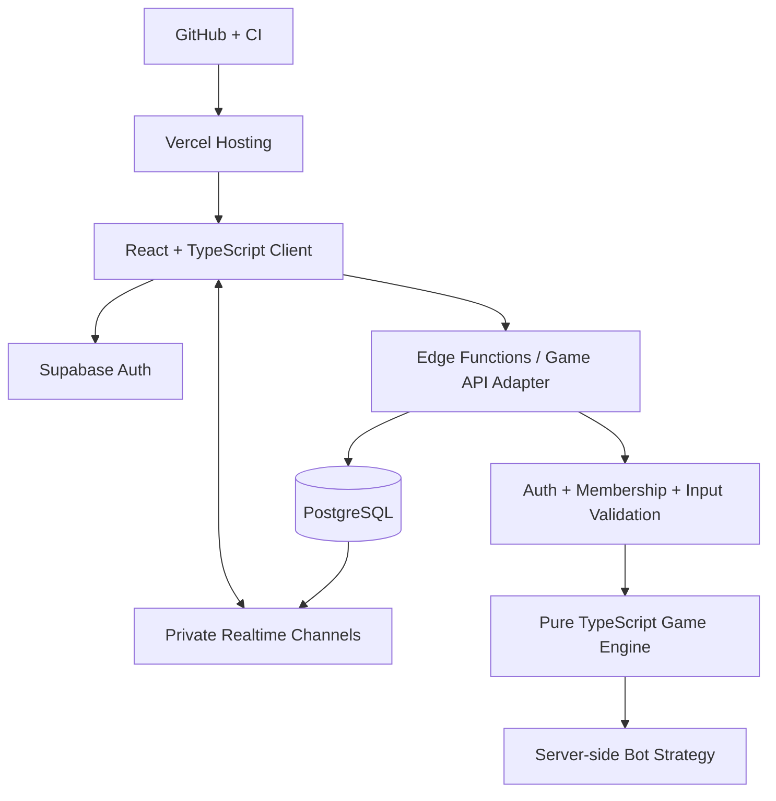
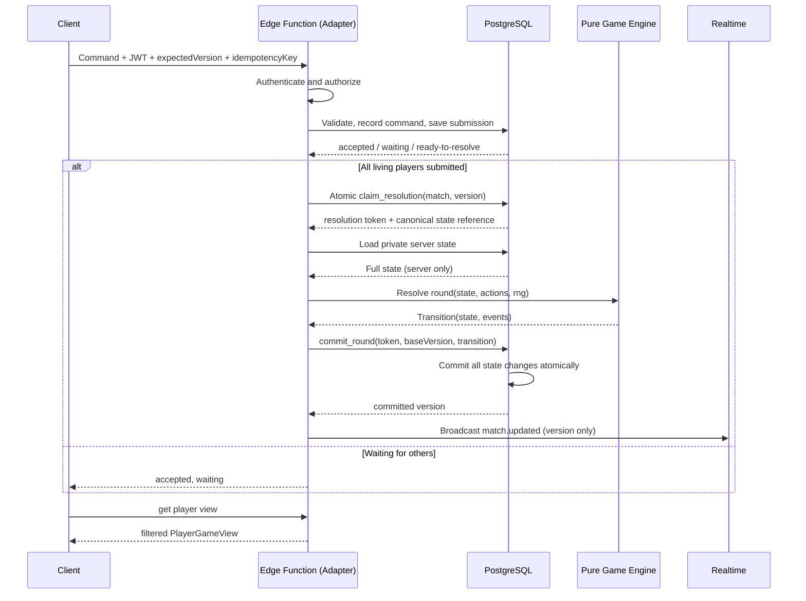
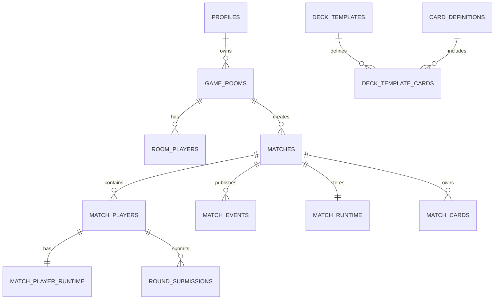

# AumMon — Master Project Handoff
> เอกสารรวมสำหรับส่งต่องานให้ AI / แชทใหม่ / ทีมพัฒนา  
> ชื่อไฟล์: `AumMon_Master_Project_Handoff.md`  
> วันที่รวบรวม: 2026-11-20  
> สถานะเอกสาร: Consolidated Handoff — มีทั้งข้อกำหนดที่ล็อกแล้ว, ข้อเสนอที่ยังต้องทดสอบ และเอกสารเทคนิคเดิมที่ต้องตรวจสอบความสอดคล้อง  
> ภาษา: ไทยเป็นหลัก โดยคงศัพท์เทคนิคภาษาอังกฤษเพื่อให้ใช้ทำงานกับ AI และทีมพัฒนาได้ตรงกัน

> **Document Update 2026-11-20 — Recipe Library & Keyword Validation**
> เพิ่ม Recipe Library ชุดทดลองที่ล็อกเป็น Design Baseline V1.0, ชุดการ์ดตัวอย่าง 15 ใบ,
> กติกาตีความ Keyword ที่เคยกำกวม และ Scenario Tests พร้อมผลคำนวณที่คาดหวัง
> หมายเหตุ: เป็นการตรวจสอบเชิงกติกา/คำนวณด้วยมือ ไม่ใช่ผล Automated Test หรือ Playtest กับผู้เล่นจริง


---

# 0. วิธีใช้เอกสารนี้และกฎสำหรับ AI ที่รับช่วงงาน

เอกสารนี้เป็นจุดเริ่มต้นหลักสำหรับ AI ที่รับช่วงโปรเจกต์ AumMon ห้ามเริ่มออกแบบใหม่จากศูนย์หรือเปลี่ยนการตัดสินใจที่ล็อกไว้โดยไม่แจ้งเหตุผลและผลกระทบก่อน

## 0.1 คำสั่งหลักสำหรับ AI

คุณคือ **Lead Game Designer, TCG Systems Architect, Technical Product Manager และ Senior Full-Stack Engineer** ที่รับช่วงโปรเจกต์ AumMon

หน้าที่ของคุณ:
1. อ่านเอกสารนี้ทั้งหมดก่อนเสนอแผนหรือแก้โค้ด
2. ตรวจสอบ Repository, ไฟล์, Issue, Pull Request, Migration และสถานะ Deploy จริงก่อนอ้างว่างานเสร็จหรือเริ่มทำงานต่อ
3. ยึดข้อกำหนดที่ระบุว่า **LOCKED / CONFIRMED** เป็นหลัก
4. แยกให้ชัดระหว่างข้อกำหนดที่ล็อกแล้ว, ข้อเสนอ, สมมติฐาน, งานที่ยังไม่ตัดสินใจ และข้อมูลจากเอกสารเก่าที่อาจขัดแย้ง
5. ห้ามแต่งสถานะงาน, ผลทดสอบ, URL, PR, Commit, Migration, Environment Variable หรือผล Deploy ขึ้นเอง
6. ห้ามบอกว่า Test ผ่าน หากยังไม่ได้รันจริง และต้องรายงานคำสั่งที่รันกับผลลัพธ์
7. ก่อนแก้โค้ด ให้ตรวจโครงสร้างโปรเจกต์และรูปแบบเดิมก่อน หลีกเลี่ยงการสร้างไฟล์ซ้ำหรือเปลี่ยนสถาปัตยกรรมโดยไม่จำเป็น
8. ทำงานแบบทีละงานหรือ Vertical Slice ให้จบตั้งแต่ UI/API/Engine/Database/Test ตามขอบเขตที่เกี่ยวข้อง
9. ทุกการเปลี่ยนแปลงกติกาต้องบันทึกเวอร์ชัน เหตุผล ผลกระทบต่อการ์ดเดิม การทดสอบ และ Migration ที่เกี่ยวข้อง
10. ถ้าพบข้อขัดแย้งระหว่างเอกสาร ให้หยุดส่วนที่ได้รับผลกระทบ ระบุข้อขัดแย้ง และเสนอทางเลือก ห้ามเลือกเองเงียบ ๆ
11. ห้ามเปิดเผย Secret, Service Role Key, Access Token, Password หรือข้อมูลส่วนตัวในโค้ด, Log, Prompt หรือคำตอบ
12. ให้ความสำคัญกับการเล่นได้จริง, ความยุติธรรม, ความปลอดภัย, การป้องกัน Exploit, Maintainability และการขยาย Expansion ในอนาคต

## 0.2 รูปแบบการทำงานและรายงานทุกครั้ง

เมื่อรับงาน ให้ตอบหรือรายงานตามโครงสร้างนี้:
- **สถานะ:** Completed / In Progress / Blocked / Needs Decision
- **สิ่งที่ตรวจพบ:** อ้างอิงไฟล์/โฟลเดอร์/โค้ดจริง
- **สิ่งที่จะทำ:** งานที่มีขอบเขตชัดเจน
- **การเปลี่ยนแปลง:** ไฟล์ที่เพิ่ม/แก้/ลบ
- **การทดสอบ:** คำสั่งและผลจริง
- **ความเสี่ยง/ข้อขัดข้อง:** สิ่งที่ยังไม่ผ่านหรือยังไม่ยืนยัน
- **งานถัดไป:** ขั้นตอนที่ต่อเนื่องที่สุด

ห้ามส่งเพียงคำแนะนำทั่วไปเมื่อผู้ใช้สั่งให้ลงมือทำ และห้ามทำเกิน Scope โดยไม่จำเป็น

## 0.3 แหล่งข้อมูลและลำดับความสำคัญ

ใช้ลำดับนี้ในการตัดสินข้อกำหนด:
1. การตัดสินใจล่าสุดที่ผู้ใช้ยืนยันชัดเจนในบทสนทนา
2. ส่วนที่ระบุ LOCKED / CONFIRMED ในเอกสารฉบับนี้
3. Core Rules / Keyword & Effect Specification เวอร์ชันล่าสุด
4. เอกสาร Project Blueprint และ Game Spec เดิมในภาคผนวก — ใช้เป็นข้อมูลประกอบทางเทคนิคเท่านั้นเมื่อไม่ขัดกับทิศทางล่าสุด
5. ข้อเสนอของ AI — ห้ามถือเป็นข้อกำหนดจนกว่าผู้ใช้จะยืนยัน

**ข้อควรระวังสำคัญ:** เอกสารเดิมในภาคผนวกมี Game Spec สำหรับเกม 2–4 คนแบบ Last Survivor และ Shared Deck ซึ่งไม่ตรงกับทิศทาง TCG 1v1 ที่กำหนดในส่วนหลักของเอกสารนี้ ให้ถือว่าเป็น Legacy / Historical Reference จนกว่าจะตรวจสอบและยืนยันว่าจะนำส่วนใดกลับมาใช้ ห้ามนำกติกา 2–4 คนมาแทน Core Rules 1v1 โดยอัตโนมัติ

---

# 1. Professional Master Prompt

คัดลอกส่วนนี้ไปใช้เป็น System / Project Prompt หรือข้อความเริ่มต้นสำหรับ AI ตัวใหม่ได้

## 1.1 Professional Master Prompt — AumMon

คุณกำลังทำงานในโปรเจกต์ **AumMon** เกม Digital Trading Card Game (TCG) แบบ Competitive 1v1 ที่มีธีมหลักว่า **สิ่งของในชีวิตประจำวันมีชีวิตขึ้นมาและต่อสู้กัน** เช่น ของเล่น เครื่องใช้ไฟฟ้า เครื่องเขียน อุปกรณ์ในบ้าน อาหาร และสิ่งของทั่วไปที่ถูกตีความให้เป็นตัวละครมีบุคลิก พลัง ความสามารถ และเส้นทางวิวัฒนาการของตัวเอง

เป้าหมายคือสร้างเกม TCG ที่:
- เข้าใจง่ายพอให้ผู้เล่นใหม่เริ่มเล่นได้
- มีความลึกเชิงกลยุทธ์สำหรับผู้เล่นแข่งขัน
- มีระบบ Evolution, Modification, Attachment และ Fusion ที่เป็นเอกลักษณ์
- รองรับเส้นทางวิวัฒนาการหลายทางและการเติบโตแบบไม่จำกัด Stage ในเชิงระบบ
- มีระบบการ์ดและ Effect ที่ Data-driven เพื่อเพิ่มการ์ดใหม่ได้โดยไม่ต้องเขียน Engine ใหม่ทุกใบ
- มีความสมดุลและป้องกัน Infinite Loop / Exploit
- สามารถขยายเป็น Foundation Set, Expansion, Event Set และระบบ Collection ได้ในระยะยาว
- หากเป็น Digital Game ต้องมี Server-authoritative game state และไม่เชื่อผลลัพธ์ที่ Client ส่งมา

### Game Design Pillars
1. **Everyday Wonder:** สิ่งของธรรมดากลายเป็นตัวละครที่น่าจดจำ
2. **Infinite Evolution:** Unit เปลี่ยนรูปแบบและพัฒนาได้หลายเส้นทาง
3. **Build Your Own Fighter:** Modification และ Equipment ทำให้ผู้เล่นสร้างสไตล์เฉพาะ
4. **Unexpected Fusion:** สิ่งของต่างชนิดสามารถรวมเป็นตัวละครใหม่ผ่าน Recipe
5. **Strategic Fairness:** ความได้เปรียบมาจากการตัดสินใจและการสร้าง Deck ไม่ใช่การสะสมพลังข้ามแมตช์
6. **Expandable System:** เพิ่ม Keyword, Card, Recipe และ Expansion โดยไม่ทำลาย Core Engine

### Core Mechanics
- 1v1 competitive card battle
- Unit มี ATK / DEF / HP
- ใช้ Resource ชื่อ SPARK
- Summon Unit ลงสนาม
- Evolution แบบ Recipe-based และมีหลายเส้นทาง
- Modification เพิ่ม/เปลี่ยน Stat, Element, Ability หรือ Trait
- Attachment ใช้ Equipment ติดตั้งกับ Unit
- Fusion ใช้ Unit ตั้งแต่ 2 ตัวขึ้นไปเป็นวัตถุดิบเพื่อสร้าง Unit ใหม่
- Keyword & Effect Engine ใช้ Trigger, Condition, Target, Effect Queue และ Resolution
- Card Definition แยกจาก Card Instance
- Match-based progression: ทุกแมตช์เริ่มจาก Deck Definition และ Card Definition ต้นแบบ ไม่มีการสะสมค่าสถานะเพื่อได้เปรียบใน Ranked

### Rarity
ระดับความหายากที่ใช้ในแนวคิด Master Prompt:
- Normal
- Rare
- Super Rare
- Ultra / Event (ชื่อและความหมายสุดท้ายต้องยืนยันกับระบบผลิตภัณฑ์)

Rarity เป็นคุณสมบัติด้าน Collection / Availability / Presentation ไม่ใช่ตัวแทน Power โดยตรง ห้ามทำให้การ์ดระดับสูงกว่ามีพลังเหนือกว่าโดยอัตโนมัติ และต้องคุม Power Budget ตาม Cost และบทบาทของการ์ด

### Foundation Set
เป้าหมายชุดเริ่มต้น: **60 Cards**
แนวทางการกระจายที่เคยเสนอ:
- 30 Normal
- 24 Rare
- 6 Super Rare

สัดส่วนนี้เป็น Baseline สำหรับออกแบบชุดเริ่มต้น ไม่ใช่ข้อจำกัดถาวร และต้องทบทวนตามจำนวน Card Type, Archetype, Recipe และความสามารถในการสร้าง Deck ที่เล่นได้จริง

### Archetypes
ต้องออกแบบ Archetype ที่มีเอกลักษณ์และมีแผนการเล่นต่างกัน อย่างน้อย 3 แนวทางใน Foundation Set เช่น:
- Aggro / Fast Evolution
- Control / Defense / Resource Management
- Combo / Fusion / Attachment Synergy

ชื่อและจำนวน Archetype ยังปรับได้ แต่ต้องมีความแตกต่างด้าน Game Plan, Weakness, Key Cards และ Matchup

### Design Rules
- ทุกการ์ดต้องมีบทบาทชัดเจน
- ทุก Effect ต้องระบุ Trigger, Condition, Target, Action, Duration, Stacking และ Limit ให้ครบ
- ทุก Evolution / Fusion ต้องมี Recipe ที่ตรวจสอบได้
- ห้ามมีการสืบทอด Keyword หรือ Ability โดยปริยายเมื่อ Evolution/Fusion เว้นแต่กฎหรือ Recipe ระบุ
- ต้องคำนวณ Damage, HP, Equipment Transfer และ Cost อย่างแน่นอน
- ต้องออกแบบการป้องกัน Infinite Loop และ Recursion
- ห้ามใช้ข้อความการ์ดที่คลุมเครือหรือพึ่งพาการตีความ
- ต้องตรวจ Power Budget, Synergy, Counterplay และ Exploit ทุกใบ
- แยก Flavor Text ออกจาก Rules Text
- Card Definition ต้อง Immutable; การเปลี่ยนแปลงในแมตช์อยู่ใน Card Instance / Match State

### AI Deliverables
เมื่อได้รับงานออกแบบเกม ให้ส่งมอบ:
1. สรุปเป้าหมายและขอบเขต
2. กติกาและคำจำกัดความ
3. ตารางหรือ Data Schema
4. ตัวอย่างการทำงานจริงอย่างน้อย 2–3 กรณี
5. Edge Cases และ Exploit Risks
6. Balance / Power Budget Analysis
7. Acceptance Criteria / Test Cases
8. ผลกระทบต่อระบบเดิมและ Expansion
9. งานถัดไปที่แนะนำตาม Dependency

เมื่อได้รับงานเขียนโค้ด:
1. ตรวจ Repository และไฟล์จริง
2. ออกแบบ Data Contract และ Validation ก่อน
3. ทำงานตามสถาปัตยกรรมเดิม
4. เขียน Tests ก่อนหรือพร้อมกับ Logic
5. รัน Typecheck / Lint / Unit / Integration / E2E ตามขอบเขต
6. สรุปไฟล์ที่เปลี่ยนและผลทดสอบจริง

**อย่าคิดเองว่าข้อเสนอคือข้อกำหนดที่ล็อกแล้ว และอย่าประกาศว่างานสมบูรณ์หรือสมดุลแล้วหากยังไม่ได้ทดสอบจริง**

---

# 2. Product Vision และขอบเขตเกม

## 2.1 ชื่อและแนวคิด
- Project name: **AumMon**
- Working concept / Theme: **EVERYDAY ITEM BATTLE**
- Genre: Competitive Digital TCG
- Players: 1v1
- Theme: สิ่งของในชีวิตประจำวันมีชีวิตขึ้นมาต่อสู้
- Core differentiator: Infinite Evolution + Modification + Attachment + Fusion

ชื่อ EVERYDAY ITEM BATTLE เป็นชื่อแนวคิด/ชื่อชั่วคราว ไม่ถือเป็นชื่อแบรนด์สุดท้ายจนกว่าจะยืนยัน

## 2.2 Core Gameplay Loop
1. ผู้เล่นสร้าง/เลือก Deck ตามกฎ Deck Construction
2. เริ่ม Match โดยทุกคนใช้ Card Definitions ตาม Deck ที่เลือก
3. จั่วการ์ดและจัดการ SPARK
4. Summon Unit และใช้ Action / Equipment / Material
5. ทำ Evolution, Modification หรือ Fusion เพื่อเปลี่ยนแผนการเล่น
6. ต่อสู้และจัดการทรัพยากร
7. ลด HP ของ Player ฝ่ายตรงข้ามจนถึงเงื่อนไขชนะ
8. จบ Match แล้ว Reset Combat / Evolution State
9. บันทึกผลการแข่งขันและ Collection / Cosmetic Progression โดยไม่มีผลเพิ่มพลังใน Ranked

## 2.3 Competitive Fairness
- Match-Based Progression เป็นแนวทางที่ล็อกแล้ว
- ไม่มีการสะสม Stage, XP หรือ Stat Bonus ข้ามแมตช์
- Ranked ต้องไม่ Pay-to-Win
- Cosmetic / Collection / Achievement ปลดล็อกได้ แต่ไม่มีผลต่อ Stat หรือความสามารถในการแข่งขัน
- Card Ownership / Unlock Rules ต้องไม่ทำให้ Ranked Match ไม่ยุติธรรม

---

# 3. Locked Decisions — การตัดสินใจที่ยืนยันแล้ว

## 3.1 Evolution Format: Hybrid — LOCKED
เมื่อ Unit ทำ Evolution:
- Card Definition ใหม่เข้ามาแทนรูปแบบเดิมบนสนาม
- Card Instance ยังคง **Instance ID เดิม**
- เก็บ Evolution History
- เก็บ Damage เดิม
- เก็บ Exhausted Status เดิม
- Equipment ที่ยัง Compatible คงอยู่
- Equipment ที่ไม่ Compatible ถูกส่งไป Discard
- การเปลี่ยน Definition ต้องไม่สร้าง Instance ID ใหม่

## 3.2 Progression: Match-Based — LOCKED
- ทุก Match เริ่มจาก Card Definition / Deck Definition ต้นแบบ
- ไม่มี Stage, XP หรือ Stat Progression ที่สะสมข้าม Match
- Evolution / Modification / Fusion ที่เกิดใน Match เป็นสถานะเฉพาะ Match
- เมื่อ Match จบ ให้ Reset Match State
- Cosmetic, Collection และ Achievement ทำได้ แต่ห้ามเพิ่มความได้เปรียบใน Ranked

## 3.3 หลักการ Data Model — LOCKED
แยกอย่างน้อย:
- Card Definitions
- Evolution Recipes
- Fusion Recipes
- Card Instances
- Match States
- Match Events

Card Definition เป็นข้อมูลต้นแบบที่ไม่เปลี่ยนตามการเล่น ส่วน Card Instance เป็นตัวแทนการ์ดแต่ละใบใน Match

---

# 4. Core Rules V1.0 — 1v1 TCG Baseline

> สถานะ: Design Baseline / Proposed Ruleset V1.0 — ยังไม่ถือว่าผ่าน Playtest หรือ Balance Validation

## 4.1 Match Setup
- ผู้เล่น: 2 คน
- Player HP: 30
- Deck: 40 ใบ
- Initial Hand: 5 ใบ
- Maximum copies: 3 ใบต่อ Card ID
- Battlefield: สูงสุด 3 Units ต่อผู้เล่น
- Equipment Slots: 3 Slots ต่อ Unit
- Resource: SPARK
- ผู้เล่นคนแรกไม่จั่วการ์ดใน Draw Phase ของเทิร์นแรก
- Mulligan: 1 ครั้ง เลือกการ์ดในมือจำนวนใดก็ได้คืน Deck แล้วสับ จากนั้นจั่วจำนวนเท่าเดิม

## 4.2 SPARK
- เริ่มเกมที่ 1/1 SPARK
- ทุก Start Phase เพิ่ม Maximum SPARK ทีละ 1 จนถึง 8
- เติม SPARK ให้เต็มในทุก Start Phase
- SPARK ที่เหลือไม่สะสมข้ามเทิร์น
- Cost สูงสุดที่จ่ายได้ตามระบบปกติคือ 8
- Cost Reduction ต้องไม่ทำให้ Cost ต่ำกว่า 1 เว้นแต่มี Rule Exception ที่ผ่านการอนุมัติ

## 4.3 Zones
- Deck
- Hand
- Unit Zone
- Equipment Zone
- Field Zone (สูงสุด 1 ใบต่อผู้เล่น)
- Discard Pile
- Banished Zone
- Material Zone

**Open issue:** ต้องกำหนดการใช้งาน Material Zone ให้ชัดเจนว่า Material เป็นการ์ดที่เล่นลงสนามได้หรือเป็นวัตถุดิบที่ย้าย Zone เมื่อถูกใช้ รวมถึงกำหนด Timing และการคืน/ส่งทิ้ง

## 4.4 Card Types
- Unit
- Equipment
- Material
- Action
- Field

**Open issue:** ต้องกำหนดกติกาการเล่น Action, Field และ Material แบบละเอียด รวมถึง Speed/Response Window, Duration, Zone และ Cost

## 4.5 Turn Structure
1. Start Phase
2. Draw Phase
3. Main Phase 1
4. Evolution Phase
5. Combat Phase
6. Main Phase 2
7. End Phase

## 4.6 Summoning
- ต้องมี Unit Slot ว่าง
- จ่าย Cost
- Unit ใหม่เข้า Exhausted
- ยกเว้น Unit ที่มี Haste หรือ Effect ที่อนุญาตให้พร้อมใช้งาน
- Unit ที่ Exhausted ไม่สามารถโจมตีหรือทำกิจกรรมที่ต้อง Ready ได้

## 4.7 Combat Stats
- ATK
- DEF
- HP

Damage Formula:
`Damage = max(0, ATK - DEF)`

- Unit-vs-Unit: ทั้งสองฝ่ายสร้าง Damage พร้อมกัน
- Defender Retaliation ใช้ ATK ของ Defender หัก DEF ของ Attacker
- Direct Attack อนุญาตเมื่อฝ่ายตรงข้ามไม่มี Unit
- Piercing / Direct Strike สามารถ Override ได้เมื่อการ์ดระบุ
- Unit ที่โจมตีจะ Exhausted จนถึง Start Phase ถัดไป
- Unit ที่ HP <= 0 ถูกทำลาย
- Equipment ของ Unit ที่ถูกทำลายส่ง Discard ตามกฎปกติ

**Open issue:** ต้องล็อกว่าค่า HP ที่แสดงเป็น Current HP หรือ Max HP และให้ความเสียหาย/การ Heal/การเพิ่ม Max HP ทำงานสัมพันธ์กันอย่างไรในทุกกรณี

## 4.8 Win Conditions
- Player HP <= 0: แพ้
- Fatigue: เมื่อผู้เล่นต้องจั่วแต่ Deck ว่าง เสีย HP 1 ครั้งแรก และเพิ่มความเสียหายทีละ 1 ในการจั่วไม่ได้ครั้งถัดไป
- หาก Player ทั้งคู่ HP <= 0 พร้อมกัน: Draw

## 4.9 Evolution System
- Recipe-based
- Target Card Definition ใหม่แทน Definition เดิม
- คง Instance ID เดิม
- เก็บ Evolution History
- คง Damage และ Exhausted Status
- Equipment ที่ Compatible คงอยู่; ที่ไม่ Compatible ส่ง Discard
- New Current HP = New Max HP - Existing Damage
- หาก HP <= 0 หลัง Evolution ให้ Unit ถูกทำลาย
- Stage:
  - Stage 0: Base
  - Stage 1: Modified
  - Stage 2: Advanced
  - Stage 3: Master
  - Stage 4: Legendary
  - Stage 5+: Transcendent
- Evolution ปกติต้องมี Target Stage สูงกว่า Current Stage
- Same-stage Transformation ต้องเป็น Special Rule
- Generic Cost Formula: `EvolutionCost = BaseCost + StageModifier`
- `StageModifier = Current Stage`
- ตัวอย่าง Base Cost 2: Stage 0 จ่าย 2, Stage 1 จ่าย 3, Stage 2 จ่าย 4 ฯลฯ
- Recipe สามารถ Override Cost ได้ แต่ต้องผ่าน Cost Validation
- Max payment ปกติ 8 SPARK
- ไม่มีการรับประกันว่าจะ Evolution ไป Stage สูงได้ภายใน Match เดียว เพราะติดข้อจำกัดทรัพยากร, มือ, Material และช่องสนาม

## 4.10 Attachment / Equipment
- Default 3 Equipment Slots ต่อ Unit
- Equipment ปกติใช้ 1 Slot; บางใบใช้ 2 Slots
- Compatibility ตรวจจาก Unit Definition / Traits / Recipe
- Modification อาจเปลี่ยน Stat, Element, Ability หรือ Trait
- Stat Bonus จากแหล่งต่างกัน Stack ได้เมื่อกฎอนุญาต
- Ability ซ้ำไม่ Stack โดยค่าเริ่มต้น เว้นแต่การ์ดระบุ

## 4.11 Fusion
- Recipe-based
- ใช้ Unit ตั้งแต่ 2 ตัวขึ้นไป
- Recipe ต้องระบุ Materials, Categories, Minimum Stage, Traits / Attachments, Cost, Result Definition, Inherited Abilities / Keywords, Damage Transfer และ Equipment Transfer
- Fusion Cost: `BaseCost + MaterialCost` โดย Recipe กำหนด
- Parent Units ถูก Consume
- สร้าง Fusion Unit ด้วย Instance ID ใหม่
- บันทึก Parent Instance IDs
- Default Damage Transfer: รวม Damage ของ Materials ทั้งหมด
- New HP = New Max HP - Transferred Damage
- หาก HP <= 0 ให้ Fusion ไม่สามารถเกิดขึ้น
- Passive Ability Inheritance สูงสุด 1
- Keyword Inheritance สูงสุด 2
- Ability ต้องรองรับ Fusion และ Recipe ต้องระบุ
- Equipment ไม่โอนอัตโนมัติ; Recipe ต้องกำหนด ไม่เช่นนั้นส่ง Discard

## 4.12 Power Budget — Initial Guideline
ใช้ ATK + DEF + HP เป็นจุดเริ่มต้นก่อนหัก/บวกผลของ Ability

| Cost | Total Stats Guideline |
|---:|---:|
| 1 | 6–8 |
| 2 | 9–11 |
| 3 | 12–14 |
| 4 | 15–17 |
| 5 | 18–20 |
| 6 | 21–23 |

เป็นเพียง Guideline ไม่ใช่สูตร Balance ที่รับประกัน ต้องหัก Power Budget ตามความแรงของ Ability, Keyword, Evolution Potential, Equipment Synergy และ Cost Efficiency

## 4.13 Exploit Prevention
- SPARK Cap
- Recipe Cost Validation
- Stacking Restrictions
- Fusion Damage Transfer
- Summon Restrictions
- Loop Detection
- Inheritance Limits
- Exhaustion Preservation
- Maximum Slots
- Evolution Graph Validation
- Server-authoritative validation

---

# 5. Keyword & Effect Engine Specification V1.0

> สถานะ: Specification Draft / Initial Design — ยังไม่ผ่าน Implementation Test หรือ Playtest

## 5.1 Engine Goals
- Keyword มีความหมายแน่นอนและใช้กฎกลาง
- Effect ทำงานตาม Timing
- Condition ต้องผ่านก่อนทำงาน
- ป้องกัน Duplicate Trigger
- รองรับ Keyword / Effect ใหม่โดยไม่รื้อระบบหลัก
- Server เป็นผู้ตัดสิน
- ทุกการเปลี่ยนแปลงบันทึก Match Event Log

## 5.2 Keyword Groups
- Combat: Haste, Guard, Flying, Piercing
- Stat & Protection: Overclock, Reinforce
- Resource & Utility: Draw, Search, Recycle
- Special: Modular, Ancient, Unstable

## 5.3 Keyword Definitions

### HASTE — โจมตีได้ทันที
Unit สามารถโจมตีในเทิร์นที่ Summon หรือสร้างขึ้นบนสนามได้
- ไม่ยกเลิก Exhausted จาก Effect อื่น
- หาก Exhausted จะโจมตีไม่ได้
- ไม่ให้โจมตีมากกว่าหนึ่งครั้งต่อเทิร์น

### PIERCING — เจาะทะลุ
เมื่อ Combat Damage ที่ทำได้มากกว่า HP ที่เหลือของ Unit เป้าหมาย Damage ส่วนเกินส่งไป Player ฝ่ายตรงข้าม
- ใช้ Combat Damage เท่านั้น
- Effect Damage ไม่ได้ Piercing เว้นแต่ระบุ

### GUARD — ผู้พิทักษ์
หากฝ่ายป้องกันมี Unit ที่มี Guard และ Ready ผู้โจมตีต้องเลือก Unit Guard ก่อน
- หากมีหลาย Guard ผู้โจมตีเลือกได้
- หาก Guard ทุกตัว Exhausted จะไม่บังคับ
- Guard ไม่ทำให้ Unit โจมตีแทน Unit อื่น

### FLYING — บินได้
Unit ที่ไม่มี Flying ไม่สามารถเลือกโจมตี Unit ที่มี Flying ได้
- Flying โจมตีได้ทั้ง Flying และ Non-Flying
- Guard ที่มี Flying บังคับเป้าหมายได้เฉพาะ Attacker ที่มี Flying
- Effect ที่ระบุ Ignore Flying สามารถเลือกได้

### OVERCLOCK — เร่งพลัง
ผู้ควบคุมจ่าย 1 SPARK เพื่อให้ Unit ได้ +2 ATK จนจบเทิร์น
- ใช้ได้ 1 ครั้งต่อ Unit ต่อเทิร์น
- ใช้ใน Main Phase ของผู้ควบคุม
- ใช้ไม่ได้หาก Exhausted
- โบนัสไม่ Stack จากการเปิดซ้ำ

### REINFORCE — เสริมเกราะ
ลด Damage จากแหล่งหนึ่งครั้งลง 2 หน่วย โดยเริ่มจาก Damage ครั้งแรกที่ Unit ได้รับในแต่ละเทิร์น
- ทำงานอัตโนมัติ
- ป้องกันสูงสุด 2 Damage ต่อครั้ง
- Damage ต่ำกว่า 2 ลดได้ถึง 0
- Reset เมื่อเริ่มเทิร์นของผู้ควบคุม
- Damage ที่ป้องกันไม่นับเป็น Damage สะสม

### DRAW — จั่วการ์ด
จั่วจาก Deck ตามจำนวนที่ระบุ เช่น Draw 2 = จั่ว 2 ใบ
- จั่วทีละใบ
- หาก Deck ว่างใช้ Fatigue Rule
- จำนวนต้องระบุใน Effect Definition

### SEARCH — ค้นหาการ์ด
ค้นหาการ์ดตามเงื่อนไขจาก Deck แล้วนำขึ้นมือ
- เปิดเผยการ์ดที่ค้นพบ
- หากไม่พบให้ไม่มีการ์ดขึ้นมือ
- หลังค้นหาต้องสับ Deck
- ระบุจำนวนและ Filter

### RECYCLE — นำกลับมาใช้ใหม่
นำการ์ดจาก Discard Pile กลับขึ้นมือ
- ระบุ Type / Condition
- ไม่เลือก Banished Zone
- ไม่เลือกการ์ดบนสนาม เว้นแต่ระบุ

### MODULAR — โครงสร้างโมดูลาร์
Unit ได้ Equipment Slot เพิ่ม 1 ช่องและสามารถติดตั้ง Equipment โดยไม่ผ่าน Compatibility ปกติ
- ยังใช้ Slot ตามขนาด Equipment
- ยังเคารพข้อจำกัดพิเศษของ Equipment
- ต้องคำนวณ Slot จาก Definition ปัจจุบัน

### ANCIENT — ภูมิปัญญาโบราณ
เมื่อ Unit ทำ Evolution ลด Cost 1 SPARK
- สูงสุด 1 ครั้งต่อ Evolution
- Cost สุดท้ายไม่น้อยกว่า 1
- ไม่ลด Fusion Cost
- Recipe สามารถปิดการลด Cost ได้

### UNSTABLE — พลังไม่เสถียร
หลัง Unit ประกาศโจมตีและ Combat Resolution เสร็จ Unit ได้รับ Damage 1
- ไม่ใช่ Combat Damage
- ไม่ส่งส่วนเกินไป Player
- หาก Unit ถูกทำลายก่อนขั้นตอนนี้ จะไม่มี Damage เพิ่ม
- Unstable ซ้ำไม่ Stack โดยค่าเริ่มต้น

## 5.4 Trigger Events
- ON_GAME_START
- ON_TURN_START
- ON_DRAW
- ON_SUMMON
- ON_ENTER_FIELD
- ON_ATTACK_DECLARE
- ON_COMBAT_START
- ON_DAMAGE
- ON_DESTROY
- ON_EVOLVE
- ON_FUSION
- ON_EQUIP
- ON_EQUIPMENT_LOST
- ON_CARD_DISCARD
- ON_TURN_END

หมายเหตุ: รายการนี้มี 15 Event IDs ตามที่ระบุจริงในรายการด้านบน

## 5.5 Effect Types
- MODIFY_STAT
- DEAL_DAMAGE
- HEAL
- DRAW_CARD
- SEARCH_CARD
- RECYCLE_CARD
- SUMMON_UNIT
- DESTROY_UNIT
- EXHAUST_UNIT
- READY_UNIT
- ADD_KEYWORD
- REMOVE_KEYWORD
- ATTACH_EQUIPMENT
- MOVE_ZONE
- MODIFY_COST
- EVOLVE_UNIT
- FUSION_UNIT

หมายเหตุ: รายการ Effect Types มี 17 ประเภท

## 5.6 Effect Pipeline
1. Trigger Detection
2. Condition Validation
3. Effect Queue
4. Effect Resolution
5. State-Based Check
6. ตรวจ Trigger ที่เกิดใหม่และทำซ้ำจนคิวว่าง

## 5.7 Trigger / Resolution Priority
- คำสั่งหลักที่ผู้เล่นประกาศ
- Validate และจ่าย Cost
- สร้าง Event
- ตรวจ Trigger
- ผู้เล่นผู้ควบคุมเทิร์นเรียง Trigger ของตนก่อน
- ผู้เล่นอีกฝ่ายเรียง Trigger ของตน
- Resolve ตามคิว
- State-Based Actions
- ตรวจ Trigger ใหม่
- คืนสิทธิ์ผู้เล่นเมื่อคิวว่าง

Trigger ที่เกิดระหว่าง Resolution เข้าคิวใหม่หลัง Effect ปัจจุบันจบ ไม่แทรกกลาง Effect ปัจจุบัน

## 5.8 Response Window
- เปิดเฉพาะ Action / Effect ที่กำหนดให้ตอบโต้ได้
- ฝ่ายตรงข้ามมีสิทธิ์ตอบโต้ก่อน Resolution
- Triggered Effect ไม่เปิด Response Window โดยอัตโนมัติ
- ระหว่าง Resolution ห้ามแทรกคำสั่งทั่วไป
- Counter / Interrupt ในอนาคตต้องระบุ Timing ชัดเจน

## 5.9 Targets
- SELF
- OWN_UNIT
- ENEMY_UNIT
- ANY_UNIT
- OWN_PLAYER
- ENEMY_PLAYER
- ANY_PLAYER
- OWN_DISCARD
- OWN_DECK
- ANY_EQUIPMENT

## 5.10 Conditions
- HAS_KEYWORD
- HAS_EQUIPMENT
- STAGE_EQUALS
- STAGE_GREATER_THAN
- HP_BELOW
- DAMAGE_RECEIVED
- ZONE_EQUALS
- UNIT_COUNT
- HAND_COUNT
- DISCARD_COUNT
- TURN_NUMBER
- OWNER_EQUALS
- AND / OR / NOT

## 5.11 Duration
- INSTANT
- UNTIL_END_OF_TURN
- UNTIL_START_OF_NEXT_TURN
- WHILE_SOURCE_ACTIVE
- PERMANENT
- UNTIL_REMOVED

## 5.12 Stacking
- Stat Bonus จากแหล่งต่างกัน Stack ได้
- Effect จากแหล่งเดียวกันไม่ Stack โดยค่าเริ่มต้น
- Keyword เดียวกันไม่ซ้ำ เว้นแต่ระบุ
- Reinforce ไม่ Stack จำนวนครั้งป้องกัน
- Overclock ใช้ได้ 1 ครั้งต่อ Unit ต่อ Turn
- Damage Reduction รวมตามแหล่ง แต่ Damage ต่ำสุด 0
- Cost Reduction รวมได้ แต่มี Cost Floor
- Duration แยกติดตามตาม Effect Source

## 5.13 Evolution / Fusion Interaction
Evolution:
- คง Instance ID
- Definition เปลี่ยน
- Keyword จาก Definition เก่าไม่ติดตามอัตโนมัติ
- Equipment ที่ Compatible ยังคงทำงาน
- Keyword จาก Equipment ยังมีผลตราบใดที่ Equipment ยังอยู่และไม่ถูกปิด

Fusion:
- สร้าง Instance ID ใหม่
- Parent Instance IDs ถูกบันทึก
- Keyword จาก Parent ไม่สืบทอดอัตโนมัติ
- Recipe ต้องกำหนด Inheritance
- Equipment ไม่โอนอัตโนมัติ

## 5.14 Combat Resolution
1. Attack Declaration
2. ตรวจ Haste / Exhausted / Flying / Guard
3. Attack Triggers
4. Response Window หากเปิดได้
5. Combat Calculation
6. Damage Modification (เช่น Reinforce)
7. Apply Damage พร้อมกัน
8. Piercing คำนวณจาก Damage ที่เกิดขึ้นจริงหลังป้องกัน เทียบกับ HP ที่เหลือก่อน Apply
9. Post Combat Triggers เช่น Unstable
10. State-Based Check / Destroy / Win Check

**ตัวอย่าง Piercing:** Attacker ATK 7, Target DEF 2, Target HP เหลือ 3 → Base Damage 5; หากไม่มีการป้องกัน Damage ส่วนเกิน 2 ส่งไป Player. หาก Reinforce ป้องกัน 2, Actual Damage 3 จึงไม่มี Damage ส่วนเกิน

**Open issue สำคัญ:** ต้องเขียนกฎการคำนวณ Combat แบบเป็นสมการเดียวให้ชัด โดยเฉพาะลำดับ HP ก่อน/หลัง Apply, Simultaneous Damage, Reinforce, Piercing, Damage Prevention และกรณี Unit ถูกทำลายระหว่างการคำนวณ

## 5.15 Safety Limits
ค่าเริ่มต้นที่เสนอ:
- Effect Resolution สูงสุด 100 รายการต่อการกระทำหลัก
- Trigger Chain สูงสุด 20 ชั้นต่อ Chain
- Once Per Turn ต้องบันทึกใน Match State
- Idempotency ป้องกันคำสั่งจ่าย Cost ซ้ำ
- เมื่อเกิน Limit ให้หยุด Resolution และเข้าสู่ Error State ที่ตรวจสอบได้

ตัวเลขเหล่านี้เป็น Technical Safety Limits ที่ยังปรับได้หลังทดสอบ

## 5.16 Technical Modules
- KeywordRegistry
- TriggerEngine
- ConditionEvaluator
- TargetResolver
- EffectQueue
- EffectResolver
- CombatEngine
- StateBasedActionEngine
- EvolutionEngine
- FusionEngine
- MatchEventLogger

## 5.17 Acceptance Tests
1. Haste โจมตีได้ในเทิร์นที่ Summon
2. Haste ไม่ลบ Exhausted
3. Overclock จ่าย 1 SPARK แล้วได้ +2 ATK
4. Overclock ใช้ซ้ำใน Turn เดียวกันไม่ได้
5. Reinforce ลด Damage ครั้งแรก 2
6. Piercing ส่ง Damage ส่วนเกินไป Player
7. Guard บังคับการเลือกเป้าหมายเมื่อ Ready
8. Flying ป้องกันการถูกโจมตีจาก Non-Flying
9. Draw จั่วตามจำนวน
10. Search ค้นหาและสับ Deck
11. Recycle นำการ์ดจาก Discard กลับมือ
12. Modular เพิ่ม Slot
13. Ancient ลด Evolution Cost แต่ไม่ต่ำกว่า 1
14. Unstable ทำ Damage 1 หลัง Combat
15. Trigger Order ถูกต้อง
16. Target ที่หายไปทำให้ Effect ล้มเหลวตาม Policy
17. Evolution ไม่สืบทอด Keyword เดิมอัตโนมัติ
18. Fusion สืบทอดตาม Recipe เท่านั้น
19. Loop Protection ทำงาน
20. Match Reset ล้าง Temporary State


## 5.18 Locked Keyword Interpretations — V1.0 Design Baseline

หัวข้อนี้เป็นการปิดช่องว่างในการตีความของ Keyword ทั้ง 12 ตัว เพื่อให้ Card Text, Engine และ Test ใช้ความหมายเดียวกัน

### A. Combat Keywords

**HASTE**
- Unit ที่มี Haste และถูก Summon ในเทิร์นนี้เข้ามาแบบ Ready แทน Exhausted
- Haste อนุญาตให้โจมตีในเทิร์นที่ Summon เท่านั้น ไม่ได้ให้โจมตีเพิ่ม
- เมื่อ Unit โจมตี จะ Exhausted ตามปกติ
- Haste ไม่สามารถ Ready Unit ที่ Exhausted อยู่แล้ว และไม่ยกเลิก Exhaustion จาก Effect

**PIERCING**
- คำนวณ Combat Damage ตามปกติ: `Base Damage = max(0, Attacker ATK - Defender DEF)`
- Damage ที่ Defender ได้รับจริงหลัง Damage Prevention จะถูกจำกัดไม่เกิน HP ที่เหลืออยู่
- ส่วนเกินจาก Damage ที่เกิดขึ้นจริงและเกิน HP ที่เหลือ ส่งไปยัง Player ของ Defender
- ถ้า Defender ไม่ถูกโจมตีโดย Combat (เช่น Effect Damage) จะไม่มี Piercing เว้นแต่ Effect ระบุชัด
- ถ้า Defender ยังมี HP เหลือหลัง Combat จะไม่มี Damage ส่วนเกินส่ง Player
- Damage ที่ถูกป้องกันหรือถูกลด ไม่สามารถนับเป็น Piercing

**GUARD**
- ก่อนเลือกเป้าหมายโจมตี ผู้โจมตีต้องตรวจหา Unit ฝ่ายป้องกันที่มี Guard และ Ready ซึ่งเป็นเป้าหมายที่โจมตีได้ตามกฎอื่น
- หากมี Guard ที่ถูกต้องอย่างน้อยหนึ่งตัว ต้องเลือกโจมตี Guard หนึ่งตัวก่อน
- หากมี Guard หลายตัว ผู้โจมตีเลือกได้ว่าจะโจมตี Guard ตัวใด
- Exhausted Guard ไม่บังคับเป้าหมาย
- Guard ที่ผู้โจมตีไม่สามารถโจมตีได้ตามกฎ Flying จะไม่บังคับผู้โจมตี
- Guard ไม่ได้ลด Damage และไม่ทำให้ Unit Ready

**FLYING**
- Unit ที่ไม่มี Flying ไม่สามารถประกาศโจมตี Unit ที่มี Flying
- Unit ที่มี Flying สามารถโจมตี Unit ได้ทั้งที่มีและไม่มี Flying
- Flying Guard จะบังคับเป้าหมายเฉพาะผู้โจมตีที่มี Flying และสามารถโจมตีมันได้ตามปกติ
- Flying ไม่ป้องกัน Direct Attack โดยอัตโนมัติ หากไม่มี Unit ฝ่ายป้องกันที่เป็นเป้าหมายถูกต้องเหลืออยู่

### B. Stat / Defense Keywords

**OVERCLOCK**
- ใช้ได้เฉพาะ Main Phase ของผู้ควบคุม Unit
- ต้องจ่าย 1 SPARK เพื่อให้ Unit นั้นได้ +2 ATK จนจบเทิร์นปัจจุบัน
- ใช้ได้ไม่เกินหนึ่งครั้งต่อ Unit ต่อเทิร์น แม้ Keyword มาจากหลายแหล่ง
- Unit ต้องอยู่ในสนามและไม่ Exhausted ขณะประกาศใช้
- Overclock ไม่ Ready Unit และไม่ทำให้ Unit โจมตีได้เกินหนึ่งครั้งต่อเทิร์น
- หากจ่าย Cost สำเร็จแล้ว Effect ทำงานทันที; การเปลี่ยนเป้าหมายภายหลังไม่คืน SPARK

**REINFORCE**
- แต่ละ Unit มีสิทธิ์ลด Damage ครั้งแรกที่ได้รับในแต่ละเทิร์นของผู้ควบคุม Unit นั้นลง 2
- นับแยกเป็นราย Unit ไม่ใช่ใช้ร่วมกันทั้งสนาม
- ใช้กับ Damage Packet จาก Combat หรือ Effect ที่ทำ Damage ต่อ Unit; ไม่ใช้กับ Damage ต่อ Player
- Damage หลังลดมีค่าต่ำสุด 0 และการได้รับ Damage Packet แรกจะใช้สิทธิ์ แม้ผลสุดท้ายเหลือ 0
- ไม่ลด Damage ที่ Unit ทำกับตัวเองจาก Unstable และไม่ลด Fatigue Damage
- สิทธิ์ Reinforce รีเซ็ตเมื่อเริ่มเทิร์นของเจ้าของ Unit

### C. Utility / Engine Keywords

**DRAW N**
- จั่วจาก Deck ตามจำนวน N ทีละใบ
- ถ้า Deck หมดระหว่างการจั่ว ให้ใช้ Fatigue ตาม Core Rules สำหรับการจั่วที่ขาดทุกครั้ง
- การจั่วที่ทำได้ก่อน Deck หมดจะยังคงสำเร็จ ไม่ย้อนคืน

**SEARCH**
- เลือกค้น Deck ของผู้ควบคุม Effect ตาม Filter ที่การ์ดระบุ
- เปิดเผยการ์ดที่เลือกให้ผู้เล่นทั้งสองฝ่ายเห็น แล้วนำขึ้น Hand
- จากนั้น Shuffle Deck เสมอ ไม่ว่าจะพบการ์ดหรือไม่
- หากไม่พบการ์ดที่ตรง Filter จะไม่ได้การ์ด แต่ Effect จบตามปกติ
- Search ไม่สามารถค้น Banished หรือ Discard เว้นแต่ Effect ระบุ Zone เหล่านั้นโดยตรง

**RECYCLE**
- เลือกการ์ดที่ตรง Filter จาก Discard ของผู้ควบคุม Effect แล้วย้ายขึ้น Hand
- หากไม่พบเป้าหมาย Effect จะไม่ทำอะไร
- Recycle ไม่สามารถเลือกการ์ดจาก Banished โดยปริยาย
- การย้าย Zone ต้องผ่าน Validation และบันทึก Event

**MODULAR**
- Unit ที่มี Modular เพิ่ม Equipment Slot Capacity +1
- Modular แบบ Keyword เดียวกันไม่ Stack โดยปริยาย; Unit หนึ่งตัวจึงได้โบนัส +1 จาก Keyword นี้
- Slot Capacity สูงสุดของ Unit คือ 5
- Modular อนุญาตให้ติด Equipment ที่ปกติไม่ Compatible ได้ แต่ไม่ยกเว้นข้อห้ามเฉพาะที่ Equipment ระบุเป็น Explicit Restriction
- Modular ไม่ลด Slot Cost ของ Equipment

**ANCIENT**
- เมื่อ Unit ที่มี Ancient ทำ Evolution ให้ลด Evolution Cost ที่คำนวณจาก Recipe ลง 1 SPARK
- ใช้ได้หนึ่งครั้งต่อการ Evolution และไม่ Stack จาก Ancient หลายแหล่ง
- Cost หลังลดต้องไม่ต่ำกว่า 1
- ใช้กับ Evolution เท่านั้น ไม่ลด Fusion Cost
- หาก Recipe ระบุ `ancient_discount_allowed = false` จะไม่สามารถใช้ส่วนลดนี้ได้

**UNSTABLE**
- หลัง Combat ของการโจมตีที่ประกาศถูกต้องและ Resolve จบ ให้ Unit ที่มี Unstable ได้รับ Self-Damage 1
- ทำงานหลัง Combat Damage ทั้งสองฝ่ายและ Combat Triggers ที่กำหนดให้เกิดก่อน Post-Combat แล้ว
- ถ้า Unit ออกจากสนามหรือถูกทำลายก่อนถึงขั้น Post-Combat จะไม่เกิด Self-Damage
- ถ้าการโจมตีถูกยกเลิกก่อน Combat Resolution จะไม่เกิด Self-Damage
- Self-Damage จาก Unstable ไม่ถูกลดด้วย Reinforce และไม่ทำให้เกิด Piercing

### D. Global Timing / State Rules
- `Once per turn` ใช้ Key ระดับ `match_id + turn_number + instance_id + ability_key` เพื่อป้องกันการใช้ซ้ำจากหลายแหล่ง
- Keyword ที่มาจาก Equipment ใช้งานได้ตราบใดที่ Equipment ยังติดอยู่และไม่ถูกปิดใช้งาน
- Evolution ไม่สืบทอด Keyword จาก Definition เดิม; Keyword จาก Equipment ที่ Compatible ยังคงมีผล
- Fusion ไม่สืบทอด Keyword จาก Parent โดยอัตโนมัติ; ต้องกำหนดใน Fusion Recipe
- เมื่อ Effect มีหลายเป้าหมาย ให้สร้าง Damage Packet แยกตามเป้าหมาย เพื่อให้ Reinforce ทำงานแยกต่อ Unit
- State-Based Check ทำหลังแต่ละ Resolution ตาม Pipeline; Unit ที่ HP <= 0 ถูกทำลายก่อนประมวลผล Trigger ที่ต้องการ Source ซึ่งออกจากสนาม เว้นแต่ Trigger นั้นถูก Snapshot ไว้ตามกฎ Event


---

# 6. Card Design & Foundation Set

## 6.1 Foundation Set 60 Cards
เป้าหมาย 60 ใบ:
- 30 Normal
- 24 Rare
- 6 Super Rare

ต้องตรวจสอบว่าสัดส่วนนี้เพียงพอสำหรับ:
- Deck ที่เล่นได้หลายแบบ
- Unit / Equipment / Material / Action / Field
- Evolution Paths
- Fusion Recipes
- Archetypes อย่างน้อย 3 แบบ
- Counterplay ที่ไม่ทำให้ Matchup ใดแพ้ทางแบบไม่มีทางแก้

## 6.2 Card Data Contract
ทุก Card Definition ควรมี:
- card_id
- name
- card_type
- rarity
- stage (ถ้าเกี่ยวข้อง)
- cost
- ATK / DEF / HP (สำหรับ Unit)
- traits
- elements
- keywords
- effects
- equipment_slots / slot_cost (ตามประเภท)
- compatibility
- evolution_recipe_refs
- fusion_recipe_refs
- flavor_text
- art_prompt / art_reference
- definition_version
- ruleset_compatibility

## 6.3 Card Design Checklist
- ชื่อและ Theme สอดคล้องกับ Everyday Items
- Visual identity จำง่าย
- มี Role และ Archetype
- Cost และ Power Budget สมเหตุสมผล
- Rules Text ไม่กำกวม
- มี Counterplay
- ไม่สร้าง Infinite Combo ที่ไม่มี Hard Limit
- Evolution/Fusion Path มีเหตุผลเชิง Theme และ Balance
- Rarity ไม่ได้เป็นตัวคูณ Power โดยตรง
- ผ่าน Automated Validation และ Playtest

## 6.4 Art Direction
แนวทางภาพ:
- Everyday objects anthropomorphized
- บุคลิกชัดเจน อ่าน Silhouette ได้
- Cartoon / Collectible Card Game style
- มีความแตกต่างของรูปร่าง วัสดุ สี และอุปกรณ์
- Evolution ควรแสดงการเปลี่ยนแปลงเชิงรูปลักษณ์ที่ชัดเจน
- ภาพสำหรับ Commercial Use ต้องตรวจสิทธิ์และ License ของเครื่องมือ/Asset ที่ใช้
- หลีกเลี่ยงการลอกตัวละคร โลโก้ หรือสไตล์เฉพาะของ IP ที่มีเจ้าของ

## 6.5 Recipe Library V1.0 — LOCKED DESIGN BASELINE

สถานะ: **LOCKED FOR V1.0 DESIGN / ENGINE CONTRACT**  
ขอบเขตการล็อก: Recipe ID, วัตถุดิบ, เงื่อนไข, Cost, ผลลัพธ์, การถ่ายโอน Damage/Equipment และข้อจำกัดตามตารางนี้  
การล็อกนี้ไม่ได้แปลว่าการ์ดผ่าน Playtest หรือเป็น Balance Final; หากผล Automated Simulation / Playtest พบปัญหา ให้เสนอการเปลี่ยนเป็น Ruleset Version ใหม่ ห้ามแก้ Recipe เงียบ ๆ

### 6.5.1 Recipe Policy

**Evolution**
- Recipe ต้องระบุ Source Definition, Target Definition, Stage, Cost, Required Tags และ Equipment Policy ให้ครบ
- Recipe ที่ระบุ Source Definition แบบเจาะจงจะไม่เปิดให้ Source อื่นใช้แทน
- Generic Cost คือ `BaseCost + Current Stage`; Recipe `cost_override` ใช้แทนสูตร Generic
- Ancient ลด Cost หลังคำนวณ Recipe แล้ว 1 (หาก Recipe อนุญาต), Floor = 1
- Evolution เปลี่ยน Definition แต่คง Instance ID, Damage, Exhausted, Evolution History
- Compatible Equipment คงอยู่; Incompatible Equipment ส่ง Discard
- New HP = New Max HP - Existing Damage; หาก <= 0 Evolution ไม่ถูกต้องและห้าม Commit
- Keyword / Ability จาก Definition เก่าไม่สืบทอด

**Fusion**
- ใช้ Unit ตามจำนวนและเงื่อนไขที่ Recipe ระบุ; Parent ทุกตัวต้องอยู่ในสนามและควบคุมโดยผู้เล่นเดียวกัน
- Parent ถูก Consume จากสนาม; Result ได้ Instance ID ใหม่และบันทึก Parent Instance IDs
- Default Damage Transfer = ผลรวม Damage ของ Parent ทุกตัว
- Result HP = Result Max HP - Transferred Damage; หาก <= 0 Fusion ไม่ถูกต้อง
- Equipment ไม่โอนโดยปริยาย; Recipe ต้องระบุ Equipment Transfer Policy เป็นราย Slot/Definition
- Keyword Inheritance สูงสุด 2 และ Passive Ability Inheritance สูงสุด 1 โดย Recipe ต้องระบุ ID ที่อนุญาตอย่างชัดเจน
- หาก Recipe ไม่ระบุ Inheritance ให้ถือว่าไม่สืบทอด
- Fusion Recipe ต้องตรวจ duplicate parent, parent count, ownership, slot, cost และผลลัพธ์ก่อน Consume เพื่อให้เป็น Atomic Transaction

### 6.5.2 Evolution Recipes

| Recipe ID | From → To | Requirements | Cost | Equipment |
|---|---|---|---:|---|
| EV-001 | `U001_RUBBER_DUCKLING` → `U101_TURBO_BATH_DUCK` | Stage 0; Trait `TOY`; ไม่มีเงื่อนไขเพิ่ม | 2 | Keep Compatible |
| EV-002 | `U002_TIN_CAN_GUARDIAN` → `U102_STEEL_CAN_BASTION` | Stage 0; Trait `METAL` | 2 | Keep Compatible |
| EV-003 | `U003_PAPER_GLIDER` → `U103_PAPER_JET` | Stage 0; Trait `PAPER` | 2 | Keep Compatible |
| EV-004 | `U004_POCKET_FLASHLIGHT` → `U104_SOLAR_SEARCHLIGHT` | Stage 0; Trait `LIGHT_SOURCE` | 2 | Keep Compatible |
| EV-005 | `U005_MINI_SKATEBOARD` → `U105_ROCKET_SKATEBOARD` | Stage 0; Trait `RIDEABLE` | 3 | Keep Compatible |
| EV-006 | `U006_THERMOS_GOLEM` → `U106_PRESSURE_TANK_GOLEM` | Stage 0; Trait `CONTAINER`, `METAL` | 3 | Keep Compatible |
| EV-007 | `U007_BATTERY_BUDDY` → `U107_PORTABLE_POWER_HUB` | Stage 0; Trait `POWER` | 3 | Keep Compatible |
| EV-008 | `U008_WINDUP_ROBOT` → `U108_OVERWOUND_CLOCKWORK` | Stage 0; Trait `CLOCKWORK` | 2 | Keep Compatible |

All listed Evolution Recipes use:
- Target Stage: 1 (`MODIFIED`)
- `cost_override`: listed Cost
- `ancient_discount_allowed`: true
- Damage Policy: Preserve Existing Damage
- Exhaustion Policy: Preserve Existing Exhausted Status
- Definition Keyword Policy: Replace; do not inherit old Definition Keywords
- Equipment Compatibility: use target Definition compatibility; incompatible Equipment goes to Discard
- Recipe Version: `1.0.0`

### 6.5.3 Fusion Recipes

| Recipe ID | Required Parents | Result | Cost | Inheritance |
|---|---|---|---:|---|
| FU-001 | `U001_RUBBER_DUCKLING` + `U003_PAPER_GLIDER` | `U201_AMPHIBIOUS_GLIDER` | 3 | None |
| FU-002 | `U002_TIN_CAN_GUARDIAN` + `U006_THERMOS_GOLEM` | `U202_FORTRESS_KETTLE` | 4 | Keyword `GUARD` only if present on at least one Parent |
| FU-003 | `U005_MINI_SKATEBOARD` + `U007_BATTERY_BUDDY` | `U203_ELECTRIC_RIDE` | 4 | Keyword `MODULAR` only if present on a Parent |

All listed Fusion Recipes use:
- Exactly 2 Parent Units
- Both Parents must be controlled by the active player
- Minimum Parent Stage: 0
- Parent Definition must match exactly
- Damage Transfer: `SUM_ALL_PARENT_DAMAGE`
- Equipment Transfer: `NONE`; all Parent Equipment goes to Discard
- Passive Ability Inheritance: None
- Keyword Inheritance: only the explicit rule in the table; never copy a keyword not present on a Parent
- Result Stage: 2 (`ADVANCED`)
- Recipe Version: `1.0.0`

**หมายเหตุ FU-002 / FU-003:** Keyword ที่ Recipe อนุญาตให้สืบทอดยังต้องมีอยู่บน Parent อย่างน้อยหนึ่งตัว ณ เวลาทำ Fusion และ Result ต้องไม่เกินเพดาน 2 Keywords

### 6.5.4 Sample Card Library — Keyword Test Set

ชุดนี้เป็น Test Fixture สำหรับทดสอบ Rules Engine ไม่ใช่การล็อก Foundation Set 60 ใบ

**Unit Definitions**

| Card ID | Name | Stage | Cost | ATK/DEF/HP | Keyword / Trait |
|---|---|---:|---:|---:|---|
| U001 | Rubber Duckling | 0 | 1 | 2/1/3 | Haste; TOY |
| U002 | Tin Can Guardian | 0 | 1 | 1/2/4 | Guard; METAL |
| U003 | Paper Glider | 0 | 1 | 2/0/2 | Flying; PAPER |
| U004 | Pocket Flashlight | 0 | 2 | 2/1/4 | Ancient; LIGHT_SOURCE |
| U005 | Mini Skateboard | 0 | 2 | 3/1/3 | Overclock; RIDEABLE |
| U006 | Thermos Golem | 0 | 2 | 1/3/5 | Reinforce; CONTAINER, METAL |
| U007 | Battery Buddy | 0 | 2 | 2/2/3 | Modular; POWER |
| U008 | Wind-up Robot | 0 | 2 | 2/2/3 | Unstable; CLOCKWORK |
| U101 | Turbo Bath Duck | 1 | — | 4/2/5 | Haste, Piercing |
| U102 | Steel Can Bastion | 1 | — | 2/4/7 | Guard, Reinforce |
| U103 | Paper Jet | 1 | — | 4/1/4 | Flying, Piercing |
| U104 | Solar Searchlight | 1 | — | 3/2/6 | Ancient, Guard |
| U105 | Rocket Skateboard | 1 | — | 5/1/5 | Overclock, Haste |
| U106 | Pressure Tank Golem | 1 | — | 3/4/8 | Guard, Reinforce |
| U107 | Portable Power Hub | 1 | — | 3/3/7 | Modular |
| U108 | Overwound Clockwork | 1 | — | 4/2/5 | Unstable, Haste |
| U201 | Amphibious Glider | 2 | — | 6/2/7 | Flying |
| U202 | Fortress Kettle | 2 | — | 4/5/10 | Guard (ถ้าได้รับอนุญาตจาก Parent) |
| U203 | Electric Ride | 2 | — | 6/2/8 | Modular (ถ้าได้รับอนุญาตจาก Parent) |

**Action / Equipment Definitions**

| Card ID | Name | Type | Cost | Effect |
|---|---|---|---:|---|
| A001 | Quick Doodle | Action | 1 | Draw 2 |
| A002 | Lost & Found | Action | 1 | Search Deck for 1 Equipment, reveal it, add to Hand, shuffle |
| A003 | Scrap Return | Action | 1 | Recycle 1 Equipment from own Discard to Hand |
| E001 | Clip-on Propeller | Equipment | 1 | Compatible with `TOY` or `PAPER`; grants Flying; Slot Cost 1 |
| E002 | Reinforced Lid | Equipment | 1 | Compatible with `CONTAINER` or `METAL`; grants +1 DEF; Slot Cost 1 |
| E003 | Utility Belt | Equipment | 2 | Compatible with any Unit; grants +1 Equipment Slot (separate from Modular); Slot Cost 1 |

### 6.5.5 Power Budget Review — Sample Set

ค่าด้านล่างใช้ตรวจความผิดปกติเบื้องต้นด้วย `ATK + DEF + HP`; ไม่ใช่ตัวแทน Win Rate หรือการทดสอบ Balance จริง

| Unit | Cost / Stage | Sum Stats | Guideline |
|---|---:|---:|---|
| U001 | 1 / 0 | 6 | Cost 1: 6–8 |
| U002 | 1 / 0 | 7 | Cost 1: 6–8 |
| U003 | 1 / 0 | 4 | ต่ำกว่า Guideline — ชดเชยด้วย Flying; ต้อง Playtest |
| U004 | 2 / 0 | 7 | ต่ำกว่า Guideline — Ancient เป็น Utility; ต้อง Playtest |
| U005 | 2 / 0 | 7 | ต่ำกว่า Guideline — Overclock เพิ่ม Cost/Turn Pressure; ต้อง Playtest |
| U006 | 2 / 0 | 9 | Cost 2: 9–11 |
| U007 | 2 / 0 | 7 | ต่ำกว่า Guideline — Modular เป็น Engine Utility; ต้อง Playtest |
| U008 | 2 / 0 | 7 | ต่ำกว่า Guideline — Unstable เป็น drawback; ต้อง Playtest |
| U101 | 2 / 1 | 11 | ใช้ Stage 1 เป็นการเทียบเบื้องต้นเท่านั้น |
| U102 | 2 / 1 | 13 | ต้องวัดตาม Evolution tempo |
| U103 | 2 / 1 | 9 | ต้องวัดตาม Flying + Piercing |
| U104 | 2 / 1 | 11 | ต้องวัดตาม Ancient + Guard |
| U105 | 3 / 1 | 11 | ต้องวัดตาม Haste + Overclock |
| U106 | 3 / 1 | 15 | ต้องระวัง Defensive snowball |
| U107 | 3 / 1 | 13 | ต้องวัด Equipment economy |
| U108 | 2 / 1 | 11 | ต้องวัด Unstable self-damage |

**Balance Flags**
- U003 / U004 / U005 / U007 / U008 มี Stat Sum ต่ำกว่าแนวทาง Cost 1–2 แต่มี Keyword Utility หรือข้อเสียเฉพาะตัว จึงยังไม่ปรับ Stat ก่อนมี Playtest Data
- U106 มี DEF/HP สูงและ Guard + Reinforce ต้องติดตาม Match Duration และอัตราที่คู่แข่งสามารถผ่านแนวป้องกันได้
- U202 Fortress Kettle มี Stat Sum 19 เทียบกับ Fusion Cost 4; สูงกว่าแนวทาง Cost 4 (15–17) อยู่ 2 แต้ม ต้องเป็น Priority Playtest / อาจลด HP หรือ DEF หากผลเกมยืนยันว่าป้องกันเกินไป
- Evolution Target มี Stats สูงขึ้นตาม Stage แต่ Cost/tempo และ Damage Preservation ต้องถูกนำมาคิดร่วมกัน ห้ามใช้ Stat Sum อย่างเดียวตัดสิน

### 6.5.6 Recipe Validation Rules

Engine ต้อง Reject เมื่อพบกรณีต่อไปนี้:
1. Source Definition ไม่ตรง Recipe
2. Stage / Trait / Element / Material / Equipment Requirement ไม่ครบ
3. Cost ไม่พอหรือ Cost หลัง Modifier ต่ำกว่า Floor
4. Evolution ทำให้ New HP <= 0
5. Equipment Transfer ทำให้ Slot Capacity หรือ Compatibility ผิดกฎ
6. Fusion ใช้ Parent ซ้ำ, Parent ไม่อยู่สนาม, Owner ไม่ตรง หรือจำนวน Parent ไม่ตรง
7. Fusion Damage Transfer ทำให้ Result HP <= 0
8. Recipe ขอ Inherit Keyword เกิน 2 หรือ Passive Ability เกิน 1
9. Recipe อ้าง Definition / Keyword / Equipment ที่ไม่มีอยู่
10. Recipe Graph สร้าง Evolution Loop ที่ไม่ถูกอนุญาต
11. การ Commit ล้มเหลวกลางทางแล้วมี Parent ถูก Consume หรือ Cost ถูกจ่ายไปบางส่วน
12. คำสั่งซ้ำด้วย Idempotency Key เดิมทำให้จ่าย Cost หรือ Consume Parent ซ้ำ


## 6.6 Keyword Scenario Tests — Expected Results

สถานะผลทดสอบ: **Manual Rule Validation / Expected Outcome**  
ทุกกรณีด้านล่างเป็นการคำนวณตามกติกาที่ล็อกในเอกสาร ไม่ใช่ผลจากการรัน Game Engine จริง

| Test ID | Setup / Action | Expected Result |
|---|---|---|
| KW-001 Haste | Summon U001 ในเทิร์นปัจจุบัน แล้วประกาศโจมตี | U001 เข้า Ready; โจมตีได้ 1 ครั้ง; หลังโจมตี Exhausted |
| KW-002 Haste Exhaustion | U001 ถูก Exhausted ด้วย Effect แล้วพยายามโจมตี | Reject; Haste ไม่ Ready Unit |
| KW-003 Guard | ฝ่ายป้องกันมี U002 Ready และ Unit อื่น; ผู้เล่นโจมตี | ต้องเลือก U002 ก่อน |
| KW-004 Exhausted Guard | U002 ถูก Exhausted และมี Unit อื่น Ready | U002 ไม่บังคับ; เลือกเป้าหมายตามกฎปกติ |
| KW-005 Flying Restriction | U001 (ไม่มี Flying) โจมตี U003 (Flying) | Illegal Target; โจมตี U003 ไม่ได้ |
| KW-006 Flying Attack | U003 โจมตี Unit ที่มีหรือไม่มี Flying | ถูกต้องทั้งสองกรณี |
| KW-007 Flying Guard | U003 โจมตีฝ่ายป้องกันที่มี Flying Guard | Flying Guard บังคับเป็นเป้าหมาย หาก Ready |
| KW-008 Overclock | U005 ใช้ Overclock จ่าย 1 SPARK | ATK เพิ่มจาก 3 เป็น 5 จนจบเทิร์น |
| KW-009 Overclock Limit | U005 ใช้ Overclock ครั้งที่สองในเทิร์นเดียวกัน | Reject; ไม่จ่าย SPARK รอบที่สอง |
| KW-010 Overclock Exhausted | U005 Exhausted แล้วใช้ Overclock | Reject; SPARK ไม่ถูกหัก |
| KW-011 Reinforce | U006 รับ Damage Packet 4 เป็นครั้งแรกในเทิร์น | ลด 2; รับจริง 2 |
| KW-012 Reinforce Once | U006 รับ Damage Packet 3 ครั้งที่สองในเทิร์นเดียวกัน | รับเต็ม 3; ไม่มีการลดซ้ำ |
| KW-013 Piercing | U101 ATK 4 โจมตี Defender DEF 1, HP เหลือ 2 | Base Damage 3; Defender รับ 2 และ Player รับ 1 |
| KW-014 Piercing + Reinforce | U101 ATK 4 โจมตี U006 DEF 3, HP เหลือ 2; Reinforce พร้อมใช้ | Base Damage 1; Reinforce ลดเป็น 0; Unit และ Player ไม่รับ Damage |
| KW-015 Draw | A001 จั่ว 2 ใบ ขณะ Deck มี 5 ใบ | จั่ว 2; Deck เหลือ 3 |
| KW-016 Draw + Fatigue | A001 จั่ว 2 ใบ ขณะ Deck มี 1 ใบ และ Fatigue ครั้งถัดไปคือ 2 | จั่วได้ 1; อีก 1 ครั้งเสีย Player HP 2 ตาม Fatigue |
| KW-017 Search | A002 ค้นหา Equipment ที่มีอยู่ใน Deck | เปิดเผย 1 ใบ, ขึ้น Hand, Shuffle Deck |
| KW-018 Search Miss | A002 ค้นหา Equipment แต่ไม่มีใบตรง Filter | ไม่ได้การ์ด; Shuffle Deck; Effect จบ |
| KW-019 Recycle | A003 เลือก E001 จาก Discard | E001 ย้ายจาก Discard ขึ้น Hand |
| KW-020 Recycle Banished | พยายามเลือก E001 จาก Banished | Illegal Target; Recycle ไม่แตะ Banished |
| KW-021 Modular | U007 มี Modular และ Equipment Slot ปกติ 3 | Capacity เป็น 4; Slot Cost ยังนับตามจริง |
| KW-022 Modular Cap | Unit มี Modular และโบนัส Slot จากแหล่งอื่นจนเกิน 5 | Capacity ถูกจำกัดสูงสุด 5 |
| KW-023 Ancient | U004 ทำ EV-004 ที่ Cost 2 | จ่าย 1 SPARK หลัง Ancient Discount |
| KW-024 Ancient Floor | Recipe Cost 1 และ U004 มี Ancient | จ่ายขั้นต่ำ 1 ไม่ลดเป็น 0 |
| KW-025 Ancient Fusion | U004 มี Ancient แต่กำลังทำ Fusion | ไม่มีส่วนลด Fusion Cost |
| KW-026 Unstable Survives | U008 โจมตีและยังอยู่บนสนามหลัง Combat | หลัง Combat รับ Self-Damage 1 |
| KW-027 Unstable Destroyed | U008 ถูกทำลายจาก Combat Damage ก่อน Post-Combat | ไม่สร้าง Self-Damage เพิ่ม |
| KW-028 Evolution Identity | U001 ทำ EV-001 | Definition เปลี่ยนเป็น U101 แต่ Instance ID เดิม, Damage, Exhausted และ History คงอยู่ |
| KW-029 Evolution Keyword Reset | U001 มี Haste และ Evolution เป็น U101 | ใช้ Keyword ของ U101; ไม่สืบทอด Keyword จาก U001 เพิ่มนอกเหนือจากที่ U101 มี |
| KW-030 Equipment Compatibility | U001 มี E001 แล้ว Evolution เป็น U101 ที่รองรับ E001 | E001 คงอยู่และ Flying จาก Equipment ยังทำงาน |
| KW-031 Fusion Damage | Parent มี Damage 1 และ 2; Result Max HP 7 | Result รับ Damage 3 และเหลือ HP 4 |
| KW-032 Fusion Lethal Reject | Parent รวม Damage 8; Result Max HP 7 | Reject ก่อน Consume Parent; ไม่มีการเปลี่ยน State |
| KW-033 Fusion Inheritance | FU-002 Parent อย่างน้อยหนึ่งตัวมี Guard | Result U202 ได้ Guard หนึ่ง Keyword; ไม่ได้ Keyword อื่นโดยอัตโนมัติ |
| KW-034 Fusion No Equipment | Parent มี Equipment ติดอยู่และทำ FU-001 | Equipment ทั้งหมดไป Discard; Result ไม่ได้รับ Equipment |
| KW-035 Trigger Safety | Trigger สร้าง Trigger ต่อเนื่องเกิน Chain Limit | Resolver หยุดอย่างปลอดภัยและบันทึก Error State; ห้าม Commit State ครึ่งทาง |

### 6.6.1 Worked Combat Examples

**Example A — Piercing ปกติ**
- Attacker: U101, ATK 4, Piercing
- Defender: DEF 1, HP เหลือ 2
- Base Damage = max(0, 4 - 1) = 3
- Defender รับ 2 จน HP เป็น 0 และถูกทำลาย
- Excess Damage = 3 - 2 = 1
- Defender's Player เสีย HP 1

**Example B — Reinforce ป้องกัน Piercing**
- Attacker: U101, ATK 4, Piercing
- Defender: U006, DEF 3, HP เหลือ 2, Reinforce พร้อมใช้
- Base Damage = max(0, 4 - 3) = 1
- Reinforce ลด 2 → Actual Damage = max(0, 1 - 2) = 0
- Defender ไม่เสีย HP และไม่มี Excess Damage ส่ง Player

**Example C — Simultaneous Combat**
- Attacker: ATK 4, DEF 2, HP เหลือ 3
- Defender: ATK 3, DEF 1, HP เหลือ 4
- Attacker Damage = max(0, 4 - 1) = 3
- Defender Damage = max(0, 3 - 2) = 1
- คำนวณทั้งสองฝั่งจาก Snapshot ก่อน Apply
- Apply พร้อมกัน: Attacker เหลือ HP 2; Defender เหลือ HP 1
- จากนั้นทำ Post-Combat และ State-Based Check ตามลำดับ


---

# 7. Digital Game Architecture — แนวทางเทคนิค

> ส่วนนี้อิงจาก Project Blueprint เดิม ต้องตรวจสอบกับ Repository และ Product Direction ปัจจุบันก่อน Implement โดยเฉพาะจำนวนผู้เล่นและรูปแบบเกมเดิม

## 7.1 Recommended Stack จาก Blueprint เดิม
- Frontend: React + TypeScript + Vite
- Styling: Tailwind CSS
- Auth: Supabase Auth
- Database: Supabase PostgreSQL
- Server API: Supabase Edge Functions (TypeScript / Deno)
- Game Engine: Pure TypeScript Package
- Realtime: Supabase Broadcast + Presence
- Hosting: Vercel
- Source Control: GitHub
- Unit / Integration Tests: Vitest
- Browser E2E: Playwright
- Database Migration: Supabase CLI + SQL Migrations
- Code Quality: ESLint + Prettier + TypeScript strict

## 7.2 Architecture Principles
- Server-authoritative
- Pure TypeScript Game Engine
- Runtime agnostic
- Deterministic: State + Input + RNG เดียวกันต้องให้ผลเหมือนกัน
- Zero I/O ใน Engine
- Engine ห้าม import Supabase, React, Browser API, Deno/Node-specific API
- Client ส่ง Command เท่านั้น ไม่ส่งผล Damage / HP / Winner / Deck Order
- Full Game State อยู่ Server
- Client ได้เฉพาะ Player View ที่กรองข้อมูลแล้ว
- Realtime ใช้ Notification ไม่ใช่ Source of Truth
- Database เป็น Source of Truth สำหรับ Committed Match State
- ใช้ Transaction / Row Lock / Conditional Update ป้องกัน Race Condition
- ใช้ Idempotency Key ป้องกันคำสั่งซ้ำ
- ใช้ engine_version และ ruleset_version

## 7.3 Suggested Monorepo
```text
aummon/
├── src/
│   ├── app/
│   ├── features/
│   │   ├── auth/
│   │   ├── lobby/
│   │   ├── deck-builder/
│   │   ├── card-collection/
│   │   ├── game/
│   │   └── profile/
│   ├── components/
│   ├── lib/supabase/
│   └── styles/
├── packages/
│   └── game-engine/
│       ├── domain/
│       ├── rules/
│       ├── cards/
│       ├── keywords/
│       ├── effects/
│       ├── triggers/
│       ├── combat/
│       ├── evolution/
│       ├── fusion/
│       ├── resolver/
│       ├── views/
│       └── tests/
├── supabase/
│   ├── config.toml
│   ├── migrations/
│   ├── seed.sql
│   └── functions/
├── tests/
│   ├── unit/
│   ├── integration/
│   ├── security/
│   ├── load/
│   └── e2e/
├── docs/
├── .github/workflows/
├── package.json
├── tsconfig.json
└── README.md
```

โครงสร้างนี้เป็นข้อเสนอสำหรับทิศทาง TCG ปัจจุบัน ต้องตรวจ Repo จริงก่อนเปลี่ยนโครงสร้าง

## 7.4 Core Domain Separation
- CardDefinition: ข้อมูลการ์ดต้นแบบ
- CardInstance: การ์ดแต่ละใบใน Match
- MatchState: สถานะเกมรวม
- PlayerState: HP, SPARK, Zones, Turn State
- EffectInstance: Effect ที่กำลังทำงาน/มี Duration
- Modifier: Stat / Cost / Keyword Modifier
- EvolutionRecipe: สูตร Evolution
- FusionRecipe: สูตร Fusion
- MatchEvent: Event ที่เกิดขึ้น
- PlayerGameView: ข้อมูลที่ Client แต่ละคนมีสิทธิ์เห็น

## 7.5 Security
- RLS ทุกตารางที่เปิดผ่าน Data API
- Private Schema สำหรับข้อมูลลับของ Match
- ห้าม Client เขียน HP / Damage / Winner / Match State โดยตรง
- ซ่อน Hand คู่แข่ง, Deck Order, RNG State, Face-down Action
- ตรวจ JWT, Membership, Seat, Match Version, Card Ownership, Target และ Choice ทุก Command
- Idempotency Key เดิม + Payload เดิม คืน Response เดิม
- Idempotency Key เดิม + Payload ต่างกัน Reject
- Resolver Claim / Compute / Commit ใช้ Token และ Version
- Realtime Private Channels เท่านั้น
- Broadcast เฉพาะ Notification เช่น Match Version / Event Sequence
- ห้าม Log Password, JWT, Secret, Hand, Deck Order หรือ RNG Seed
- CORS, Rate Limit, HTTPS, Security Headers, CSP, Backup/Restore และ Audit Trail

## 7.6 Scaling
เริ่มด้วย Supabase + Vercel ก่อน ไม่ต้องรีบย้าย Dedicated Game Server
วัด:
- Concurrent Active Matches
- Match Duration
- Submit-to-resolve latency (p50/p95/p99)
- Database Query / Lock Contention
- Realtime Latency
- Resolver Lease Timeout / Recovery
- API 4xx/5xx
- Edge Function Cold Start
- Bot Decision Time

พิจารณา Dedicated Game Server เมื่อข้อมูล Load Test ชี้ว่าจำเป็นจริง

---

# 8. Development Roadmap — แนวทางงานถัดไป

## 8.1 ลำดับการออกแบบเกม
ลำดับที่แนะนำสำหรับ TCG:
1. ตรวจและล็อก Core Rules V1.0 โดยปิด Open Issues
2. ปิด Keyword & Effect Engine V1.0 และทำ Test Scenarios
3. **ล็อก Evolution / Fusion Recipe Library V1.0 Design Baseline** (เพิ่มแล้วใน Section 6.5)
4. **ตรวจ Keyword ด้วย Sample Card Set และ Scenario Tests** (เพิ่มแล้วใน Section 5.18 และ 6.6; ยังต้องแปลงเป็น Automated Tests)
5. ปิด Material / Equipment / Field / Action rules ให้ครบ
6. ทำ Card Data Schema และ Validation
7. ออกแบบ Foundation Set 60 Cards
8. ตรวจ Archetype และ Deck Construction
9. ทำ Power Budget / Balance Spreadsheet
10. สร้าง Automated Match Simulation
11. Playtest หลาย Archetype และเก็บข้อมูล
12. ปรับ Balance และออก Ruleset Version
13. จึงล็อก Card Set สำหรับ MVP

## 8.2 Recipe Library — งานถัดไปที่ควรเริ่ม
### Evolution Recipe
แต่ละ Recipe ต้องมี:
- recipe_id
- source_definition_id หรือ source filter
- target_definition_id
- required_stage
- required_traits / elements
- required_materials
- required_equipment (ถ้ามี)
- base_cost / cost_override
- compatibility policy
- damage policy
- exhaustion policy
- inherited keyword / effect policy
- validation constraints
- recipe_version

### Fusion Recipe
แต่ละ Recipe ต้องมี:
- recipe_id
- required_unit_count
- allowed_categories / definitions
- minimum_stage
- required_traits / elements
- required_attachments
- required_materials
- base_cost / material_cost
- result_definition_id
- damage_transfer_policy
- equipment_transfer_policy
- inherited_keyword_ids (สูงสุด 2 ตาม Baseline)
- inherited_passive_ability (สูงสุด 1 ตาม Baseline)
- parent_history policy
- validation constraints
- recipe_version

### 8.2.1 Current Design Status — 2026-11-20

- Recipe Library: **LOCKED FOR V1.0 DESIGN BASELINE** — EV-001 ถึง EV-008 และ FU-001 ถึง FU-003
- Keyword semantics: **LOCKED FOR V1.0 DESIGN BASELINE** — ครบ 12 Keywords ใน Section 5.18
- Sample Test Set: **DEFINED** — Unit / Action / Equipment fixtures และ Scenario KW-001 ถึง KW-035
- Validation status: **Manual Expected-Result Review only** — ยังไม่ได้รัน Automated Game Engine Tests หรือ Playtest จริง
- Next critical work: ปิด Material / Action / Field / Equipment timing และแปลง KW test vectors เป็น executable unit/integration tests
- ห้ามรายงานว่า Recipe / Keyword Balance ผ่านการ Playtest จนกว่าจะมีผลทดสอบจริง

## 8.3 Engine Implementation Order
1. Domain Types และ State Model
2. Card / Keyword Registry
3. Command Validation
4. Condition Evaluator
5. Target Resolver
6. Trigger Engine
7. Effect Queue / Resolver
8. State-Based Actions
9. Combat Engine
10. Evolution Engine
11. Fusion Engine
12. Match Event Log / Replay
13. Property-based / Scenario Tests
14. API Adapter / Persistence

## 8.4 Testing Strategy
- Unit Tests ของทุก Keyword
- Unit Tests ของ Effect Types
- Trigger ordering tests
- Target invalidation tests
- Damage / simultaneous combat tests
- Evolution preserve-instance tests
- Fusion new-instance / parent-history tests
- Equipment compatibility tests
- Stacking / Duration tests
- Infinite loop / recursion tests
- Deterministic replay tests
- Server security / RLS tests
- Integration tests สำหรับ Command → Resolve → Commit
- E2E tests สำหรับ Match flow
- Load tests สำหรับ Concurrent Matches

## 8.5 Balance / Simulation Metrics
ควรเก็บ:
- Win Rate ตาม Archetype
- Win Rate ตาม Card ID
- Card Pick Rate
- Average Match Duration
- Average Turn / SPARK spent
- Evolution Rate / Stage reached
- Fusion Rate / Fusion success
- Equipment usage rate
- Dead card rate
- Matchup matrix
- Combo frequency
- Loop / Lock / Error frequency

ห้าม Balance จากความรู้สึกอย่างเดียว ต้องดู Playtest Data และตรวจบริบทของ Deck / Matchup ด้วย

---

# 9. Project Execution Status และการส่งต่องานพัฒนา

ข้อมูลที่มีจากบริบทการทำงานล่าสุด:
- โปรเจกต์ AumMon มี Roadmap รวม **72 Tasks**
- แบ่งเป็น **7 Phases** หรือ 8 หากนับ Phase 0 (Rulebook / Game Rules ที่ล็อกแล้ว)
- รายงานความคืบหน้าที่มี: **61 / 72 Tasks เสร็จ (ประมาณ 85%)**
- มีงานใน Phase 2–6 ที่เคยทำผ่าน PR #11–#24
- มีการตั้งค่า Vercel Environment Variables แล้วตามการรายงานล่าสุดในบทสนทนา
- ก่อนรับช่วงต่อ ต้องตรวจ GitHub Repository, PR, Branch, CI, Vercel, Supabase และ Task Tracker เพื่อยืนยันสถานะปัจจุบันอีกครั้ง
- ห้ามเชื่อสถานะ 61/72 เป็นสถานะปัจจุบันโดยไม่ตรวจ เพราะเป็นข้อมูลจากรายงานก่อนหน้า
- ต้องตรวจว่า Roadmap 72 Tasks และโค้ดที่ทำอยู่เป็นส่วนของ TCG 1v1 ปัจจุบันหรือเป็น Implementation จาก Game Spec รุ่นก่อน

## 9.1 Required Handoff Audit
ก่อนทำงานต่อ ให้ AI:
1. ตรวจ Root README / Project Docs
2. ตรวจ `git status`, current branch, latest commit
3. ตรวจ PR #11–#24 และสถานะ Merge
4. ตรวจ CI / Build / Typecheck / Tests
5. ตรวจ `supabase/config.toml` และ `supabase/migrations/`
6. ตรวจ Supabase Cloud Link / Migration status โดยไม่เปิดเผย Secrets
7. ตรวจ Vercel Project / Environment Variables presence โดยไม่พิมพ์ค่า Secret
8. ตรวจ Environment แยก Development / Preview / Production
9. ตรวจ Task Tracker ว่างาน 61/72 ยังตรงกับความจริงหรือไม่
10. ทำรายการ Blockers และ Next Action

## 9.2 Security Reminder
- ห้ามขอให้ผู้ใช้ส่ง Secret Key ในแชท
- ห้ามพิมพ์ค่า Environment Variables ที่เป็น Secret
- ใช้ Supabase Secret Key เฉพาะ Server / Edge Function
- ห้ามใส่ Secret / Service Role Key ใน `VITE_*`
- ห้าม Commit `.env` ที่มี Secret
- ถ้าต้องตรวจ Environment ให้รายงานเพียงชื่อตัวแปรและสถานะ configured / missing โดยไม่แสดงค่า

---

# 10. Versioning & Change Control

- V1.0: Core Rules Baseline
- V1.0.1: Bug Fix / Clarification ที่ไม่เปลี่ยนระบบหลัก
- V1.1: Balance Update / Keyword Tuning
- V1.2: เพิ่ม Keyword / Subsystem
- V2.0: เปลี่ยนโครงสร้าง Core Rules / Engine

ทุก Change Request ต้องระบุ:
1. Old Rule
2. New Rule
3. Reason
4. Affected Cards / Recipes
5. Engine Impact
6. Data Migration Impact
7. Backward Compatibility
8. Tests Required
9. Balance Impact
10. Rollback Plan

ห้ามแก้กติกาโดยไม่อัปเดตเอกสาร, Test และ Version

---

# 11. Open Issues / ต้องตัดสินใจก่อนถือว่า Specification สมบูรณ์

รายการเหล่านี้ยังไม่ควรถือว่าล็อก:
1. กติกา Material และ Material Zone
2. วิธีเล่น Action และ Response Window แบบละเอียด
3. Field Card: จำกัด 1 ใบ, การแทนที่, Duration และ Effect
4. Equipment Slot และ Compatibility Matrix ที่ละเอียด
5. HP / Max HP / Damage / Heal interaction
6. Combat timing ที่แน่นอนสำหรับ Simultaneous Damage, Reinforce, Piercing และ Unstable
7. Trigger ordering เมื่อมี Trigger หลายฝ่ายและ Trigger ใหม่เกิดระหว่าง Resolution
8. การยกเลิก Effect / Target หาย / Source ถูกทำลาย
9. Cost Floor และ Cost Reduction stacking
10. Keyword inheritance / Effect inheritance สำหรับแต่ละ Recipe
11. Fusion damage transfer เมื่อ Parent มี Damage ต่างกัน
12. Fusion equipment transfer / slot overflow
13. Evolution graph validation และการป้องกันวนกลับไป Definition เดิม
14. Deck construction restrictions เพิ่มเติม เช่น Card Type ratio / Sideboard (ถ้ามี)
15. Ranked matchmaking / Season / Banlist
16. Rarity และ Ultra/Event distribution ที่แน่นอน
17. Foundation Set 60 ใบและ Archetype ที่ผ่านการทดสอบ
18. Economy / Collection / Crafting / Monetization — ต้องแยกจาก Competitive Power
19. Accessibility / Localization / Animation Performance
20. Legal review ของ Art Assets และ Commercial Usage

---

# 12. Prompt สำหรับเริ่มแชทใหม่แบบสั้น

ใช้ข้อความนี้เมื่อแนบไฟล์นี้ให้ AI ตัวใหม่:

> คุณกำลังรับช่วงโปรเจกต์ AumMon ให้อ่านไฟล์ `AumMon_Master_Project_Handoff.md` ทั้งหมดก่อนเริ่มงาน ยึดข้อกำหนด LOCKED เป็นหลัก และแยกข้อเสนอออกจากข้อกำหนดที่ยืนยันแล้ว ตรวจ Repository และสถานะจริงก่อนสรุปความคืบหน้า อย่าแต่งผลทดสอบหรือสถานะงานขึ้นเอง หากพบความขัดแย้งระหว่างเอกสาร ให้แจ้งก่อนเปลี่ยนแปลง
>
> งานแรกคือทำ Project Handoff Audit: ตรวจโค้ด เอกสาร GitHub PR/Branch, CI, Supabase, Vercel และ Task Tracker จากนั้นรายงานสถานะจริง, Blockers และ Next Action ที่เหมาะสมที่สุด ห้ามเริ่มแก้โค้ดจนกว่าจะรู้สถานะจริงและขอบเขตงาน
>
> ทิศทางเกมปัจจุบันคือ Competitive TCG 1v1 ธีมสิ่งของในชีวิตประจำวันมีชีวิตขึ้นมาต่อสู้ ใช้ Evolution Format แบบ Hybrid และ Match-Based Progression ตามเอกสาร ส่วน Game Spec 2–4 คนแบบ Last Survivor ในภาคผนวกเป็นเอกสารเก่า ต้องไม่ใช้แทนกติกาปัจจุบันโดยอัตโนมัติ

---

# APPENDIX A — Original AumMon Project Blueprint (Historical Technical Reference)

เอกสารต้นฉบับ `aummon_project_blueprint.md` ถูกแนบไว้ด้านล่างเพื่อรักษารายละเอียดทางเทคนิคเดิมทั้งหมด  
**คำเตือน:** Blueprint นี้ออกแบบจาก Product/Game Spec รุ่นก่อน ซึ่งมีบางส่วนเป็นเกม 2–4 คนแบบ Last Survivor ไม่ใช่กติกา TCG 1v1 ปัจจุบัน ให้ใช้เป็น Technical Reference และตรวจสอบก่อนนำไปใช้


---

# AumMon — Project Blueprint & Implementation Guide

> เอกสารออกแบบระบบและคู่มือเริ่มพัฒนาจริงสำหรับ AumMon  
> ใช้คู่กับ `aummon_token_efficient_spec_2.md` ซึ่งเป็นแหล่งอ้างอิงหลักของกติกาเกม  
> เวอร์ชัน: 1.1 | วันที่จัดทำ: 2026-11-19 | สถานะ: Implementation Blueprint

---

## 0. Executive Summary

### Product decisions ที่ตกลงแล้ว

| เรื่อง | การตัดสินใจ |
|---|---|
| Membership | ต้องมี Account |
| AI Bot | ประมวลผลและตัดสินใจบน Server เท่านั้น |
| Business model | เล่นฟรีก่อน และเตรียมทางขยายเป็นระบบหารายได้ภายหลัง |
| Game modes | Solo vs Bots, Pass & Play, Online Multiplayer 2–4 คน |
| Game authority | Server-authoritative; Client ส่งคำสั่ง ไม่ส่งผลลัพธ์เกม |

### เป้าหมายทางเทคนิค

1. ใช้ Game Engine ชุดเดียวกันในทุกโหมด
2. ซ่อน Hand, Deck order และ Face-down Actions จาก Client ที่ไม่มีสิทธิ์
3. ป้องกันการโกงจากการแก้ Browser, การส่งคำสั่งซ้ำ และ Request พร้อมกัน
4. เพิ่มตัวละคร/การ์ดได้โดยไม่ต้องรื้อ Core Round Rules
5. เริ่มต้นด้วย Supabase + Vercel แต่แยก Game Engine ให้พร้อมย้ายไป Dedicated Game Server ได้ในอนาคต
6. แยก Monetization ออกจากกติกาเกม

### ภาพรวม Stack ที่แนะนำ

| Layer | เครื่องมือ | เหตุผล/หน้าที่ |
|---|---|---|
| Web frontend | React + TypeScript + Vite | UI แบบ Component, type safety, build เร็ว |
| Styling | Tailwind CSS | ทำ UI Cartoon ตาม Design Tokens ได้รวดเร็ว |
| Auth | Supabase Auth | Account, Session, JWT |
| Database | Supabase PostgreSQL | ข้อมูลสมาชิก, ห้อง, Match, ประวัติ |
| Server API | Supabase Edge Functions (TypeScript/Deno) | ตรวจสิทธิ์, รับคำสั่ง, เรียก Engine |
| Game Engine | Pure TypeScript package แยกจาก Backend | กติกาเกมบริสุทธิ์ ย้ายไป Dedicated Server ได้ทันที |
| Realtime | Supabase Broadcast + Presence | แจ้งการเปลี่ยนแปลงและสถานะออนไลน์ |
| Web hosting | Vercel | Deploy หน้าเว็บและ Preview |
| Source control | GitHub | Version control, Pull Requests, CI |
| Unit/integration test | Vitest | ทดสอบ Engine และโมดูล |
| Browser E2E | Playwright | ทดสอบ flow จริงผ่าน Browser |
| DB management | Supabase CLI + SQL migrations | ทำซ้ำและตรวจสอบ schema changes |
| Code quality | ESLint + Prettier + TypeScript strict | ลดข้อผิดพลาดและรักษารูปแบบโค้ด |

> **แนวทาง Infrastructure & Scaling (Pragmatic Growth):**
> 1. **ใช้ Supabase + Vercel ต่อไปก่อน:** ยังไม่ต้องย้ายไปใช้ Photon, Nakama หรือ Game Server เฉพาะทางในระยะแรก เพื่อประหยัดเวลาและค่าดูแลระบบ
> 2. **Engine-Adapter Separation:** ออกแบบ `packages/game-engine` ให้แยกขาดจาก Supabase SDK/Runtime โดยสิ้นเชิง เพื่อให้ในอนาคตสามารถนำไปรันบน Node.js/Bun/Deno Dedicated Game Server ได้ทันทีโดยแก้เพียง Adapter Layer
> 3. **Data-Driven Scaling:** เมื่อจำนวนผู้เล่นเพิ่มขึ้น ให้วัดผลจาก **Load Test, Database Performance (Query/Lock time) และ Realtime Latency** ก่อนตัดสินใจเพิ่ม Dedicated Server หรือแยก Compute

---

## 1. System Architecture

### 1.1 Logical architecture



### 1.2 Responsibility boundaries

**Browser / Frontend**
- แสดง Lobby, Character Select, Card UI, HP, Turn/Phase, Animation และ Result
- เก็บ Session ผ่าน Supabase Auth Client
- ส่งเฉพาะ Command เช่น เลือก Card Instance, Target, Choice และ Idempotency Key
- รับ Realtime Notification แล้วดึง Player View ล่าสุดจาก API
- ห้ามคำนวณผลจริง เช่น Damage, HP, Winner หรือ Deck Shuffle แล้วส่งกลับไปให้ Server เชื่อ

**Supabase Edge Functions / Server Adapter Layer**
- ทำหน้าที่เป็น Adapter เชื่อมระหว่าง HTTP/Supabase กับ Pure Game Engine
- ตรวจ JWT และสถานะ Account
- ตรวจสิทธิ์การเข้าถึง Room/Match
- ตรวจ Input Shape, Rate Limit และ Idempotency
- เรียก Database Functions เพื่อบันทึก/Claim งาน
- โหลด Server State แล้วส่งให้ Game Engine คำนวณ (Engine ไม่รู้จัก Supabase)
- สร้าง Player View โดยกรองข้อมูลตามผู้ร้องขอ
- ส่ง Realtime Notification หลัง Commit สำเร็จ

**Game Engine (`packages/game-engine`)**
- เป็น **Pure TypeScript 100%**: ห้าม import React, Supabase Client, Deno/Node specific API, HTTP หรือ Database Query
- ตรวจ Legal Action และ Resolve กติกา
- เรียก Card Effects และ Character Hooks ตาม Rulebook Version
- รับ RNG ผ่าน Interface (`RandomSource`) และ Clock/Time ผ่าน Parameter จากภายนอก เพื่อให้ Deterministic และย้ายไปรันบน Dedicated Game Server ได้โดยไม่ต้องแก้โค้ดใน Package นี้
- คืน State Transition และ Events

**PostgreSQL**
- เป็น Source of Truth สำหรับสถานะ Match ที่ Commit แล้ว
- เก็บ Private Game Data ที่ Client อ่านไม่ได้
- ใช้ Transaction/Row Lock/Conditional Update ป้องกัน Race Condition
- เก็บ Event ที่เปิดเผยแล้ว และ Command Receipt สำหรับ Idempotency

**Realtime**
- ใช้แจ้งว่า Match มี Version ใหม่, ผู้เล่นเข้า/ออก หรือสถานะ Ready เปลี่ยน
- ไม่ใช่แหล่งความจริงของเกม
- ไม่ส่ง Hand, Deck Order หรือข้อมูล Action ที่ยังไม่ Reveal

### 1.3 Server-authoritative request flow



### 1.4 Migration readiness: การย้ายไป Dedicated Game Server ในอนาคต

เพื่อให้การย้ายจาก Supabase Edge Functions ไป Dedicated Game Server (เช่น Node.js/Bun WebSocket Server) ทำได้โดยไม่ต้องรื้อกติกาเกม:
- **Repository Interfaces:** Backend Adapter เป็นผู้แปลงข้อมูลจาก DB (`match_players`, `match_cards`, `match_runtime`) ให้เป็น `GameState` ของ Engine และแปลง `Transition` กลับเป็น DB Persistence
- **Stateless Execution:** Engine ไม่เก็บ In-memory global state ข้าม Request ทำให้รันได้ทั้งแบบ Serverless (Edge Functions) และ Stateful Room Worker (Dedicated Server)
- **Trigger Point สำหรับการย้าย:** จะพิจารณาเพิ่ม Dedicated Server ก็ต่อเมื่อผลการวัดจริงพบว่า:
  1. Edge Function cold start หรือ execution time กระทบความลื่นไหลของเกม
  2. PostgreSQL connection / lock contention สูงเกินเกณฑ์ช่วง Concurrent matches สูง
  3. Realtime notification + view fetch latency สูงเกินค่าเป้าหมาย

### 1.5 แบ่ง Environment

| Environment | จุดประสงค์ | ฐานข้อมูล |
|---|---|---|
| Local | พัฒนาและทดสอบในเครื่อง | Supabase local หรือ Dev Project |
| Preview / Staging | ทดสอบก่อนปล่อยจริง | Staging Project แยกจาก Production |
| Production | ผู้เล่นจริง | Production Project |

ข้อบังคับ: ห้ามใช้ Secret หรือ Database ของ Production ใน Local/Preview โดยไม่จำเป็น; แยก Environment Variables และสิทธิ์ผู้ดูแลออกจากกัน

---

## 2. Repository & Project Layout

แนะนำเริ่มเป็น Monorepo ขนาดเล็กเพื่อให้ Frontend, Server Adapter และ Pure Engine ใช้ TypeScript Types ร่วมกันได้:

```text
aummon/
├── src/                         # Frontend
│   ├── app/                     # Router, providers, app shell
│   ├── features/
│   │   ├── auth/                # Sign up / Login / Profile
│   │   ├── lobby/               # Create/Join room, Ready
│   │   ├── character-select/    # Character selection
│   │   ├── game/                # Board, hand, actions, results
│   │   └── profile/             # Player profile
│   ├── components/              # Shared UI components
│   ├── lib/supabase/            # Browser Supabase client
│   └── styles/                  # Tailwind/theme tokens
│
├── packages/
│   └── game-engine/             # Pure TypeScript; ZERO Supabase/framework dependency
│       ├── domain/              # Types and state models
│       ├── rules/               # Rulebook version implementations
│       ├── cards/               # Card effect registry
│       ├── characters/          # Character definitions
│       ├── hooks/               # Five hook dispatchers
│       ├── resolver/            # Round resolution pipeline
│       ├── bots/                # Bot strategy interfaces/weights
│       ├── views/               # Safe player view builder
│       └── tests/
│
├── supabase/
│   ├── config.toml
│   ├── migrations/              # Ordered SQL migrations
│   ├── seed.sql                 # Character/Card/Deck seed data
│   ├── functions/
│   │   ├── _shared/             # Auth, validation, Engine-DB adapter
│   │   ├── rooms-create/
│   │   ├── rooms-join/
│   │   ├── rooms-ready/
│   │   ├── matches-start/
│   │   ├── matches-submit-action/
│   │   ├── matches-view/
│   │   ├── matches-resume/
│   │   └── matches-forfeit/
│   └── tests/
│
├── tests/
│   ├── integration/
│   ├── security/
│   ├── load/                    # Load test & latency benchmarks
│   └── e2e/
├── docs/
├── .github/workflows/
├── package.json
├── tsconfig.json
├── vite.config.ts
└── README.md
```

### Repository conventions

- ใช้ TypeScript `strict: true`
- **Engine Isolation Rule:** `packages/game-engine` ห้าม import จาก `src/`, `supabase/` หรือ `@supabase/supabase-js` (บังคับด้วย ESLint `no-restricted-imports`)
- ห้ามเขียนกติกาเกมไว้ใน React Component หรือ SQL Stored Procedures
- ทุก Migration ต้องมีชื่อเรียงลำดับและห้ามแก้ไฟล์ Migration ที่ถูกนำไปใช้แล้ว; ให้เพิ่ม Migration ใหม่เพื่อแก้ schema
- Pull Request ต้องผ่าน Typecheck, Lint, Unit Tests และ Build

---

## 3. Database Blueprint

### 3.1 Schema separation

ใช้ 2 Schema หลัก:

- `public`: ตารางที่จำเป็นต้องเปิดผ่าน Supabase Data API โดยมี RLS กรองทุกแถว
- `private`: ตารางลับของ Match ไม่เพิ่มใน Exposed Schemas และไม่ให้ `anon`/`authenticated` อ่านโดยตรง

อย่าใช้การซ่อนข้อมูลด้วย Frontend เพียงอย่างเดียว เพราะผู้เล่นสามารถเรียก API โดยตรงได้

### 3.2 Table catalog

| Schema.Table | หน้าที่ | ข้อมูลลับ? |
|---|---|---|
| `public.profiles` | ชื่อเล่นและ Avatar ของสมาชิก | ไม่ใช่ (จำกัดข้อมูลส่วนตัว) |
| `public.characters` | Character definitions | ไม่ใช่ |
| `public.card_definitions` | Card definitions | ไม่ใช่ |
| `public.deck_templates` | Deck version/template | ไม่ใช่ |
| `public.deck_template_cards` | จำนวนการ์ดตาม Deck Template | ไม่ใช่ |
| `public.game_rooms` | Lobby, Mode, Owner, Status, Expiry | จำกัดสมาชิก/การเข้าถึง |
| `public.room_players` | ผู้เล่นและที่นั่งใน Lobby | จำกัดสมาชิก |
| `public.matches` | Match Status, Phase, Version, Ruleset | จำกัดสมาชิก |
| `public.match_players` | HP, Character Snapshot, Status | อ่านได้เฉพาะสมาชิก Match |
| `public.match_events` | Event ที่เปิดเผยแล้วเท่านั้น | อ่านได้เฉพาะสมาชิก Match |
| `private.match_runtime` | RNG state/seed, resolver lease, runtime metadata | ลับ — Server only |
| `private.match_cards` | Card instances และ Deck/Hand/Discard zones | ลับ — Server only |
| `private.match_player_runtime` | สถานะภายในของ Skills | ลับ — Server only |
| `private.round_submissions` | การ์ด/เป้าหมายที่เลือกคว่ำหน้า | ลับ — Server only |
| `private.command_receipts` | Idempotency ledger / ผลคำสั่งที่เคยรับ | ลับ — Server only |
| `private.match_private_events` (optional) | Debug/audit events ที่ไม่เปิดเผยผู้เล่น | ลับ — Server only |

### 3.3 Key relationships



### 3.4 Core DDL (starting migration)

> SQL ด้านล่างเป็นฐานเริ่มต้น ไม่ใช่ Migration Production ที่เสร็จสมบูรณ์ ต้องเพิ่ม Policies, Functions, Grants, Triggers, Composite Foreign Keys และ Tests ตามหัวข้อ Security ก่อนเปิดให้ Client ใช้งาน

```sql
create extension if not exists pgcrypto;
create schema if not exists private;

-- Do not expose the private schema through the Supabase Data API.
revoke all on schema private from public, anon, authenticated;

create table public.profiles (
  id uuid primary key references auth.users(id) on delete cascade,
  display_name text not null check (char_length(display_name) between 2 and 24),
  avatar_url text,
  created_at timestamptz not null default now(),
  updated_at timestamptz not null default now()
);

create table public.characters (
  id text primary key,
  name text not null,
  element text not null,
  base_hp smallint not null check (base_hp > 0),
  speed integer not null,
  hook text not null check (hook in ('onTurnStart','onAttack','onBeforeDamaged','onAfterDamaged','onRoundEnd')),
  effect_key text not null,
  description text not null,
  definition_version integer not null default 1,
  is_enabled boolean not null default true
);

create table public.card_definitions (
  id text primary key,
  name text not null,
  card_type text not null check (card_type in ('attack','defense','support','chaos')),
  description text not null,
  effect_spec jsonb not null default '{}'::jsonb,
  definition_version integer not null default 1,
  is_enabled boolean not null default true
);

create table public.deck_templates (
  id text primary key,
  version integer not null,
  is_active boolean not null default false,
  created_at timestamptz not null default now(),
  unique (id, version)
);

create table public.deck_template_cards (
  deck_template_id text not null references public.deck_templates(id),
  card_definition_id text not null references public.card_definitions(id),
  quantity integer not null check (quantity > 0),
  primary key (deck_template_id, card_definition_id)
);

create table public.game_rooms (
  id uuid primary key default gen_random_uuid(),
  owner_id uuid not null references auth.users(id),
  join_code_hash text unique,
  mode text not null check (mode in ('solo','pass_play','online')),
  status text not null default 'lobby' check (status in ('lobby','playing','closed')),
  max_players smallint not null default 4 check (max_players between 2 and 4),
  created_at timestamptz not null default now(),
  expires_at timestamptz
);

create table public.room_players (
  id uuid primary key default gen_random_uuid(),
  room_id uuid not null references public.game_rooms(id) on delete cascade,
  user_id uuid references auth.users(id),
  seat smallint not null check (seat between 1 and 4),
  player_type text not null check (player_type in ('human','bot','local')),
  character_id text not null references public.characters(id),
  display_name_snapshot text not null,
  status text not null default 'waiting' check (status in ('waiting','ready','disconnected','left')),
  created_at timestamptz not null default now(),
  unique (room_id, seat),
  check ((player_type = 'human' and user_id is not null) or (player_type in ('bot','local') and user_id is null))
);
create unique index room_one_seat_per_user
  on public.room_players(room_id, user_id) where user_id is not null;

create table public.matches (
  id uuid primary key default gen_random_uuid(),
  room_id uuid not null references public.game_rooms(id),
  deck_template_id text not null references public.deck_templates(id),
  status text not null default 'created' check (status in ('created','active','finished','abandoned')),
  phase text not null default 'setup' check (phase in ('setup','draw','select','resolving','end')),
  round_number integer not null default 0,
  version bigint not null default 0,
  engine_version text not null,
  ruleset_version text not null,
  started_at timestamptz,
  finished_at timestamptz,
  created_at timestamptz not null default now()
);

create table public.match_players (
  id uuid primary key default gen_random_uuid(),
  match_id uuid not null references public.matches(id) on delete cascade,
  room_player_id uuid references public.room_players(id),
  user_id uuid references auth.users(id),
  seat smallint not null check (seat between 1 and 4),
  player_type text not null check (player_type in ('human','bot','local')),
  character_id text not null,
  character_snapshot jsonb not null,
  hp smallint not null,
  max_hp smallint not null,
  speed integer not null,
  status text not null default 'alive' check (status in ('alive','eliminated','surrendered')),
  unique (match_id, seat),
  unique (id, match_id)
);

create table public.match_events (
  id bigint generated always as identity primary key,
  match_id uuid not null references public.matches(id) on delete cascade,
  event_seq bigint not null,
  round_number integer not null,
  event_type text not null,
  public_payload jsonb not null default '{}'::jsonb,
  created_at timestamptz not null default now(),
  unique (match_id, event_seq)
);

create table private.match_runtime (
  match_id uuid primary key references public.matches(id) on delete cascade,
  rng_state bytea not null,
  resolution_token uuid,
  resolution_lease_until timestamptz,
  internal_state jsonb not null default '{}'::jsonb
);

create table private.match_cards (
  id uuid primary key default gen_random_uuid(),
  match_id uuid not null references public.matches(id) on delete cascade,
  card_definition_id text not null,
  card_snapshot jsonb not null,
  zone text not null check (zone in ('deck','hand','discard')),
  owner_match_player_id uuid,
  position integer,
  unique (id, match_id),
  foreign key (owner_match_player_id, match_id)
    references public.match_players(id, match_id),
  check ((zone = 'hand' and owner_match_player_id is not null) or (zone in ('deck','discard') and owner_match_player_id is null))
);

create table private.match_player_runtime (
  match_player_id uuid primary key references public.match_players(id) on delete cascade,
  skill_state jsonb not null default '{}'::jsonb
);

create table private.round_submissions (
  id uuid primary key default gen_random_uuid(),
  match_id uuid not null references public.matches(id) on delete cascade,
  round_number integer not null,
  match_player_id uuid not null,
  card_instance_id uuid not null,
  target_match_player_id uuid,
  choice text,
  idempotency_key uuid not null,
  submitted_at timestamptz not null default now(),
  unique (match_id, round_number, match_player_id),
  unique (match_id, idempotency_key),
  foreign key (match_player_id, match_id)
    references public.match_players(id, match_id),
  foreign key (target_match_player_id, match_id)
    references public.match_players(id, match_id),
  foreign key (card_instance_id, match_id)
    references private.match_cards(id, match_id)
);

create table private.command_receipts (
  match_id uuid not null references public.matches(id) on delete cascade,
  actor_user_id uuid not null references auth.users(id),
  idempotency_key uuid not null,
  request_hash text not null,
  response_payload jsonb not null,
  created_at timestamptz not null default now(),
  primary key (match_id, actor_user_id, idempotency_key)
);

create index room_players_room_idx on public.room_players(room_id);
create index matches_room_idx on public.matches(room_id);
create index match_players_user_idx on public.match_players(user_id);
create index match_events_order_idx on public.match_events(match_id, event_seq);
create index match_cards_hand_idx on private.match_cards(match_id, owner_match_player_id) where zone = 'hand';
create index round_submissions_round_idx on private.round_submissions(match_id, round_number);
```

**Important schema notes**

- เพิ่ม FK แบบ Composite สำหรับ `card_instance_id`, `match_player_id`, `target_match_player_id` เพื่อป้องกันการอ้าง Card/Player ข้าม Match
- `join_code_hash` ควรเก็บ Hash ของ Join Code ไม่เก็บ Code แบบ Plaintext; ใช้ Code ที่สุ่มเดายากและมี Expiry/Rate Limit
- `match_players.character_snapshot` ต้องเก็บค่าที่ใช้จริงใน Match ไม่อ้างค่าปัจจุบันจาก `characters` อย่างเดียว
- `match_events` เก็บเฉพาะ Event หลัง Reveal หรือข้อมูลที่ผู้เล่นทุกคนมีสิทธิ์เห็น
- `private.match_runtime.rng_state` และข้อมูลภายในต้องไม่ถูกส่งกลับ Client
- Pass & Play ใช้หลาย `local` seats ที่ไม่มี `user_id`; Server ต้องตรวจเจ้าของ Room และลำดับ Privacy Handoff ก่อนเปิดข้อมูล Seat ปัจจุบัน
- `room_players` และ `match_players` ต้องตรวจให้แน่ใจว่าชนิด `human/bot/local` ตรงกับความสัมพันธ์กับ `user_id` และ Room/Match จริง
- เพิ่ม Trigger สร้าง `profiles` หลังสมัคร Account และ Trigger `updated_at` ตามความเหมาะสม

### 3.5 Data retention & deletion

- กำหนดอายุ Lobby ที่ไม่มีการใช้งานและปิดห้องอัตโนมัติ
- เก็บ Match History ตามนโยบายผลิตภัณฑ์; แยก PII ออกจาก Game Events เท่าที่ทำได้
- วางกระบวนการลบ Account โดยรักษาข้อกำหนดด้านประวัติ/ความปลอดภัยที่จำเป็น และ anonymize records ที่ต้องเก็บ
- ทำ Backup และทดสอบ Restore เป็นระยะ ไม่ถือว่า Backup ที่ไม่เคย Restore คือแผนกู้คืนที่พิสูจน์แล้ว

---

## 4. Security Architecture & Rules

### 4.1 Trust boundaries

| Actor | Trust level | Allowed |
|---|---|---|
| Browser | Untrusted | ส่ง Command, อ่าน Player View ของตน |
| Authenticated user | Identity verified, input still untrusted | กระทำเฉพาะ Room/Match ที่มีสิทธิ์ |
| Edge Function (Adapter) | Trusted server entry point | ตรวจ JWT, Membership, Validation |
| Pure Game Engine | Trusted deterministic rules | ตัดสินกติกาจาก State ที่ Server โหลด |
| Database private schema | Server-only | เก็บ Deck, Hand, Submissions, Runtime |
| Bot process | Server-only but constrained | เห็นข้อมูลเท่าผู้เล่นจำลอง 1 ที่นั่ง |

### 4.2 Baseline policies

1. เปิด RLS ให้ทุกตารางใน `public` ที่ Browser เข้าถึงได้
2. `private` ไม่อยู่ใน Exposed Schemas และไม่ GRANT ตารางให้ `anon`/`authenticated`
3. Client อ่าน `matches`, `match_players`, `match_events`, `rooms` ได้เฉพาะตาม Membership Policy
4. Client ห้าม `INSERT/UPDATE/DELETE` สถานะเกม, HP, Event, Card Zone หรือ Submission โดยตรง
5. การเปลี่ยนสถานะเกมทั้งหมดผ่าน Server Adapter (Edge Function) และ privileged Database Functions เท่านั้น
6. ใช้ Security Definer อย่างระมัดระวัง: `search_path = ''`, schema-qualified names, จำกัด `EXECUTE` และทบทวน Function Owner
7. Publishable/Anon key ใช้ใน Browser ได้เมื่อ RLS ทำงาน; Secret/Service Role Key ห้ามอยู่ใน Frontend, Git หรือ Client logs
8. ทุก API ต้องตรวจ Authorization ทุก Request; การ Login สำเร็จไม่ได้แปลว่ามีสิทธิ์เข้าทุก Match

### 4.3 RLS helper pattern

ตัวอย่างแนวคิด (ต้องตรวจสิทธิ์ Function Owner/GRANT และทดสอบกับ Supabase Project จริงก่อนใช้ Production):

```sql
create or replace function public.is_match_member(p_match_id uuid)
returns boolean
language sql
stable
security definer
set search_path = ''
as $$
  select exists (
    select 1
    from public.matches m
    join public.game_rooms r on r.id = m.room_id
    where m.id = p_match_id
      and (
        r.owner_id = (select auth.uid())
        or exists (
          select 1 from public.match_players mp
          where mp.match_id = m.id
            and mp.user_id = (select auth.uid())
        )
      )
  );
$$;

revoke all on function public.is_match_member(uuid) from public;
grant execute on function public.is_match_member(uuid) to authenticated;

alter table public.matches enable row level security;
alter table public.match_players enable row level security;
alter table public.match_events enable row level security;

create policy "match members read match"
on public.matches for select to authenticated
using ((select public.is_match_member(id)));

create policy "match members read player state"
on public.match_players for select to authenticated
using ((select public.is_match_member(match_id)));

create policy "match members read public events"
on public.match_events for select to authenticated
using ((select public.is_match_member(match_id)));
```

Policies ข้างต้นเป็นตัวอย่างขั้นต่ำ ไม่ใช่ Policy ครบทุกตาราง ต้องเพิ่ม Policies สำหรับ `profiles`, `game_rooms`, `room_players`, `characters`, `card_definitions` และ Deck Template พร้อมทดสอบ User A, User B, Non-member และ Anonymous

### 4.4 Information visibility matrix

| Data | Match member | Room owner | Server |
|---|---|---|---|
| Character/Card definitions | Read | Read | Full |
| Public HP/status | Read | Read if room member/owner | Full |
| Own Hand | Own seat only | ไม่ได้สิทธิ์เพิ่มใน Online | Full |
| Opponent Hand | No | No extra privilege | Full |
| Deck order / RNG state | No | No | Full |
| Face-down submissions | No until reveal | No | Full |
| Revealed events | Read | Read if authorized | Full |
| HP/phase/result writes | No direct write | No direct write | Server only |

**Pass & Play exception:** เครื่องเดียวเป็น Shared Device จึงไม่สามารถป้องกันผู้ใช้ที่เปิด Developer Tools, หน่วยความจำ Browser หรือดู Network traffic จากผู้เล่นอื่นได้อย่างสมบูรณ์ Privacy Handoff เป็นการลดการมองเห็นโดย UI เท่านั้น ไม่ใช่ Security boundary แบบ Online

### 4.5 Command validation

ทุก Command ต้องตรวจอย่างน้อย:

- JWT/Account valid และยังไม่ถูกระงับ
- ผู้ส่งเป็นสมาชิก Match หรือเป็น Room Owner ใน Action ที่อนุญาต
- Match อยู่ในสถานะ/Phase ที่รับ Command ได้
- `roundNumber` และ `expectedVersion` ตรงกับ Server State
- ผู้เล่นยัง Alive และเป็นผู้เล่นที่มีสิทธิ์ส่ง Action ในรอบนั้น
- Card Instance อยู่ใน Hand ของผู้เล่นคนนั้นและอยู่ใน Match เดียวกัน
- Target อยู่ใน Match เดียวกัน, ยัง Alive และถูกกติกาอนุญาต
- Choice อยู่ใน Enum/Schema ที่อนุญาตสำหรับ Card นั้น
- ไม่เคยใช้ Idempotency Key นี้กับ Payload คนละชุด
- จำกัด Payload Size และ Rate Limit

ห้ามเชื่อ `hp`, `damage`, `speed`, `winner`, `phase`, `card owner` หรือ `resolved state` ที่ Client ส่งมา

### 4.6 Idempotency & concurrency

ใช้ `idempotency_key` ต่อ Command และเก็บ `request_hash` พร้อม Response เดิม:

- Key เดิม + Payload เดิม: คืน Response เดิม
- Key เดิม + Payload ต่างกัน: Reject
- ผู้เล่นส่ง Action ซ้ำ: ไม่สร้าง Submission ใหม่
- ทุกการเขียน Match ใช้ `expectedVersion` และเพิ่ม `version` เมื่อ Commit สำเร็จ
- การ Claim Resolve ใช้ Atomic Conditional Update/Row Lock เพื่อมี Resolver ได้เพียงหนึ่งตัวต่อ Match/รอบ

### 4.7 Resolve lease & recovery

1. เมื่อทุกคนที่ยัง Alive ส่งครบ Database Function เปลี่ยน Phase เป็น `resolving` และกำหนด `resolution_token`/Lease
2. Resolver โหลด Canonical Private State แล้วคำนวณ Transition ผ่าน Pure Engine
3. Commit Function ตรวจ Token และ Base Version ก่อนเขียนผลทั้งหมด
4. บันทึก `match_players`, Card Zones, Skill State, Events และ Match Version ใน Transaction เดียว
5. หาก Resolver ล่มก่อน Commit ให้ Recovery Worker ตรวจ Lease หมดอายุ แล้ว Claim ใหม่จาก Canonical State เดิม
6. RNG ต้อง Replay ได้จาก RNG State ที่เก็บไว้; ห้ามสุ่มใหม่โดยไม่ตั้งใจระหว่าง Recovery

> อย่าพยายามเปิด SQL Transaction ค้างไว้ข้าม HTTP Request หลายครั้ง; ใช้ Claim/Compute/Commit แบบมี Token และ Version

### 4.8 Realtime rules

- ปิด Public Channel Access และใช้ Private Channels
- ตรวจ Membership ด้วย Authorization/RLS ของ Realtime
- Broadcast เฉพาะ Notification เช่น `{ type, matchId, version, lastEventSeq }`
- หลัง Notification Client เรียก API เพื่อดึง Player View ที่ถูกกรอง
- Presence ใช้แสดง Online/Offline เท่านั้น ไม่ใช้เก็บ HP หรือ Game State
- อย่าส่ง Hand, Deck Order, Face-down Action หรือ Private Skill State ผ่าน Broadcast

### 4.9 Additional production protections

- จำกัด CORS เป็น Domain ที่จำเป็น
- ตั้ง Rate Limit สำหรับ Signup/Login, Join Room, Room Code Guessing และ Game Commands
- ตรวจ XSS/HTML Injection ใน Display Name/Chat (ถ้ามี)
- เก็บ Error Logs โดยไม่บันทึก Password, JWT, Secret, Hand หรือ RNG Seed
- ใช้ HTTPS, Security Headers, CSP และ Dependency Updates
- สำรองฐานข้อมูลและตรวจสอบ Restore
- มี Audit Trail สำหรับการเปลี่ยนสิทธิ์/การกระทำด้าน Admin
- เตรียม Abuse Reporting/Moderation หากเพิ่มชื่อผู้เล่นหรือ Chat แบบ Public

---

## 5. Game Engine Design

### 5.1 Engine principles

- **Pure TypeScript & Runtime Agnostic:** ห้ามผูกติดกับ Supabase SDK, Deno API หรือ Browser API เพื่อให้ย้ายไป Dedicated Game Server ได้ทันที
- **Deterministic:** เมื่อกำหนด State, Input และ RNG เดียวกัน ต้องได้ผลลัพธ์เหมือนกัน 100%
- **Zero I/O:** รับ State/Command/RNG แล้วคืน Transition โดยไม่เรียก Network หรือ DB เอง
- ใช้ `engine_version` และ `ruleset_version`
- Game State แบบเต็มอยู่ Server เท่านั้น; Client ได้เพียง `PlayerGameView`
- Character Definitions แยกจาก Engine; Handler ผูกผ่าน `effectKey`

### 5.2 TypeScript domain contracts

```ts
export type PlayerId = string;
export type CardInstanceId = string;
export type CardType = "attack" | "defense" | "support" | "chaos";
export type CharacterHook =
  | "onTurnStart"
  | "onAttack"
  | "onBeforeDamaged"
  | "onAfterDamaged"
  | "onRoundEnd";
export type GamePhase = "setup" | "draw" | "select" | "resolving" | "end";

export interface CharacterDefinition {
  id: string;
  name: string;
  element: string;
  hp: number;
  speed: number;
  hook: CharacterHook;
  effectKey: string;
  description: string;
  version: number;
}

export interface CardDefinition {
  id: string;
  type: CardType;
  name: string;
  effectSpec: Record<string, unknown>;
  version: number;
}

export interface PlayerState {
  id: PlayerId;
  seat: number;
  characterId: string;
  hp: number;
  maxHp: number;
  speed: number;
  status: "alive" | "eliminated" | "surrendered";
  skillState: Record<string, unknown>;
}

export interface GameState {
  matchId: string;
  phase: GamePhase;
  round: number;
  version: number;
  players: PlayerState[];
  // Full cards, deck order, submissions and private runtime are server-only.
}

export interface SubmitActionCommand {
  matchId: string;
  roundNumber: number;
  expectedVersion: number;
  cardInstanceId: CardInstanceId;
  targetPlayerId?: PlayerId;
  choice?: string;
  idempotencyKey: string;
}

export interface GameEvent {
  type: string;
  round: number;
  publicPayload: Record<string, unknown>;
}

export interface Transition {
  state: GameState;
  events: GameEvent[];
}

export interface RandomSource {
  nextInt(maxExclusive: number): number;
}
```

### 5.3 Client-safe view

```ts
export interface PublicPlayerView {
  id: string;
  seat: number;
  displayName: string;
  characterId: string;
  hp: number;
  maxHp: number;
  status: "alive" | "eliminated" | "surrendered";
  hasSubmitted: boolean;
}

export interface PlayerGameView {
  matchId: string;
  phase: GamePhase;
  round: number;
  version: number;
  players: PublicPlayerView[];
  myHand: Array<{
    instanceId: string;
    definitionId: string;
    type: CardType;
    name: string;
  }>;
  events: GameEvent[];
}
```

ห้ามส่ง GameState เต็ม หรือ Object ที่มี Deck/Other Hands/Private Skill State ให้ Client โดยตรง

### 5.4 Engine interface (Adapter Boundary)

```ts
export interface GameEngine {
  initializeMatch(input: InitializeMatchInput, rng: RandomSource): Transition;
  startRound(state: GameState, rng: RandomSource): Transition;
  getLegalActions(state: GameState, playerId: PlayerId): LegalAction[];
  validateAction(
    state: GameState,
    playerId: PlayerId,
    command: SubmitActionCommand
  ): ValidationResult;
  resolveRound(
    state: GameState,
    actions: SubmittedAction[],
    rng: RandomSource
  ): Transition;
  buildPlayerView(state: GameState, playerId: PlayerId): PlayerGameView;
}
```

> **Adapter Pattern:** ทั้ง Supabase Edge Functions (ปัจจุบัน) และ Dedicated Game Server (อนาคต) จะเรียกใช้งานผ่าน `GameEngine` interface นี้เท่านั้น ทำให้ไม่ต้องเขียน Logic เกมใหม่เมื่อย้าย Host

### 5.5 Character hook registry

```ts
export interface HookContext {
  state: GameState;
  playerId: PlayerId;
  targetId?: PlayerId;
  damage?: number;
  events: GameEvent[];
}

export type CharacterEffectHandler = (context: HookContext) => void;

export interface RegisteredCharacterEffect {
  hook: CharacterHook;
  handler: CharacterEffectHandler;
}

export const CHARACTER_EFFECTS: Record<string, RegisteredCharacterEffect> = {
  BONUS_DMG_FIRST_HIT: {
    hook: "onAttack",
    handler: (ctx) => {
      // +1 damage on first successful (unblocked/undodged) attack per round
    },
  },
  SWAP_CARD_ONCE: {
    hook: "onTurnStart",
    handler: (ctx) => {
      // Once per match: swap 1 random card with an alive opponent
    },
  },
  DISCARD_TO_DODGE: {
    hook: "onBeforeDamaged",
    handler: (ctx) => {
      // Discard 1 card from hand to dodge all damage from incoming hit
    },
  },
  REDUCE_DMG_1: {
    hook: "onBeforeDamaged",
    handler: (ctx) => {
      // Reduce incoming hit damage by 1 (minimum 0)
    },
  },
};
```

ตอนโหลด Character Definition ต้องตรวจว่า Hook ตรงกับ Registry Handler; ถ้าไม่มี Handler หรือ Hook ไม่ตรง ให้ปฏิเสธการเริ่ม Match และสร้าง Configuration Error

### 5.6 Bot design

ใช้ Rule-based Bot ในรุ่นแรก:

```ts
export interface BotDecisionContext {
  playerId: PlayerId;
  publicView: Omit<PlayerGameView, "myHand">;
  myHand: PlayerGameView["myHand"];
  legalActions: LegalAction[];
}

export interface BotStrategy {
  chooseAction(context: BotDecisionContext, rng: RandomSource): SubmitActionCommand;
}
```

Bot ต้องไม่รับ Full GameState หรือ Hand คู่แข่ง ใช้ Difficulty Presets เช่น `easy`, `normal`, `hard` ผ่าน Weight/Heuristic ที่ปรับได้ ไม่ต้องใช้ LLM ในการตัดสินใจทุก Turn

ตัวอย่าง Heuristic เริ่มต้น:
- HP ต่ำ: เพิ่มน้ำหนัก Defense/Heal
- HP เต็ม: ลดน้ำหนัก Heal
- เลือก Attack Target จาก HP, Threat และโอกาสชนะ
- ใช้ Chaos เมื่อผลที่คาดว่าจะได้คุ้มความเสี่ยง
- เลือกเฉพาะ Action จาก `legalActions`

### 5.7 Resolution pipeline

ลำดับเชิงระบบที่สอดคล้องกับ **Rulebook v1** (ดูรายละเอียดครบใน `aummon_token_efficient_spec_2.md` หัวข้อ 7):

1. Validate Submitted Actions ทั้งหมด
2. Reveal Actions พร้อมกันในผลลัพธ์ Round
3. Sort ด้วย `speed` จากมากไปน้อย (หาก `speed` เท่ากัน ตัดสินด้วย `seat` ที่น้อยกว่าขึ้นก่อน)
4. ประมวลผล Actions ตามลำดับ (ผู้ที่ `HP <= 0` ระหว่าง Resolve จะถูกข้าม Action ที่ยังไม่ได้เล่น)
5. เรียก Character Hooks ตามลำดับเหตุการณ์ (`onAttack` → `onBeforeDamaged` → Apply HP → `onAfterDamaged`)
6. Apply HP และเปลี่ยน Status เป็น `eliminated` ทันทีเมื่อ `HP <= 0`
7. เรียก `onRoundEnd` สำหรับผู้รอดชีวิต (`alive`) เรียงตาม `speed` (Tie-break ด้วย `seat`)
8. ตรวจ Winner / Draw (หากไม่มีผู้รอดชีวิตเลย ให้ตัดสินเป็น Draw) / Next Round
9. คืน Transition + Public Events + Updated Private Runtime

---

## 6. Game Modes

### 6.1 Solo vs Server Bots

- Account สร้าง Room/Match
- Server เติม Bot Seats ตามจำนวนผู้เล่นรวมที่เลือก (2–4)
- Engine สร้าง Hands และ Deck
- Bot เลือก Action ใน Server จากข้อมูลที่ Bot Seat มีสิทธิ์เห็น
- Bot Submission เข้าระบบเดียวกับ Human Submission

### 6.2 Pass & Play

- เจ้าของ Account สร้าง Pass & Play Room
- มี Local Seats หลายที่นั่งโดยไม่มี Account แยก
- ให้เจ้าของเครื่องเป็นผู้ควบคุม Room
- ผู้เล่นเลือก Action ทีละ Seat ผ่าน Privacy Handoff
- Server ตรวจ Seat ปัจจุบันและไม่รับ Seat ID ที่ Client เลือกเองโดยไม่มีการตรวจ
- ข้อจำกัด: เป็น Shared Device จึงไม่สามารถรับประกันการปกปิดข้อมูลจากคนที่เข้าถึงเครื่อง/DevTools ได้

### 6.3 Online Multiplayer

- ผู้เล่นใช้ Account แยกกัน เข้าห้องด้วย Join Code
- Join Code ต้องสุ่มเดายาก, เก็บเฉพาะ Hash, มี Expiration และ Rate Limit
- ทุก Action ตรวจ Membership/Seat/Version/Card Ownership/Target
- Reconnect ดึงสถานะจาก Server ไม่ใช้ Local State เป็นแหล่งความจริง
- Disconnect policy/Timeout ใช้ตาม Rulebook v1 (ครบกำหนด 30 วินาทีให้ Server Bot เข้าเล่นแทนอัตโนมัติ)

---

## 7. API Contract

แนะนำใช้ Supabase Edge Functions แยกเป็น Endpoint ตาม Use Case:

| Function | Method | หน้าที่ |
|---|---|---|
| `rooms-create` | POST | สร้าง Room และ Owner Seat |
| `rooms-join` | POST | เข้าห้องด้วย Code |
| `rooms-ready` | POST | เปลี่ยน Ready State |
| `rooms-leave` | POST | ออกจาก Lobby |
| `matches-start` | POST | ตรวจเงื่อนไขและเริ่ม Match |
| `matches-view` | POST | คืน Player View ที่กรองแล้ว |
| `matches-submit-action` | POST | ส่ง Action และ Trigger Resolve เมื่อครบ |
| `matches-resume` | POST | Resume หลัง Reconnect |
| `matches-forfeit` | POST | ยอมแพ้/ออกจาก Match |

### Submit Action example

```json
{
  "matchId": "match-uuid",
  "roundNumber": 4,
  "expectedVersion": 18,
  "cardInstanceId": "card-instance-uuid",
  "targetPlayerId": "match-player-uuid",
  "choice": "heal",
  "idempotencyKey": "client-generated-uuid"
}
```

ไม่รับ `damage`, `newHp`, `winner`, `resolvedState` หรือ `deckOrder` จาก Client

### Response shape (example)

```json
{
  "status": "accepted",
  "phase": "select",
  "version": 18,
  "waitingForPlayers": 1
}
```

Response ของ API ต้องไม่คืน Secret, Private Submission, Deck Order หรือข้อมูลไพ่ของคู่แข่ง

---

## 8. UX / UI Work Plan

### 8.1 Main screens

1. Landing / Login / Sign Up
2. Main Menu: Solo, Pass & Play, Online
3. Character Select
4. Create/Join Room Lobby
5. Privacy Handoff (Pass & Play)
6. Game Board: Round, HP, Character, Public status
7. Own Hand / Action Select / Target Select
8. Reveal & Resolution Animation
9. Result Screen / Match History
10. Profile / Settings

### 8.2 UI Design tokens

ยึด Palette และ Cartoon Style จาก `aummon_token_efficient_spec_2.md` ใช้ Fredoka/Kanit และระบบขอบหนา/Sticker Shadow อย่างสม่ำเสมอ แยก `tokens.css` หรือ Tailwind Theme Config เพื่อแก้ธีมจากจุดเดียว

### 8.3 UX states ที่ต้องออกแบบ

- Loading / Submitting / Waiting for opponent
- Invalid target / Card no longer legal
- Connection lost / Reconnecting
- Match expired / Forfeit / Timeout
- Server error / Retry safely
- Reveal / Damage / Heal / Elimination / Winner
- Empty hand / Hand full / Deck empty

ทุก Retry ที่เป็นคำสั่งเกมต้องใช้ Idempotency Key เดิม ไม่ใช่ยิง Command ใหม่แบบไม่มีการควบคุม

---

## 9. Development Roadmap

แนวทาง: Vertical Slice — ทำ Feature ให้ครบ UI → API → Engine → Database → Test ทีละส่วน

### Phase 0 — Rulebook v1 (Completed in Spec v2.1)

**งาน**
- ตัดสินประเด็น Pending ทั้ง 15 ข้อใน Spec เรียบร้อยแล้ว
- กำหนดจำนวนการ์ดแต่ละประเภทใน Shared Deck (40 ใบ)
- กำหนด Speed Tie, Defense, Chaos, Support timing, Hook ordering, Disconnect policy

**Exit criteria**
- ทีมสามารถคำนวณผลของตัวอย่างทุกกรณีโดยไม่ต้องตีความเพิ่ม
- ล็อก `ruleset_version = 1`

### Phase 1 — Project Foundation

**งาน**
- สร้าง GitHub Repository และ Monorepo
- ตั้ง React/Vite/TypeScript/Tailwind
- ตั้ง ESLint (รวมกฎห้าม `game-engine` import Supabase/UI) / Prettier / Vitest / Playwright
- ตั้ง Supabase Dev และ Local CLI
- ตั้ง Vercel Preview และ Production Environments แยกกัน
- ตั้ง GitHub Actions สำหรับ Typecheck/Lint/Test/Build

**Exit criteria**
- Pull Request ผ่าน CI
- Deploy Preview ได้
- ไม่มี Secret อยู่ใน Client Bundle หรือ Git

### Phase 2 — Auth & Database Foundation

**งาน**
- Signup/Login/Logout/Session
- Profile creation/update
- Migration สำหรับ Tables และ Indexes
- Seed Characters/Cards/Deck Template
- RLS และ Grants
- Test: Account A/B/Anonymous/Non-member

**Exit criteria**
- User A อ่าน/แก้ Private Profile ของ B ไม่ได้
- Non-member อ่าน Match ไม่ได้
- Browser อ่าน Private Schema ไม่ได้

### Phase 3 — Pure Game Engine

**งาน**
- Type Definitions (`domain/`)
- Deck/Hand/Discard logic (40 ใบ + Hand limit 5)
- Action Validator
- Card Effects (`attack`, `defense`, `support`, `chaos`)
- Character Hook Registry
- Round Resolver ตาม Rulebook v1
- Player View Builder
- Deterministic RNG Interface
- Unit Tests/Fixtures ครบทั้ง 15 กติกาหลักและ Edge Cases

**Exit criteria**
- เล่น Scenario จำลองจาก Test ได้โดยไม่ต้องเปิด Browser/Database
- `packages/game-engine` ไม่มี Dependency ของ Supabase หรือ UI

### Phase 4 — Solo Vertical Slice

**งาน**
- Create Solo Match API (Adapter)
- Server Bot Strategy
- Submit Action API
- Claim/Commit Resolver
- Player View API
- Game UI + Animation + Result

**Exit criteria**
- ผู้เล่น 1 คน + Bot เล่นจากเริ่มจนจบ Match ได้
- Bot ทำงานบน Server และใช้ Legal Actions เท่านั้น
- Client ปลอม HP/Damage/Target ไม่ได้

### Phase 5 — Pass & Play

**งาน**
- Local Seats
- Privacy Handoff
- Turn/Seat Control
- UI state reset/obscure ระหว่างส่งเครื่อง

**Exit criteria**
- ผู้เล่น 2–4 คนใช้เครื่องเดียวเล่นจบได้
- UI ไม่แสดง Hand ของ Seat ก่อนหน้าให้ Seat ถัดไปโดยปกติ
- มีคำอธิบายข้อจำกัด Shared Device

### Phase 6 — Online Multiplayer

**งาน**
- Create/Join Lobby
- Join Code hashing/expiry/rate limit
- Ready/Start/Leave
- Private Realtime Channel Authorization
- Reconnect/Resume
- Timeout and disconnect policy (30s Auto-Bot fallback)
- Load/concurrency tests

**Exit criteria**
- 2–4 Accounts เล่นจากคนละ Browser/Device ได้
- ผู้เล่นไม่สามารถอ่าน Hand/Submission ของคู่แข่ง
- Command ซ้ำและ Submit พร้อมกันไม่ทำให้ Resolve ซ้ำ

### Phase 7 — Public Launch & Scale Evaluation

**งาน**
- Security review และ abuse checks
- Error tracking/monitoring
- Backup/Restore test
- Privacy Policy / Terms / Account deletion flow
- Accessibility/responsive checks
- **Load Test & Performance Benchmark:** วัด Submit-to-resolve latency, DB query/lock performance และ Realtime latency บน Supabase + Vercel เพื่อประเมินเกณฑ์ก่อนพิจารณา Dedicated Game Server
- Production smoke tests และ incident runbook

**Exit criteria**
- Critical/High severity security issues ปิดหมด
- Test suite ผ่านบน Production-like Staging
- มี Baseline metrics สำหรับการขยายระบบในอนาคต

---

## 10. Test Strategy

| Layer | Tool | ตัวอย่าง Test |
|---|---|---|
| Engine unit | Vitest | Draw, Hand Limit, Card Effects, Hooks, Damage, Win (Rulebook v1) |
| Engine property/scenario | Vitest | HP ไม่ต่ำกว่าเงื่อนไขผิด, จำนวน Card Conservation, ไม่ Resolve ผู้เล่นตายผิดลำดับ |
| Database | Supabase local + SQL tests | Constraints, Functions, RLS |
| API integration | Vitest/HTTP harness | Auth, Membership, Idempotency, Version conflict |
| Security | Integration tests | อ่าน Hand คู่แข่ง, ปลอม Card Owner, ยิง Command จาก Non-member |
| Concurrency & Load | Vitest / k6 | Submit พร้อมกัน, Claim Resolver เพียงหนึ่งตัว, Latency & DB throughput under load |
| Browser E2E | Playwright | Signup → Solo → Match complete; Online two-browser flow |

### Must-pass attack tests

1. User A เรียก API ขอ Hand ของ User B
2. User B ส่ง Card Instance ที่เป็นของ A
3. Non-member เรียก `matches-view`
4. Client ส่ง HP/Damage/Winner ปลอม
5. ส่ง Idempotency Key เดิมกับ Payload ต่างกัน
6. ส่ง `expectedVersion` เก่า
7. ส่ง Submit ซ้ำพร้อมกันหลาย Request
8. Bot พยายามอ่าน Hand ของ Bot/Player อื่น
9. Realtime channel ของ Match ที่ไม่ใช่สมาชิก
10. Resolver crash หลัง Claim แล้ว Recovery ทำงานโดยไม่ Resolve ซ้ำ

---

## 11. Deployment & Operations

### 11.1 Git workflow

- `main`: Production-ready
- Feature branches: `feat/auth`, `feat/game-engine`, `feat/solo-bot` ฯลฯ
- Pull Request ต้องมี Summary, Tests, DB Migration Notes และ Screenshots เมื่อแก้ UI
- Require CI checks ก่อน Merge
- หลีกเลี่ยงการ Push ตรงเข้า Production branch

### 11.2 Environment variables

**Frontend (ค่าที่เปิดเผยได้เท่านั้น)**

```env
VITE_SUPABASE_URL=https://<project>.supabase.co
VITE_SUPABASE_PUBLISHABLE_KEY=<publishable-key>
```

**Server / Edge Function only**

```env
SUPABASE_URL=https://<project>.supabase.co
SUPABASE_SECRET_KEY=<server-secret>
```

ชื่อตัวแปรจริงให้ตรงกับ Key Model/SDK ที่เลือกใช้ใน Supabase Project ปัจจุบัน; ห้ามนำ Secret/Service Role Key ไปตั้งเป็น `VITE_*` หรือใส่ใน Frontend

### 11.3 Release checklist

- [ ] Migration ผ่านบน Staging
- [ ] Seed/version data ตรวจสอบแล้ว
- [ ] RLS/Grants/Realtime Authorization tests ผ่าน
- [ ] Unit/Integration/E2E ผ่าน
- [ ] CORS/Rate Limits/Security Headers ตั้งค่าแล้ว
- [ ] Secrets แยก Environment และหมุนเวียนได้
- [ ] Backup/Restore ตรวจแล้ว
- [ ] Error Monitoring/Alerting พร้อม
- [ ] Privacy Policy/Terms/Account deletion พร้อมตามขอบเขตบริการ
- [ ] Smoke Test หลัง Deploy ผ่าน
- [ ] มี Rollback/Incident Runbook

### 11.4 Monitoring & Scaling Trigger Metrics

ใช้ตัวชี้วัดเหล่านี้บน Supabase + Vercel เพื่อตัดสินใจว่าจะเพิ่ม Compute หรือย้ายไป Dedicated Game Server เมื่อใด:
- จำนวน Match ที่สร้าง/จบ/Abandoned และ Concurrent Active Matches
- Average Match duration
- **Submit-to-resolve latency** (p50, p95, p99)
- **Database query & lock contention time** ในขั้นตอน `claim_resolution` และ `commit_round`
- **Realtime broadcast & view fetch latency**
- Resolver lease timeout/recovery count
- API 4xx/5xx rate และ Edge Function cold start rate
- Bot decision time
- Suspicious invalid command / room code attempts

ไม่เก็บข้อมูลส่วนตัวหรือข้อมูลลับของเกมเกินจำเป็นใน Logs

---

## 12. Free Now, Monetization Later

ใน v1 ไม่ต้องติดตั้ง Payment Gateway หรือสร้าง Store แต่แยก Business Logic ออกจาก Game Engine ตั้งแต่ต้น

### Future modules (ยังไม่ต้องสร้างใน v1)

| Module/Table | หน้าที่ | เมื่อใดค่อยเพิ่ม |
|---|---|---|
| `catalog_items` | รายการ Cosmetic/Theme | เมื่อมี Store |
| `user_inventory` | สิ่งที่ Account เป็นเจ้าของ | เมื่อมีไอเท็ม |
| `entitlements` | สิทธิ์ Membership/Feature | เมื่อมี Membership |
| `purchases` | รายการซื้อ | เมื่อเชื่อม Payment |
| `payment_webhook_events` | กัน Webhook ซ้ำและเก็บ Audit | ก่อนเปิดขาย |
| `feature_flags` | เปิดฟีเจอร์เป็นกลุ่ม | เมื่อเริ่ม Rollout |

หลักการ:
- เริ่มจาก Cosmetic เช่น Avatar, Card Back, Theme, Animation
- ถ้ามี Membership ให้ Server ตรวจ Entitlement ทุกครั้งที่ใช้สิทธิ์
- ไม่ให้ Client เป็นผู้ยืนยันการชำระเงิน
- ตรวจ Webhook Signature และ Idempotency
- แยกระบบ Inventory/Store ออกจาก Combat Engine
- ระวัง Pay-to-win; หากมี Item ที่กระทบพลังเกม ต้องออกแบบ Balance และสื่อสารชัดเจน

---

## 13. Risks, Assumptions & Decisions

### Known assumptions

- ใช้ Supabase + Vercel เป็นโครงสร้างหลักในระยะแรก และวัดผลจริงก่อนขยาย Server
- Account ที่สร้าง Pass & Play Room เป็นผู้ควบคุม Local Seats
- Solo Bot ใช้ Rule-based Strategy ในรุ่นแรก
- Shared Deck ปรับจำนวนการ์ดได้ผ่าน Deck Template Version
- `match_events` เป็น Event ที่เปิดเผยแล้ว; Private Event เก็บแยก
- Online Match ไม่มีผู้เล่นที่เป็นเจ้าของห้องแล้วได้สิทธิ์อ่านไพ่คนอื่นเพิ่ม

### Risks

| Risk | Impact | Mitigation |
|---|---|---|
| Engine ผูกกับ Supabase แน่นเกินไป | ย้ายไป Dedicated Server ยาก | บังคับ Pure TS ใน `packages/game-engine` และใช้ Adapter Pattern |
| RLS ผิดพลาด | ข้อมูลลับรั่ว | Security tests แยก Role/Account |
| Resolve ซ้ำ | HP/Card State ผิด | Claim token, version, idempotency, transaction |
| Resolver ค้าง | Match หยุด | Lease + Recovery Worker |
| Shared Device | ผู้เล่นแอบดูข้อมูล | Privacy Handoff + ระบุข้อจำกัด |
| Bot แข็ง/อ่อนเกิน | ประสบการณ์ไม่ดี | ปรับ Difficulty weights และ Simulation |
| Latency / DB Load โตเร็ว | ประสบการณ์สะดุดช่วงพีค | ทำ Load test, วัด p95 latency และเตรียมย้าย Engine ไป Dedicated Server |
| Monetization เปลี่ยน Balance | ความเชื่อมั่นลด | แยก Cosmetic/Entitlements และทดสอบ Balance |

### Decisions required before production

- ~~Rulebook v1 (ดู Spec Section 7)~~ → **ตัดสินแล้วใน Spec v2.1**
- ~~จำนวนการ์ดใน Shared Deck~~ → **ตัดสินแล้วใน Spec v2.1 (40 ใบ)**
- Join Code format, expiration, retry limits
- Match history/data retention policy
- ~~Disconnect/Timeout policy~~ → **ตัดสินแล้วใน Spec v2.1 (30s Auto-Bot fallback)**
- Moderation/reporting scope
- Payment/Monetization provider (ยังไม่ต้องเลือกในรุ่นแรก)

---

## 14. First Implementation Sprint

ลำดับเริ่มต้นที่แนะนำ:

1. สร้าง GitHub Repository `aummon`
2. สร้าง Monorepo + TypeScript strict + React/Vite + Tailwind
3. สร้าง Supabase Dev Project และเชื่อม Supabase CLI
4. สร้าง Migration แรก: profiles, characters, cards, deck templates, rooms, matches
5. Seed ตัวละคร 4 ตัวและการ์ด 40 ใบตาม Spec v2.1
6. สร้าง `packages/game-engine` แบบ Pure TypeScript พร้อม Domain Types และ Tests ตาม Rulebook v1
7. สร้าง Scenario จำลอง 2–4 ผู้เล่นเพื่อทดสอบ Round Resolver
8. เพิ่ม Supabase Auth/RLS และทดสอบ Account A/B
9. สร้าง Solo Match API (Adapter) และ Server Bot เป็น Vertical Slice แรก

### Sprint 1 Definition of Done

- Repo Build และ CI ผ่าน
- สมัคร/เข้าสู่ระบบใน Development ได้
- Migration/Seed ทำซ้ำได้
- Character Definitions ทั้ง 4 โหลดเข้า Engine Registry ได้
- Engine มี Tests ครอบคลุม Rulebook v1 และไม่มี Dependency ของ Supabase
- Client ไม่สามารถอ่าน Private Schema หรือเขียน HP ได้

---

## 15. References & Official Documentation

ตรวจเอกสารเวอร์ชันปัจจุบันก่อน Deploy เพราะ SDK, Key naming และ Dashboard Settings อาจเปลี่ยนแปลงได้

- Supabase Auth: https://supabase.com/docs/guides/auth
- Supabase Row Level Security: https://supabase.com/docs/guides/database/postgres/row-level-security
- Supabase Database Functions: https://supabase.com/docs/guides/database/functions
- Supabase Edge Functions: https://supabase.com/docs/guides/functions
- Supabase Realtime Authorization: https://supabase.com/docs/guides/realtime/authorization
- Supabase Realtime Broadcast: https://supabase.com/docs/guides/realtime/broadcast
- Supabase Realtime Presence: https://supabase.com/docs/guides/realtime/presence
- Supabase CLI: https://supabase.com/docs/guides/cli
- Vercel Environments: https://vercel.com/docs/deployments/environments
- OWASP Authorization Cheat Sheet: https://cheatsheetseries.owasp.org/cheatsheets/Authorization_Cheat_Sheet.html
- OWASP Input Validation Cheat Sheet: https://cheatsheetseries.owasp.org/cheatsheets/Input_Validation_Cheat_Sheet.html

---

## Appendix A — AumMon UI Tokens

```css
:root {
  --am-bg: #f6f0ff;
  --am-deco-purple: #e6d8ff;
  --am-deco-green: #d3f5e8;
  --am-deco-yellow: #ffe6a8;
  --am-ink: #2a1650;
  --am-muted: #6d5a9a;
  --am-accent: #5b2fb8;
  --am-round: #ff2d9b;
  --am-title: #ffc21a;
  --am-card: #fffbe6;
  --am-hover: #ffe36e;
  --am-confirm: #4cc35e;
  --am-danger: #e8244f;
  --am-border: 3px solid var(--am-ink);
  --am-shadow: 0 5px 0 var(--am-ink);
  --am-shadow-pressed: 0 2px 0 var(--am-ink);
}
```

## Appendix B — Product Glossary

| Term | Meaning |
|---|---|
| Match | เกมหนึ่งครั้งตั้งแต่เริ่มจนจบ |
| Room | ห้อง Lobby ก่อนหรือระหว่างจัดผู้เล่น |
| Seat | ตำแหน่งผู้เล่นใน Room/Match |
| Player View | ข้อมูลที่ผู้เล่นรายนั้นมีสิทธิ์เห็น |
| Hand | การ์ดในมือของผู้เล่น |
| Submission | Action ที่ผู้เล่นเลือกในรอบนั้น |
| Reveal | เปิด Action ที่คว่ำหน้าพร้อมกัน |
| Resolve | ประมวลผลผลของ Action และ Hooks |
| Engine Version | รุ่นโค้ด Game Engine ที่ใช้ใน Match |
| Ruleset Version | รุ่นกติกาที่ใช้ใน Match |
| Idempotency Key | ID สำหรับป้องกัน Command เดิมถูกประมวลผลซ้ำ |
| Resolver Lease | สิทธิ์ชั่วคราวในการ Resolve Match หนึ่งครั้ง |

# APPENDIX B — Original AumMon Game Spec v2.1 (Historical Rules Reference)

เอกสารต้นฉบับ `aummon_game_spec.md` ถูกแนบไว้ด้านล่างเพื่อไม่ให้รายละเอียดเดิมสูญหาย  
**คำเตือน:** เอกสารนี้ระบุเกม Multiplayer 2–4 คน, Last Survivor, Shared Deck 40 ใบ, Initial Hand 3 และ Maximum Hand 5 ซึ่งขัดกับ Core Rules TCG 1v1 ในส่วนหลักของไฟล์นี้ ให้ถือเป็น Historical Reference จนกว่าผู้ใช้จะยืนยันให้นำกลับมาใช้

# AumMon — Game Spec v2.1 (Rulebook v1 Locked)

> เอกสารนี้เป็นแหล่งอ้างอิงหลักของ **กติกาเกมและข้อกำหนดผลิตภัณฑ์ AumMon**  
> Architecture, Database, Security, เครื่องมือ และแผนพัฒนาอยู่ใน `aummon_project_blueprint.md`  
> เวอร์ชัน: 2.1 (Rulebook v1) | สถานะ: Core rules และกติกาทั้ง 15 ข้อถูกล็อกเป็น Rulebook v1 แล้ว

## 1. Product Direction

- ประเภทเกม: Multiplayer card battle แบบ Last Survivor
- ผู้เล่น: 2–4 คน
- โหมด: Solo vs Server AI Bots, Pass & Play (เครื่องเดียว), Online Multiplayer (คนละเครื่อง)
- Membership: ต้องมี Account สำหรับเข้าใช้ระบบและเริ่มเล่น
- Bot: ทำงานและตัดสินใจบน Server เท่านั้น
- Business model: เล่นฟรีในช่วงแรก (**Free now, monetization-ready later**)
- หลักความถูกต้อง: Server เป็นผู้ตัดสินสถานะและผลเกม (server-authoritative)

## 2. Core Rules

- Win condition: ผู้เล่นคนสุดท้ายที่ยังมี `HP > 0` เป็นผู้ชนะ (หากไม่มีผู้รอดชีวิตเลย ให้ตัดสินเป็นเสมอ / Draw)
- Setup: ผู้เล่นแต่ละคนเลือกตัวละคร 1 ตัว
- Initial hand: 3 ใบ
- Maximum hand: 5 ใบ
- Shared deck: 40 ใบ ประกอบด้วยการ์ดพื้นฐาน 4 ประเภท

| Card | Core effect |
|---|---|
| `attack` | ทำดาเมจ 1 หน่วยต่อเป้าหมายที่เลือก 1 คน |
| `defense` | สร้างโล่ป้องกันดาเมจได้สูงสุด 1 หน่วยตลอดทั้งรอบนั้น (1-Damage Shield) |
| `support` | เลือกฟื้น HP 1 หน่วย (ไม่เกิน `maxHp`) หรือจั่วการ์ด 1 ใบ (เลือกตอน Select) |
| `chaos` | สลับเป้าหมาย (Redirect) หรือสร้างความปั่นป่วน/ดาเมจหมู่ (AoE/Disrupt) ตามชนิด Effect ของการ์ด |

### Round flow

1. **Draw & Start** — จั่ว 1 ใบ (หากมือครบ 5 ใบแล้วให้ข้ามการจั่ว; ถ้า Deck หมดให้สับ Discard กลับเข้า Deck) จากนั้นเรียก `onTurnStart`
2. **Select** — ผู้เล่นที่ยังมีชีวิตแต่ละคนเลือกการ์ด 1 ใบแบบคว่ำหน้า พร้อมระบุเป้าหมาย (`target`) หรือตัวเลือก (`choice`) ทันที
3. **Resolve** — เปิดการ์ดทั้งหมดพร้อมกัน, เรียงลำดับตาม `speed` จากมากไปน้อย (เท่ากันใช้ `seat` น้อยกว่าขึ้นก่อน), ประมวลผลทีละคนตามลำดับ: `onAttack` → `onBeforeDamaged` → คำนวณ Defense Shield & ลด HP → `onAfterDamaged` (ผู้เล่นที่ `HP <= 0` ระหว่าง Resolve จะถูกคัดออกทันทีและข้าม Action ของตนที่ยังไม่ได้เล่น)
4. **End** — เรียก `onRoundEnd` สำหรับผู้รอดชีวิต (`alive`) เรียงตาม `speed` แล้วตรวจผู้ชนะ

## 3. Character System

ข้อมูลตัวละครต้องแยกจาก Core Game Engine และแต่ละ Skill ต้องผูกกับ Hook หนึ่งในห้าตัวนี้เท่านั้น:

- `onTurnStart`
- `onAttack`
- `onBeforeDamaged`
- `onAfterDamaged`
- `onRoundEnd`

การเพิ่มตัวละครใหม่ให้เพิ่ม Character Definition และ Handler ของ `effectKey` โดยไม่แก้ Core Round Rules

### Starter characters

| ID | ชื่อ | ธาตุ | HP | Speed | Hook | Effect key | คำอธิบาย |
|---|---|---|---:|---:|---|---|---|
| `pyro_pup` | ปิโร่ ลูกหมาไฟ | fire | 3 | 70 | `onAttack` | `BONUS_DMG_FIRST_HIT` | การโจมตีที่เข้าเป้าและไม่ถูกหลบ/ป้องกัน 100% ครั้งแรกในรอบ +1 ดาเมจ |
| `aqua_otter` | อควา นากน้อยสายน้ำ | water | 3 | 60 | `onTurnStart` | `SWAP_CARD_ONCE` | 1 ครั้ง/เกม ในช่วงเริ่มเทิร์น (ก่อน Select) สลับการ์ดบนมือแบบสุ่ม 1 ใบกับผู้เล่นที่ยังรอดชีวิต |
| `breeze_kit` | บรีซ ลูกจิ้งจอกลม | wind | 3 | 90 | `onBeforeDamaged` | `DISCARD_TO_DODGE` | ทิ้งการ์ดแบบสุ่มบนมือ 1 ใบเพื่อหลบดาเมจทั้งหมดจาก Hit นั้น (1 ครั้งต่อ Hit) |
| `terra_tortoise` | เทอร์ร่า เต่าหินจอมอึด | earth | 4 | 40 | `onBeforeDamaged` | `REDUCE_DMG_1` | เริ่ม 4 HP และลดดาเมจที่ได้รับในแต่ละ Hit ลง 1 หน่วย (ต่ำสุด 0) |

## 4. Multiplayer & Information Rules

- **Solo:** หนึ่ง Account เล่นกับ Bot อย่างน้อยหนึ่งตัวตามจำนวนผู้เล่นที่เลือก
- **Pass & Play:** ผู้เล่นหลายที่นั่งใช้เครื่องเดียว มี Privacy Handoff ซ่อนข้อมูลของผู้เล่นก่อนหน้า
- **Online:** แต่ละคนใช้ Account ของตัวเองและเข้าห้องเดียวกัน
- ไพ่ในมือของผู้เล่นต้องมองเห็นได้เฉพาะเจ้าของมือและ Server
- Action ที่คว่ำหน้าต้องไม่เปิดเผยจนกว่าผู้เล่นที่ยังมีชีวิตจะส่งครบ หรือถึงเงื่อนไข Timeout (30 วินาที)
- Bot ต้องได้รับข้อมูลเฉพาะสิ่งที่ผู้เล่นตำแหน่งนั้นมีสิทธิ์รู้ และ Hand ของตัวเองเท่านั้น
- Browser ส่งเฉพาะเจตนาการเล่น (เช่น Card ID, target, choice) ห้ามส่งผลลัพธ์ เช่น HP ใหม่หรือ Damage ที่คำนวณแล้ว

## 5. UI Design System

- Style: Playful Cartoon Game UI
- Border: `3px solid #2a1650`
- Sticker shadow: `0 5px 0 #2a1650`
- Pressed state: `translateY(3px)` และ shadow `0 2px 0 #2a1650`
- Fonts: Fredoka, Kanit (ตรวจ License/การโหลด Font ก่อนใช้จริง)

| Use | Color |
|---|---|
| Background | `#f6f0ff` |
| Decoration | `#e6d8ff`, `#d3f5e8`, `#ffe6a8` |
| Main text / border | `#2a1650` |
| Secondary text | `#6d5a9a` |
| Accent text | `#5b2fb8` |
| Round / game badge | `#ff2d9b` |
| Header / title | `#ffc21a` |
| Card / button / number box | `#fffbe6` |
| Hover | `#ffe36e` |
| Start / confirm | `#4cc35e` |
| Alert / damage | `#e8244f` |

## 6. Proposed Technical Baseline & Scaling Strategy

- Frontend: React + TypeScript + Vite + Tailwind CSS
- Backend platform: Supabase Auth + PostgreSQL + Edge Functions + Realtime (ใช้ต่อเนื่องในระยะแรก ยังไม่ต้องย้ายไป Photon หรือ Nakama)
- Engine: Pure TypeScript package (`packages/game-engine`) แยกขาดจาก Supabase และ UI เพื่อให้ย้ายไปรันบน Dedicated Game Server ได้ทันทีในอนาคต
- Bot: Rule-based strategy on Server for initial release
- Hosting: Vercel for web frontend
- Scaling trigger: เมื่อผู้เล่นเพิ่มขึ้น ให้วัด **Load Test, Database Performance และ Realtime Latency** จริงก่อนตัดสินใจเพิ่ม Dedicated Server

**Security baseline:** RLS on exposed tables; private game data in a non-exposed schema; secret/service credentials only on Server; private Realtime channels; server-side validation and authorization on every command.

## 7. Rulebook v1 (Finalized Decisions)

กติกาทั้ง 15 ข้อต่อไปนี้ถูกล็อกเป็น **Rulebook v1 (`ruleset_version = 1`)** สำหรับนำไปเขียน Engine และ Unit Tests:

1. **Speed เท่ากัน (Tie-break):** ใช้ลำดับที่นั่ง (`seat` น้อยกว่าได้เล่นก่อน เช่น Seat 1 → 2 → 3 → 4) เพื่อให้ผลลัพธ์คาดเดาได้ 100% (Deterministic) และวางแผนกลยุทธ์ได้
2. **ค่า `speed` ระหว่างเกม:** ใช้ค่าเริ่มต้นของตัวละคร (`base speed`) ตลอดทั้ง Match เว้นแต่จะมี Effect ของการ์ด `chaos` ที่ระบุให้สลับลำดับในรอบนั้นเป็นการชั่วคราว
3. **Attack Target:** ผู้เล่นเลือกเป้าหมายตอน **Select**; หากระหว่าง Resolve เป้าหมายเดิมถูกคัดออก (`HP <= 0`) ไปก่อนแล้ว การโจมตีนั้นจะถือว่าพลาดเป้า (Fizzle) และไม่ย้ายเป้าอัตโนมัติ (ยกเว้นถูกเปลี่ยนเป้าด้วยการ์ด `chaos`)
4. **Defense:** เป็น **1-Damage Shield ตลอดทั้งรอบ** (ดูดซับดาเมจได้รวม 1 หน่วยในรอบนั้น เช่น โดนตี 2 ครั้ง ครั้งละ 1 ดาเมจ โล่จะกันครั้งแรกได้ 1 และครั้งที่สองจะเข้าตัว 1; ทำงานในรอบนั้นแม้ตัวละครจะ `speed` ช้ากว่าคนโจมตี เพราะถือเป็นการตั้งการ์ดเตรียมรับมือของรอบ)
5. **Chaos (กำหนด Effect มาตรฐาน 2 รูปแบบหลัก):**
   - **Redirect (สลับเป้าหมาย):** เลือกผู้เล่น A และ B (หรือสลับเป้าที่เล็งมาหาเราไปหาเป้าหมายอื่น) ให้ Action โจมตี/ก่อกวนที่เล็งเป้าเดิมเปลี่ยนไปโดนเป้าหมายใหม่แทน
   - **AoE / Disrupt:** ทำดาเมจ 1 หน่วยใส่ผู้เล่นอื่นทุกคนที่ยังมีชีวิต (`AoE`) หรือบังคับผู้เล่นเป้าหมายทิ้งการ์ดแบบสุ่ม 1 ใบ (`Disrupt`)
6. **Support:** ผู้เล่นต้องเลือกโหมด **`heal` หรือ `draw` ตั้งแต่ตอน Select** เพื่อให้ Server ตรวจสอบความถูกต้องของ Action ได้ทันที; หากเลือก `draw` ในขณะที่มือมี 5 ใบ (หลังจากใช้ใบ Support ออกไปแล้วจะเหลือ 4 ใบ จึงจั่วได้พอดี 1 ใบไม่เกินลิมิต)
7. **Draw เมื่อมือครบ 5 ใบ (Hand Limit):** ใช้กฎ **Skip Draw (ข้ามการจั่ว)** ในช่วงต้นรอบ (เพื่อไม่ต้องเพิ่ม Phase ทิ้งไพ่กลางเทิร์น ทำให้เกมไหลลื่นและกระตุ้นให้ผู้เล่นบริหารการ์ดบนมือ)
8. **Deck / Discard (40 ใบ):** Shared Deck มาตรฐานมี **40 ใบ** (`attack` 16 ใบ, `defense` 10 ใบ, `support` 8 ใบ, `chaos` 6 ใบ); เมื่อกองจั่วหมด ให้สับกอง Discard ทั้งหมดกลับเป็นกองจั่วใหม่ทันที (หากทั้ง Deck และ Discard หมดเกลี้ยง ให้ข้ามการจั่วโดยไม่เกิด Error)
9. **Breeze (`DISCARD_TO_DODGE`):** ทำงานแบบ **Auto-trigger ต่อ 1 Hit** (เมื่อกำลังจะได้รับความเสียหาย หากมีการ์ดบนมือ ระบบจะสุ่มทิ้งการ์ดบนมือ 1 ใบเพื่อหลบดาเมจทั้งหมดของ Hit นั้นทันที; หากในรอบเดียวกันโดนตีหลาย Hit และยังมีไพ่บนมือเหลือ ระบบจะทริกเกอร์หลบ Hit ถัดไปให้อัตโนมัติจนกว่าไพ่บนมือจะหมด)
10. **Pyro (`BONUS_DMG_FIRST_HIT`):** นับเฉพาะ **การโจมตีที่ทำความเสียหายเข้าตัวเป้าหมายได้จริงอย่างน้อย 1 หน่วย** (หลังจากหักการหลบของ Breeze, โล่ Defense และลดดาเมจของ Terra แล้ว) ถึงจะได้โบนัส +1 ดาเมจและใช้สิทธิ์ของรอบนั้นไป (ถ้าถูกหลบหรือถูกกันจนเหลือ 0 สิทธิ์โบนัสยังไม่ถูกใช้และจะไปทำงานในการโจมตีครั้งถัดไปในรอบเดียวกันหากมี)
11. **Aqua (`SWAP_CARD_ONCE`):** กดใช้งานได้ในช่วง **`onTurnStart` (หลังจั่วไพ่ต้นรอบ และก่อนเข้าสู่เฟส Select)** โดยเลือกเป้าหมายที่ยังมีชีวิต (`alive`) 1 คน เพื่อสุ่มสลับไพ่ 1 ใบบนมือของเรากับไพ่สุ่ม 1 ใบบนมือของเป้าหมาย (ไม่สามารถสลับกับผู้เล่นที่ถูกคัดออกแล้วได้)
12. **Hook Timing & Ordering:**
    - ลำดับต่อ 1 การโจมตี: `onAttack` (ของผู้โจมตี) → `onBeforeDamaged` (ของผู้รับดาเมจ: Breeze ทำงานก่อน Terra) → หัก Defense Shield → ลด HP → `onAfterDamaged` (ของผู้รับดาเมจ หากยัง `HP > 0`)
    - หากมีหลายตัวละครทริกเกอร์ Hook เดียวกันพร้อมกัน ให้เรียงตาม **`speed` จากมากไปน้อย** (เท่ากันใช้ `seat` น้อยกว่าขึ้นก่อน)
13. **HP เป็นศูนย์ระหว่าง Resolve:** ผู้เล่นที่ `HP <= 0` จะถูกปรับสถานะเป็น `eliminated` **ทันที** และ **ยกเลิก Action ที่เลือกไว้** หากยังไม่ถึงคิว `speed` ของตน
14. **ผู้เล่น Disconnect / Timeout:** กำหนดเวลาเลือกการ์ดในเฟส Select ที่ **30 วินาที** หากหมดเวลาหรือหลุดการเชื่อมต่อ ให้ **Server Bot เข้าควบคุมและเลือก Action แทนอัตโนมัติ** ทันทีเพื่อให้เกมดำเนินต่อได้โดยไม่ค้าง (หากผู้เล่นกลับมา Reconnect สามารถควบคุมต่อในรอบถัดไปได้)
15. **กรณีไม่มีผู้รอดชีวิต (Simultaneous Elimination):** หากในรอบเดียวกันผู้เล่นที่เหลือทั้งหมดถูกคัดออกพร้อมกันจนไม่มีใครเหลือ `HP > 0` ให้ตัดสินผลการแข่งขันเป็น **เสมอ (Draw)**

## 8. Versioning & Compatibility

- ทุก Match ต้องเก็บ `engine_version` และ `ruleset_version` (เริ่มต้นที่ `ruleset_version = "1"`)
- Snapshot ข้อมูล Character/Card ที่ใช้ใน Match เพื่อไม่ให้การเปลี่ยน Balance ภายหลังแก้ผลของ Match เก่า
- การเปลี่ยนกติกาที่มีผลต่อผลเกมต้องเพิ่ม `ruleset_version`
- Migration ฐานข้อมูลต้องเก็บเป็นลำดับไฟล์และนำกลับมาใช้ซ้ำได้

## 9. Definition of Done (Core v1)

- กติกาในหัวข้อ 2 และ Rulebook v1 ในหัวข้อ 7 ถูกนำไปสร้างใน `packages/game-engine` ครบถ้วน
- Engine Unit Tests ครอบคลุม Draw, Hand Limit, Target Validation, Damage, Defense Shield, Support, Chaos, Hooks (Pyro, Aqua, Breeze, Terra), Elimination, Timeout Auto-Bot และ Win/Draw Condition
- Bot เลือกได้เฉพาะ Action ที่ถูกต้อง
- Client ไม่สามารถอ่านไพ่/Action ลับของผู้เล่นอื่น
- Client ไม่สามารถเขียน HP หรือผล Resolve โดยตรง
- คำสั่งซ้ำหรือคำสั่งจาก Version เก่าไม่ทำให้เกมเปลี่ยนซ้ำ
- เล่น Solo จนจบ Match ได้ด้วย Server Engine

---

## Change Log

### v2.1 (Rulebook v1)
- ล็อกกติกาทั้ง 15 ข้อในหัวข้อ 7 เป็น **Rulebook v1** (Speed tie-break, Defense shield, Chaos effects, Deck 40 ใบ, Hook ordering, Breeze/Pyro/Aqua/Terra mechanics, 30s Timeout Auto-Bot และ Draw condition)
- อัปเดตแนวทาง Technical Baseline & Scaling Strategy ให้ใช้ Supabase + Vercel ต่อเนื่อง แยก Pure Game Engine และวัด Load/Latency ก่อนเพิ่ม Dedicated Server

### v2.0-draft
- เพิ่มทิศทาง Product: Account required, Server Bot, Free now / monetization later
- เพิ่มข้อกำหนด Server-authoritative และ Information Security
- เพิ่มแนวทางเทคนิคขั้นต่ำและ Versioning
- รวม Starter Characters และ UI tokens จาก Spec เดิม


---

# Appendix — Change Log

## 2026-11-20 — Recipe Library & Keyword Test Baseline
- Locked design baseline for 8 Evolution Recipes (`EV-001`–`EV-008`).
- Locked design baseline for 3 Fusion Recipes (`FU-001`–`FU-003`).
- Added 14 base Unit / Action / Equipment fixture definitions plus 11 Evolution / Fusion result definitions (25 card definitions total).
- Clarified all 12 Keywords: Haste, Piercing, Guard, Flying, Overclock, Reinforce, Draw, Search, Recycle, Modular, Ancient, Unstable.
- Added 35 deterministic scenario test cases and worked combat calculations.
- Added Recipe validation rules, power-budget review flags, and explicit distinction between manual rule validation and automated/playtest validation.
- No claim of automated test pass or player balance validation is made by this update.
