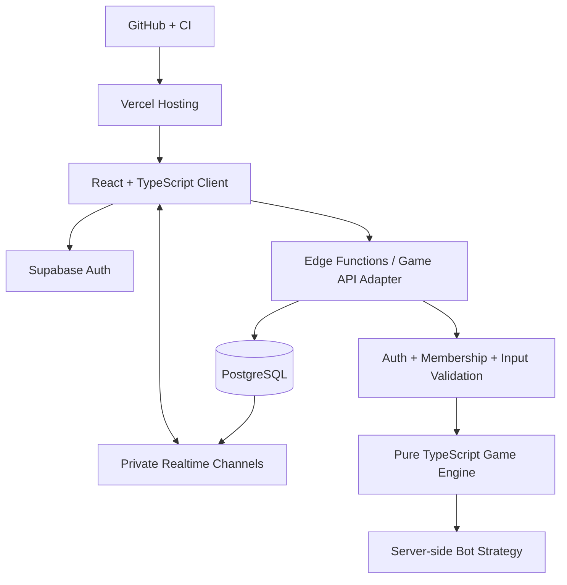
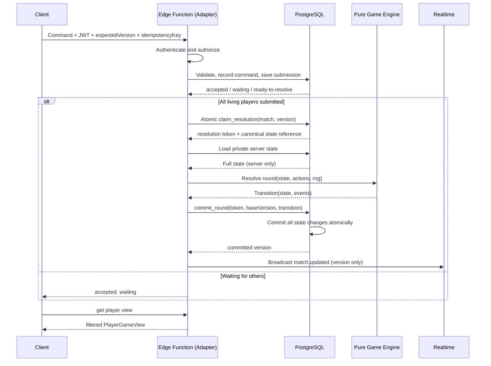
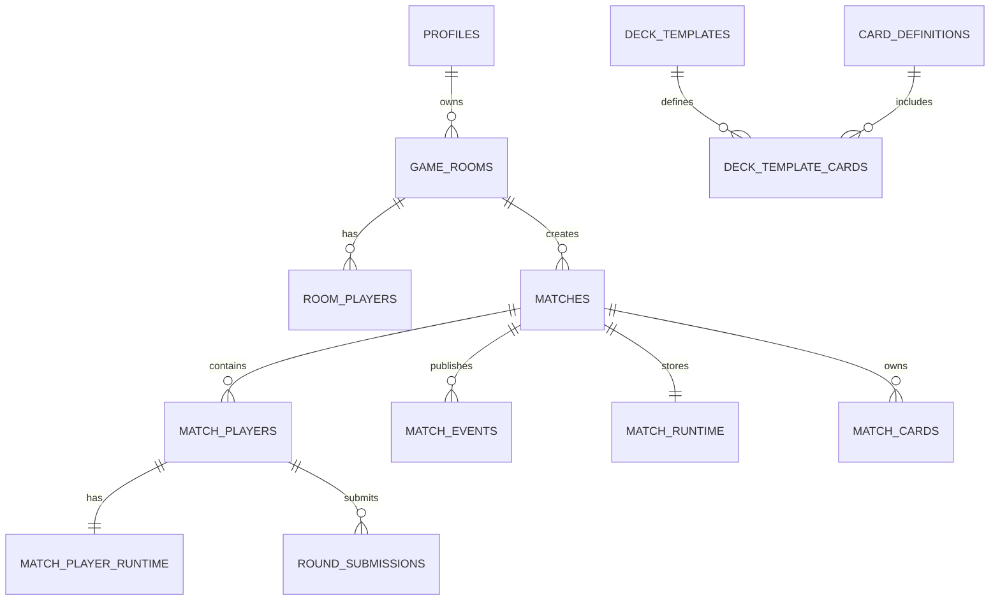

# AumMon — Project Blueprint & Implementation Guide

> เอกสารออกแบบระบบและคู่มือเริ่มพัฒนาจริงสำหรับ AumMon  
> ใช้คู่กับ `aummon_game_spec.md` ซึ่งเป็นแหล่งอ้างอิงหลักของกติกาเกม  
> เวอร์ชัน: 1.2 | อัปเดต: 2026-11-20 | สถานะ: Implementation Blueprint  
> **2026-11-21:** เกมเป็น Everyday Objects Battle (Spec v7.0, `ruleset_version = "6"`: Object Cards + Passive/free Active; engine `packages/game-engine/src/rules/v6`, ตาราง recipe ถูกลบแล้ว). ก่อนหน้า 2026-11-20: เปลี่ยนเป็น TCG 1v1 (Spec v3.0, ruleset "2" — ยกเลิกแล้ว). Platform, Auth, Security, Stack และ Operations ยังใช้ได้ตามเดิม. หัวข้อที่อธิบายกติกาเก่า 2–4 คน (§3.4 ตาราง Game, §5.2, §5.5–5.7) เป็นของ `ruleset_version = "1"` และจะถูกแทนที่ระหว่าง Roadmap Phase 8 — กติกาที่ถูกต้องอยู่ใน `aummon_game_spec.md`

---

## 0. Executive Summary

### Product decisions ที่ตกลงแล้ว

| เรื่อง | การตัดสินใจ |
|---|---|
| Membership | ต้องมี Account |
| AI Bot | ประมวลผลและตัดสินใจบน Server เท่านั้น |
| Business model | เล่นฟรีก่อน และเตรียมทางขยายเป็นระบบหารายได้ภายหลัง |
| Game modes | Solo vs Bot, Pass & Play, Online — 1v1 (2 ผู้เล่น) |
| Game authority | Server-authoritative; Client ส่งคำสั่ง ไม่ส่งผลลัพธ์เกม |

### เป้าหมายทางเทคนิค

1. ใช้ Game Engine ชุดเดียวกันในทุกโหมด
2. ซ่อน Hand, Deck order และ Face-down Actions จาก Client ที่ไม่มีสิทธิ์
3. ป้องกันการโกงจากการแก้ Browser, การส่งคำสั่งซ้ำ และ Request พร้อมกัน
4. เพิ่มการ์ด/Recipe ได้ด้วยข้อมูล (Card Definitions, Recipes) โดยไม่ต้องรื้อ Core Rules
5. เริ่มต้นด้วย Supabase + Vercel แต่แยก Game Engine ให้พร้อมย้ายไป Dedicated Game Server ได้ในอนาคต
6. แยก Monetization ออกจากกติกาเกม

### ภาพรวม Stack ที่แนะนำ

| Layer | เครื่องมือ | เหตุผล/หน้าที่ |
|---|---|---|
| Web frontend | React + TypeScript + Vite | UI แบบ Component, type safety, build เร็ว |
| Styling | Tailwind CSS | ทำ UI Cartoon ตาม Design Tokens ได้รวดเร็ว |
| Auth | Supabase Auth | Account, Session, JWT |
| Database | Supabase PostgreSQL | ข้อมูลสมาชิก, ห้อง, Match, ประวัติ |
| Server API | Supabase Edge Functions (TypeScript/Deno) | ตรวจสิทธิ์, รับคำสั่ง, เรียก Engine |
| Game Engine | Pure TypeScript package แยกจาก Backend | กติกาเกมบริสุทธิ์ ย้ายไป Dedicated Server ได้ทันที |
| Realtime | Supabase Broadcast + Presence | แจ้งการเปลี่ยนแปลงและสถานะออนไลน์ |
| Web hosting | Vercel | Deploy หน้าเว็บและ Preview |
| Source control | GitHub | Version control, Pull Requests, CI |
| Unit/integration test | Vitest | ทดสอบ Engine และโมดูล |
| Browser E2E | Playwright | ทดสอบ flow จริงผ่าน Browser |
| DB management | Supabase CLI + SQL migrations | ทำซ้ำและตรวจสอบ schema changes |
| Code quality | ESLint + Prettier + TypeScript strict | ลดข้อผิดพลาดและรักษารูปแบบโค้ด |

> **แนวทาง Infrastructure & Scaling (Pragmatic Growth):**
> 1. **ใช้ Supabase + Vercel ต่อไปก่อน:** ยังไม่ต้องย้ายไปใช้ Photon, Nakama หรือ Game Server เฉพาะทางในระยะแรก เพื่อประหยัดเวลาและค่าดูแลระบบ
> 2. **Engine-Adapter Separation:** ออกแบบ `packages/game-engine` ให้แยกขาดจาก Supabase SDK/Runtime โดยสิ้นเชิง เพื่อให้ในอนาคตสามารถนำไปรันบน Node.js/Bun/Deno Dedicated Game Server ได้ทันทีโดยแก้เพียง Adapter Layer
> 3. **Data-Driven Scaling:** เมื่อจำนวนผู้เล่นเพิ่มขึ้น ให้วัดผลจาก **Load Test, Database Performance (Query/Lock time) และ Realtime Latency** ก่อนตัดสินใจเพิ่ม Dedicated Server หรือแยก Compute

---

## 1. System Architecture

### 1.1 Logical architecture



### 1.2 Responsibility boundaries

**Browser / Frontend**
- แสดง Lobby, Character Select, Card UI, HP, Turn/Phase, Animation และ Result
- เก็บ Session ผ่าน Supabase Auth Client
- ส่งเฉพาะ Command เช่น เลือก Card Instance, Target, Choice และ Idempotency Key
- รับ Realtime Notification แล้วดึง Player View ล่าสุดจาก API
- ห้ามคำนวณผลจริง เช่น Damage, HP, Winner หรือ Deck Shuffle แล้วส่งกลับไปให้ Server เชื่อ

**Supabase Edge Functions / Server Adapter Layer**
- ทำหน้าที่เป็น Adapter เชื่อมระหว่าง HTTP/Supabase กับ Pure Game Engine
- ตรวจ JWT และสถานะ Account
- ตรวจสิทธิ์การเข้าถึง Room/Match
- ตรวจ Input Shape, Rate Limit และ Idempotency
- เรียก Database Functions เพื่อบันทึก/Claim งาน
- โหลด Server State แล้วส่งให้ Game Engine คำนวณ (Engine ไม่รู้จัก Supabase)
- สร้าง Player View โดยกรองข้อมูลตามผู้ร้องขอ
- ส่ง Realtime Notification หลัง Commit สำเร็จ

**Game Engine (`packages/game-engine`)**
- เป็น **Pure TypeScript 100%**: ห้าม import React, Supabase Client, Deno/Node specific API, HTTP หรือ Database Query
- ตรวจ Legal Action และ Resolve กติกา
- เรียก Card Effects และ Character Hooks ตาม Rulebook Version
- รับ RNG ผ่าน Interface (`RandomSource`) และ Clock/Time ผ่าน Parameter จากภายนอก เพื่อให้ Deterministic และย้ายไปรันบน Dedicated Game Server ได้โดยไม่ต้องแก้โค้ดใน Package นี้
- คืน State Transition และ Events

**PostgreSQL**
- เป็น Source of Truth สำหรับสถานะ Match ที่ Commit แล้ว
- เก็บ Private Game Data ที่ Client อ่านไม่ได้
- ใช้ Transaction/Row Lock/Conditional Update ป้องกัน Race Condition
- เก็บ Event ที่เปิดเผยแล้ว และ Command Receipt สำหรับ Idempotency

**Realtime**
- ใช้แจ้งว่า Match มี Version ใหม่, ผู้เล่นเข้า/ออก หรือสถานะ Ready เปลี่ยน
- ไม่ใช่แหล่งความจริงของเกม
- ไม่ส่ง Hand, Deck Order หรือข้อมูล Action ที่ยังไม่ Reveal

### 1.3 Server-authoritative request flow



### 1.4 Migration readiness: การย้ายไป Dedicated Game Server ในอนาคต

เพื่อให้การย้ายจาก Supabase Edge Functions ไป Dedicated Game Server (เช่น Node.js/Bun WebSocket Server) ทำได้โดยไม่ต้องรื้อกติกาเกม:
- **Repository Interfaces:** Backend Adapter เป็นผู้แปลงข้อมูลจาก DB (`match_players`, `match_cards`, `match_runtime`) ให้เป็น `GameState` ของ Engine และแปลง `Transition` กลับเป็น DB Persistence
- **Stateless Execution:** Engine ไม่เก็บ In-memory global state ข้าม Request ทำให้รันได้ทั้งแบบ Serverless (Edge Functions) และ Stateful Room Worker (Dedicated Server)
- **Trigger Point สำหรับการย้าย:** จะพิจารณาเพิ่ม Dedicated Server ก็ต่อเมื่อผลการวัดจริงพบว่า:
  1. Edge Function cold start หรือ execution time กระทบความลื่นไหลของเกม
  2. PostgreSQL connection / lock contention สูงเกินเกณฑ์ช่วง Concurrent matches สูง
  3. Realtime notification + view fetch latency สูงเกินค่าเป้าหมาย

### 1.5 แบ่ง Environment

| Environment | จุดประสงค์ | ฐานข้อมูล |
|---|---|---|
| Local | พัฒนาและทดสอบในเครื่อง | Supabase local หรือ Dev Project |
| Preview / Staging | ทดสอบก่อนปล่อยจริง | Staging Project แยกจาก Production |
| Production | ผู้เล่นจริง | Production Project |

ข้อบังคับ: ห้ามใช้ Secret หรือ Database ของ Production ใน Local/Preview โดยไม่จำเป็น; แยก Environment Variables และสิทธิ์ผู้ดูแลออกจากกัน

---

## 2. Repository & Project Layout

แนะนำเริ่มเป็น Monorepo ขนาดเล็กเพื่อให้ Frontend, Server Adapter และ Pure Engine ใช้ TypeScript Types ร่วมกันได้:

```text
aummon/
├── src/                         # Frontend
│   ├── app/                     # Router, providers, app shell
│   ├── features/
│   │   ├── auth/                # Sign up / Login / Profile
│   │   ├── lobby/               # Create/Join room, Ready
│   │   ├── character-select/    # Character selection
│   │   ├── game/                # Board, hand, actions, results
│   │   └── profile/             # Player profile
│   ├── components/              # Shared UI components
│   ├── lib/supabase/            # Browser Supabase client
│   └── styles/                  # Tailwind/theme tokens
│
├── packages/
│   └── game-engine/             # Pure TypeScript; ZERO Supabase/framework dependency
│       ├── domain/              # Types and state models
│       ├── rules/               # Rulebook version implementations
│       ├── cards/               # Card effect registry
│       ├── characters/          # Character definitions
│       ├── hooks/               # Five hook dispatchers
│       ├── resolver/            # Round resolution pipeline
│       ├── bots/                # Bot strategy interfaces/weights
│       ├── views/               # Safe player view builder
│       └── tests/
│
├── supabase/
│   ├── config.toml
│   ├── migrations/              # Ordered SQL migrations
│   ├── seed.sql                 # Character/Card/Deck seed data
│   ├── functions/
│   │   ├── _shared/             # Auth, validation, Engine-DB adapter
│   │   ├── rooms-create/
│   │   ├── rooms-join/
│   │   ├── rooms-ready/
│   │   ├── matches-start/
│   │   ├── matches-submit-action/
│   │   ├── matches-view/
│   │   ├── matches-resume/
│   │   └── matches-forfeit/
│   └── tests/
│
├── tests/
│   ├── integration/
│   ├── security/
│   ├── load/                    # Load test & latency benchmarks
│   └── e2e/
├── docs/
├── .github/workflows/
├── package.json
├── tsconfig.json
├── vite.config.ts
└── README.md
```

### Repository conventions

- ใช้ TypeScript `strict: true`
- **Engine Isolation Rule:** `packages/game-engine` ห้าม import จาก `src/`, `supabase/` หรือ `@supabase/supabase-js` (บังคับด้วย ESLint `no-restricted-imports`)
- ห้ามเขียนกติกาเกมไว้ใน React Component หรือ SQL Stored Procedures
- ทุก Migration ต้องมีชื่อเรียงลำดับและห้ามแก้ไฟล์ Migration ที่ถูกนำไปใช้แล้ว; ให้เพิ่ม Migration ใหม่เพื่อแก้ schema
- Pull Request ต้องผ่าน Typecheck, Lint, Unit Tests และ Build

---

## 3. Database Blueprint

### 3.1 Schema separation

ใช้ 2 Schema หลัก:

- `public`: ตารางที่จำเป็นต้องเปิดผ่าน Supabase Data API โดยมี RLS กรองทุกแถว
- `private`: ตารางลับของ Match ไม่เพิ่มใน Exposed Schemas และไม่ให้ `anon`/`authenticated` อ่านโดยตรง

อย่าใช้การซ่อนข้อมูลด้วย Frontend เพียงอย่างเดียว เพราะผู้เล่นสามารถเรียก API โดยตรงได้

### 3.2 Table catalog

| Schema.Table | หน้าที่ | ข้อมูลลับ? |
|---|---|---|
| `public.profiles` | ชื่อเล่นและ Avatar ของสมาชิก | ไม่ใช่ (จำกัดข้อมูลส่วนตัว) |
| `public.characters` | Character definitions | ไม่ใช่ |
| `public.card_definitions` | Card definitions | ไม่ใช่ |
| `public.deck_templates` | Deck version/template | ไม่ใช่ |
| `public.deck_template_cards` | จำนวนการ์ดตาม Deck Template | ไม่ใช่ |
| `public.game_rooms` | Lobby, Mode, Owner, Status, Expiry | จำกัดสมาชิก/การเข้าถึง |
| `public.room_players` | ผู้เล่นและที่นั่งใน Lobby | จำกัดสมาชิก |
| `public.matches` | Match Status, Phase, Version, Ruleset | จำกัดสมาชิก |
| `public.match_players` | HP, Character Snapshot, Status | อ่านได้เฉพาะสมาชิก Match |
| `public.match_events` | Event ที่เปิดเผยแล้วเท่านั้น | อ่านได้เฉพาะสมาชิก Match |
| `private.match_runtime` | RNG state/seed, resolver lease, runtime metadata | ลับ — Server only |
| `private.match_cards` | Card instances และ Deck/Hand/Discard zones | ลับ — Server only |
| `private.match_player_runtime` | สถานะภายในของ Skills | ลับ — Server only |
| `private.round_submissions` | การ์ด/เป้าหมายที่เลือกคว่ำหน้า | ลับ — Server only |
| `private.command_receipts` | Idempotency ledger / ผลคำสั่งที่เคยรับ | ลับ — Server only |
| `private.match_private_events` (optional) | Debug/audit events ที่ไม่เปิดเผยผู้เล่น | ลับ — Server only |

### 3.3 Key relationships



### 3.4 Core DDL (starting migration)

> SQL ด้านล่างเป็นฐานเริ่มต้น ไม่ใช่ Migration Production ที่เสร็จสมบูรณ์ ต้องเพิ่ม Policies, Functions, Grants, Triggers, Composite Foreign Keys และ Tests ตามหัวข้อ Security ก่อนเปิดให้ Client ใช้งาน

```sql
create extension if not exists pgcrypto;
create schema if not exists private;

-- Do not expose the private schema through the Supabase Data API.
revoke all on schema private from public, anon, authenticated;

create table public.profiles (
  id uuid primary key references auth.users(id) on delete cascade,
  display_name text not null check (char_length(display_name) between 2 and 24),
  avatar_url text,
  created_at timestamptz not null default now(),
  updated_at timestamptz not null default now()
);

create table public.characters (
  id text primary key,
  name text not null,
  element text not null,
  base_hp smallint not null check (base_hp > 0),
  speed integer not null,
  hook text not null check (hook in ('onTurnStart','onAttack','onBeforeDamaged','onAfterDamaged','onRoundEnd')),
  effect_key text not null,
  description text not null,
  definition_version integer not null default 1,
  is_enabled boolean not null default true
);

create table public.card_definitions (
  id text primary key,
  name text not null,
  card_type text not null check (card_type in ('attack','defense','support','chaos')),
  description text not null,
  effect_spec jsonb not null default '{}'::jsonb,
  definition_version integer not null default 1,
  is_enabled boolean not null default true
);

create table public.deck_templates (
  id text primary key,
  version integer not null,
  is_active boolean not null default false,
  created_at timestamptz not null default now(),
  unique (id, version)
);

create table public.deck_template_cards (
  deck_template_id text not null references public.deck_templates(id),
  card_definition_id text not null references public.card_definitions(id),
  quantity integer not null check (quantity > 0),
  primary key (deck_template_id, card_definition_id)
);

create table public.game_rooms (
  id uuid primary key default gen_random_uuid(),
  owner_id uuid not null references auth.users(id),
  join_code_hash text unique,
  mode text not null check (mode in ('solo','pass_play','online')),
  status text not null default 'lobby' check (status in ('lobby','playing','closed')),
  max_players smallint not null default 4 check (max_players between 2 and 4),
  created_at timestamptz not null default now(),
  expires_at timestamptz
);

create table public.room_players (
  id uuid primary key default gen_random_uuid(),
  room_id uuid not null references public.game_rooms(id) on delete cascade,
  user_id uuid references auth.users(id),
  seat smallint not null check (seat between 1 and 4),
  player_type text not null check (player_type in ('human','bot','local')),
  character_id text not null references public.characters(id),
  display_name_snapshot text not null,
  status text not null default 'waiting' check (status in ('waiting','ready','disconnected','left')),
  created_at timestamptz not null default now(),
  unique (room_id, seat),
  check ((player_type = 'human' and user_id is not null) or (player_type in ('bot','local') and user_id is null))
);
create unique index room_one_seat_per_user
  on public.room_players(room_id, user_id) where user_id is not null;

create table public.matches (
  id uuid primary key default gen_random_uuid(),
  room_id uuid not null references public.game_rooms(id),
  deck_template_id text not null references public.deck_templates(id),
  status text not null default 'created' check (status in ('created','active','finished','abandoned')),
  phase text not null default 'setup' check (phase in ('setup','draw','select','resolving','end')),
  round_number integer not null default 0,
  version bigint not null default 0,
  engine_version text not null,
  ruleset_version text not null,
  started_at timestamptz,
  finished_at timestamptz,
  created_at timestamptz not null default now()
);

create table public.match_players (
  id uuid primary key default gen_random_uuid(),
  match_id uuid not null references public.matches(id) on delete cascade,
  room_player_id uuid references public.room_players(id),
  user_id uuid references auth.users(id),
  seat smallint not null check (seat between 1 and 4),
  player_type text not null check (player_type in ('human','bot','local')),
  character_id text not null,
  character_snapshot jsonb not null,
  hp smallint not null,
  max_hp smallint not null,
  speed integer not null,
  status text not null default 'alive' check (status in ('alive','eliminated','surrendered')),
  unique (match_id, seat),
  unique (id, match_id)
);

create table public.match_events (
  id bigint generated always as identity primary key,
  match_id uuid not null references public.matches(id) on delete cascade,
  event_seq bigint not null,
  round_number integer not null,
  event_type text not null,
  public_payload jsonb not null default '{}'::jsonb,
  created_at timestamptz not null default now(),
  unique (match_id, event_seq)
);

create table private.match_runtime (
  match_id uuid primary key references public.matches(id) on delete cascade,
  rng_state bytea not null,
  resolution_token uuid,
  resolution_lease_until timestamptz,
  internal_state jsonb not null default '{}'::jsonb
);

create table private.match_cards (
  id uuid primary key default gen_random_uuid(),
  match_id uuid not null references public.matches(id) on delete cascade,
  card_definition_id text not null,
  card_snapshot jsonb not null,
  zone text not null check (zone in ('deck','hand','discard')),
  owner_match_player_id uuid,
  position integer,
  unique (id, match_id),
  foreign key (owner_match_player_id, match_id)
    references public.match_players(id, match_id),
  check ((zone = 'hand' and owner_match_player_id is not null) or (zone in ('deck','discard') and owner_match_player_id is null))
);

create table private.match_player_runtime (
  match_player_id uuid primary key references public.match_players(id) on delete cascade,
  skill_state jsonb not null default '{}'::jsonb
);

create table private.round_submissions (
  id uuid primary key default gen_random_uuid(),
  match_id uuid not null references public.matches(id) on delete cascade,
  round_number integer not null,
  match_player_id uuid not null,
  card_instance_id uuid not null,
  target_match_player_id uuid,
  choice text,
  idempotency_key uuid not null,
  submitted_at timestamptz not null default now(),
  unique (match_id, round_number, match_player_id),
  unique (match_id, idempotency_key),
  foreign key (match_player_id, match_id)
    references public.match_players(id, match_id),
  foreign key (target_match_player_id, match_id)
    references public.match_players(id, match_id),
  foreign key (card_instance_id, match_id)
    references private.match_cards(id, match_id)
);

create table private.command_receipts (
  match_id uuid not null references public.matches(id) on delete cascade,
  actor_user_id uuid not null references auth.users(id),
  idempotency_key uuid not null,
  request_hash text not null,
  response_payload jsonb not null,
  created_at timestamptz not null default now(),
  primary key (match_id, actor_user_id, idempotency_key)
);

create index room_players_room_idx on public.room_players(room_id);
create index matches_room_idx on public.matches(room_id);
create index match_players_user_idx on public.match_players(user_id);
create index match_events_order_idx on public.match_events(match_id, event_seq);
create index match_cards_hand_idx on private.match_cards(match_id, owner_match_player_id) where zone = 'hand';
create index round_submissions_round_idx on private.round_submissions(match_id, round_number);
```

**Important schema notes**

- เพิ่ม FK แบบ Composite สำหรับ `card_instance_id`, `match_player_id`, `target_match_player_id` เพื่อป้องกันการอ้าง Card/Player ข้าม Match
- `join_code_hash` ควรเก็บ Hash ของ Join Code ไม่เก็บ Code แบบ Plaintext; ใช้ Code ที่สุ่มเดายากและมี Expiry/Rate Limit
- `match_players.character_snapshot` ต้องเก็บค่าที่ใช้จริงใน Match ไม่อ้างค่าปัจจุบันจาก `characters` อย่างเดียว
- `match_events` เก็บเฉพาะ Event หลัง Reveal หรือข้อมูลที่ผู้เล่นทุกคนมีสิทธิ์เห็น
- `private.match_runtime.rng_state` และข้อมูลภายในต้องไม่ถูกส่งกลับ Client
- Pass & Play ใช้หลาย `local` seats ที่ไม่มี `user_id`; Server ต้องตรวจเจ้าของ Room และลำดับ Privacy Handoff ก่อนเปิดข้อมูล Seat ปัจจุบัน
- `room_players` และ `match_players` ต้องตรวจให้แน่ใจว่าชนิด `human/bot/local` ตรงกับความสัมพันธ์กับ `user_id` และ Room/Match จริง
- เพิ่ม Trigger สร้าง `profiles` หลังสมัคร Account และ Trigger `updated_at` ตามความเหมาะสม

### 3.5 Data retention & deletion

- กำหนดอายุ Lobby ที่ไม่มีการใช้งานและปิดห้องอัตโนมัติ
- เก็บ Match History ตามนโยบายผลิตภัณฑ์; แยก PII ออกจาก Game Events เท่าที่ทำได้
- วางกระบวนการลบ Account โดยรักษาข้อกำหนดด้านประวัติ/ความปลอดภัยที่จำเป็น และ anonymize records ที่ต้องเก็บ
- ทำ Backup และทดสอบ Restore เป็นระยะ ไม่ถือว่า Backup ที่ไม่เคย Restore คือแผนกู้คืนที่พิสูจน์แล้ว

---

## 4. Security Architecture & Rules

### 4.1 Trust boundaries

| Actor | Trust level | Allowed |
|---|---|---|
| Browser | Untrusted | ส่ง Command, อ่าน Player View ของตน |
| Authenticated user | Identity verified, input still untrusted | กระทำเฉพาะ Room/Match ที่มีสิทธิ์ |
| Edge Function (Adapter) | Trusted server entry point | ตรวจ JWT, Membership, Validation |
| Pure Game Engine | Trusted deterministic rules | ตัดสินกติกาจาก State ที่ Server โหลด |
| Database private schema | Server-only | เก็บ Deck, Hand, Submissions, Runtime |
| Bot process | Server-only but constrained | เห็นข้อมูลเท่าผู้เล่นจำลอง 1 ที่นั่ง |

### 4.2 Baseline policies

1. เปิด RLS ให้ทุกตารางใน `public` ที่ Browser เข้าถึงได้
2. `private` ไม่อยู่ใน Exposed Schemas และไม่ GRANT ตารางให้ `anon`/`authenticated`
3. Client อ่าน `matches`, `match_players`, `match_events`, `rooms` ได้เฉพาะตาม Membership Policy
4. Client ห้าม `INSERT/UPDATE/DELETE` สถานะเกม, HP, Event, Card Zone หรือ Submission โดยตรง
5. การเปลี่ยนสถานะเกมทั้งหมดผ่าน Server Adapter (Edge Function) และ privileged Database Functions เท่านั้น
6. ใช้ Security Definer อย่างระมัดระวัง: `search_path = ''`, schema-qualified names, จำกัด `EXECUTE` และทบทวน Function Owner
7. Publishable/Anon key ใช้ใน Browser ได้เมื่อ RLS ทำงาน; Secret/Service Role Key ห้ามอยู่ใน Frontend, Git หรือ Client logs
8. ทุก API ต้องตรวจ Authorization ทุก Request; การ Login สำเร็จไม่ได้แปลว่ามีสิทธิ์เข้าทุก Match

### 4.3 RLS helper pattern

ตัวอย่างแนวคิด (ต้องตรวจสิทธิ์ Function Owner/GRANT และทดสอบกับ Supabase Project จริงก่อนใช้ Production):

```sql
create or replace function public.is_match_member(p_match_id uuid)
returns boolean
language sql
stable
security definer
set search_path = ''
as $$
  select exists (
    select 1
    from public.matches m
    join public.game_rooms r on r.id = m.room_id
    where m.id = p_match_id
      and (
        r.owner_id = (select auth.uid())
        or exists (
          select 1 from public.match_players mp
          where mp.match_id = m.id
            and mp.user_id = (select auth.uid())
        )
      )
  );
$$;

revoke all on function public.is_match_member(uuid) from public;
grant execute on function public.is_match_member(uuid) to authenticated;

alter table public.matches enable row level security;
alter table public.match_players enable row level security;
alter table public.match_events enable row level security;

create policy "match members read match"
on public.matches for select to authenticated
using ((select public.is_match_member(id)));

create policy "match members read player state"
on public.match_players for select to authenticated
using ((select public.is_match_member(match_id)));

create policy "match members read public events"
on public.match_events for select to authenticated
using ((select public.is_match_member(match_id)));
```

Policies ข้างต้นเป็นตัวอย่างขั้นต่ำ ไม่ใช่ Policy ครบทุกตาราง ต้องเพิ่ม Policies สำหรับ `profiles`, `game_rooms`, `room_players`, `characters`, `card_definitions` และ Deck Template พร้อมทดสอบ User A, User B, Non-member และ Anonymous

### 4.4 Information visibility matrix

| Data | Match member | Room owner | Server |
|---|---|---|---|
| Character/Card definitions | Read | Read | Full |
| Public HP/status | Read | Read if room member/owner | Full |
| Own Hand | Own seat only | ไม่ได้สิทธิ์เพิ่มใน Online | Full |
| Opponent Hand | No | No extra privilege | Full |
| Deck order / RNG state | No | No | Full |
| Face-down submissions | No until reveal | No | Full |
| Revealed events | Read | Read if authorized | Full |
| HP/phase/result writes | No direct write | No direct write | Server only |

**Pass & Play exception:** เครื่องเดียวเป็น Shared Device จึงไม่สามารถป้องกันผู้ใช้ที่เปิด Developer Tools, หน่วยความจำ Browser หรือดู Network traffic จากผู้เล่นอื่นได้อย่างสมบูรณ์ Privacy Handoff เป็นการลดการมองเห็นโดย UI เท่านั้น ไม่ใช่ Security boundary แบบ Online

### 4.5 Command validation

ทุก Command ต้องตรวจอย่างน้อย:

- JWT/Account valid และยังไม่ถูกระงับ
- ผู้ส่งเป็นสมาชิก Match หรือเป็น Room Owner ใน Action ที่อนุญาต
- Match อยู่ในสถานะ/Phase ที่รับ Command ได้
- `roundNumber` และ `expectedVersion` ตรงกับ Server State
- ผู้เล่นยัง Alive และเป็นผู้เล่นที่มีสิทธิ์ส่ง Action ในรอบนั้น
- Card Instance อยู่ใน Hand ของผู้เล่นคนนั้นและอยู่ใน Match เดียวกัน
- Target อยู่ใน Match เดียวกัน, ยัง Alive และถูกกติกาอนุญาต
- Choice อยู่ใน Enum/Schema ที่อนุญาตสำหรับ Card นั้น
- ไม่เคยใช้ Idempotency Key นี้กับ Payload คนละชุด
- จำกัด Payload Size และ Rate Limit

ห้ามเชื่อ `hp`, `damage`, `speed`, `winner`, `phase`, `card owner` หรือ `resolved state` ที่ Client ส่งมา

### 4.6 Idempotency & concurrency

ใช้ `idempotency_key` ต่อ Command และเก็บ `request_hash` พร้อม Response เดิม:

- Key เดิม + Payload เดิม: คืน Response เดิม
- Key เดิม + Payload ต่างกัน: Reject
- ผู้เล่นส่ง Action ซ้ำ: ไม่สร้าง Submission ใหม่
- ทุกการเขียน Match ใช้ `expectedVersion` และเพิ่ม `version` เมื่อ Commit สำเร็จ
- การ Claim Resolve ใช้ Atomic Conditional Update/Row Lock เพื่อมี Resolver ได้เพียงหนึ่งตัวต่อ Match/รอบ

### 4.7 Resolve lease & recovery

1. เมื่อทุกคนที่ยัง Alive ส่งครบ Database Function เปลี่ยน Phase เป็น `resolving` และกำหนด `resolution_token`/Lease
2. Resolver โหลด Canonical Private State แล้วคำนวณ Transition ผ่าน Pure Engine
3. Commit Function ตรวจ Token และ Base Version ก่อนเขียนผลทั้งหมด
4. บันทึก `match_players`, Card Zones, Skill State, Events และ Match Version ใน Transaction เดียว
5. หาก Resolver ล่มก่อน Commit ให้ Recovery Worker ตรวจ Lease หมดอายุ แล้ว Claim ใหม่จาก Canonical State เดิม
6. RNG ต้อง Replay ได้จาก RNG State ที่เก็บไว้; ห้ามสุ่มใหม่โดยไม่ตั้งใจระหว่าง Recovery

> อย่าพยายามเปิด SQL Transaction ค้างไว้ข้าม HTTP Request หลายครั้ง; ใช้ Claim/Compute/Commit แบบมี Token และ Version

### 4.8 Realtime rules

- ปิด Public Channel Access และใช้ Private Channels
- ตรวจ Membership ด้วย Authorization/RLS ของ Realtime
- Broadcast เฉพาะ Notification เช่น `{ type, matchId, version, lastEventSeq }`
- หลัง Notification Client เรียก API เพื่อดึง Player View ที่ถูกกรอง
- Presence ใช้แสดง Online/Offline เท่านั้น ไม่ใช้เก็บ HP หรือ Game State
- อย่าส่ง Hand, Deck Order, Face-down Action หรือ Private Skill State ผ่าน Broadcast

### 4.9 Additional production protections

- จำกัด CORS เป็น Domain ที่จำเป็น
- ตั้ง Rate Limit สำหรับ Signup/Login, Join Room, Room Code Guessing และ Game Commands
- ตรวจ XSS/HTML Injection ใน Display Name/Chat (ถ้ามี)
- เก็บ Error Logs โดยไม่บันทึก Password, JWT, Secret, Hand หรือ RNG Seed
- ใช้ HTTPS, Security Headers, CSP และ Dependency Updates
- สำรองฐานข้อมูลและตรวจสอบ Restore
- มี Audit Trail สำหรับการเปลี่ยนสิทธิ์/การกระทำด้าน Admin
- เตรียม Abuse Reporting/Moderation หากเพิ่มชื่อผู้เล่นหรือ Chat แบบ Public

---

## 5. Game Engine Design

### 5.1 Engine principles

- **Pure TypeScript & Runtime Agnostic:** ห้ามผูกติดกับ Supabase SDK, Deno API หรือ Browser API เพื่อให้ย้ายไป Dedicated Game Server ได้ทันที
- **Deterministic:** เมื่อกำหนด State, Input และ RNG เดียวกัน ต้องได้ผลลัพธ์เหมือนกัน 100%
- **Zero I/O:** รับ State/Command/RNG แล้วคืน Transition โดยไม่เรียก Network หรือ DB เอง
- ใช้ `engine_version` และ `ruleset_version`
- Game State แบบเต็มอยู่ Server เท่านั้น; Client ได้เพียง `PlayerGameView`
- Character Definitions แยกจาก Engine; Handler ผูกผ่าน `effectKey`

### 5.2 TypeScript domain contracts

> ⚠ Contracts ด้านล่างเป็นของ ruleset 1 (เลิกใช้). Ruleset 3 ใช้ Card Definitions / Card Instances / Match State / Match Events ตาม Spec v7.0 §3.3 และ Data Contract §6.4 — โค้ดจริงอยู่ที่ `packages/game-engine/src/rules/v6`

```ts
export type PlayerId = string;
export type CardInstanceId = string;
export type CardType = "attack" | "defense" | "support" | "chaos";
export type CharacterHook =
  | "onTurnStart"
  | "onAttack"
  | "onBeforeDamaged"
  | "onAfterDamaged"
  | "onRoundEnd";
export type GamePhase = "setup" | "draw" | "select" | "resolving" | "end";

export interface CharacterDefinition {
  id: string;
  name: string;
  element: string;
  hp: number;
  speed: number;
  hook: CharacterHook;
  effectKey: string;
  description: string;
  version: number;
}

export interface CardDefinition {
  id: string;
  type: CardType;
  name: string;
  effectSpec: Record<string, unknown>;
  version: number;
}

export interface PlayerState {
  id: PlayerId;
  seat: number;
  characterId: string;
  hp: number;
  maxHp: number;
  speed: number;
  status: "alive" | "eliminated" | "surrendered";
  skillState: Record<string, unknown>;
}

export interface GameState {
  matchId: string;
  phase: GamePhase;
  round: number;
  version: number;
  players: PlayerState[];
  // Full cards, deck order, submissions and private runtime are server-only.
}

export interface SubmitActionCommand {
  matchId: string;
  roundNumber: number;
  expectedVersion: number;
  cardInstanceId: CardInstanceId;
  targetPlayerId?: PlayerId;
  choice?: string;
  idempotencyKey: string;
}

export interface GameEvent {
  type: string;
  round: number;
  publicPayload: Record<string, unknown>;
}

export interface Transition {
  state: GameState;
  events: GameEvent[];
}

export interface RandomSource {
  nextInt(maxExclusive: number): number;
}
```

### 5.3 Client-safe view

```ts
export interface PublicPlayerView {
  id: string;
  seat: number;
  displayName: string;
  characterId: string;
  hp: number;
  maxHp: number;
  status: "alive" | "eliminated" | "surrendered";
  hasSubmitted: boolean;
}

export interface PlayerGameView {
  matchId: string;
  phase: GamePhase;
  round: number;
  version: number;
  players: PublicPlayerView[];
  myHand: Array<{
    instanceId: string;
    definitionId: string;
    type: CardType;
    name: string;
  }>;
  events: GameEvent[];
}
```

ห้ามส่ง GameState เต็ม หรือ Object ที่มี Deck/Other Hands/Private Skill State ให้ Client โดยตรง

### 5.4 Engine interface (Adapter Boundary)

```ts
export interface GameEngine {
  initializeMatch(input: InitializeMatchInput, rng: RandomSource): Transition;
  startRound(state: GameState, rng: RandomSource): Transition;
  getLegalActions(state: GameState, playerId: PlayerId): LegalAction[];
  validateAction(
    state: GameState,
    playerId: PlayerId,
    command: SubmitActionCommand
  ): ValidationResult;
  resolveRound(
    state: GameState,
    actions: SubmittedAction[],
    rng: RandomSource
  ): Transition;
  buildPlayerView(state: GameState, playerId: PlayerId): PlayerGameView;
}
```

> **Adapter Pattern:** ทั้ง Supabase Edge Functions (ปัจจุบัน) และ Dedicated Game Server (อนาคต) จะเรียกใช้งานผ่าน `GameEngine` interface นี้เท่านั้น ทำให้ไม่ต้องเขียน Logic เกมใหม่เมื่อย้าย Host

### 5.5 Character hook registry

> ⚠ Ruleset 1 เท่านั้น. Ruleset 2 ใช้ Keyword/Effect registry ตาม Spec §5

```ts
export interface HookContext {
  state: GameState;
  playerId: PlayerId;
  targetId?: PlayerId;
  damage?: number;
  events: GameEvent[];
}

export type CharacterEffectHandler = (context: HookContext) => void;

export interface RegisteredCharacterEffect {
  hook: CharacterHook;
  handler: CharacterEffectHandler;
}

export const CHARACTER_EFFECTS: Record<string, RegisteredCharacterEffect> = {
  BONUS_DMG_FIRST_HIT: {
    hook: "onAttack",
    handler: (ctx) => {
      // +1 damage on first successful (unblocked/undodged) attack per round
    },
  },
  SWAP_CARD_ONCE: {
    hook: "onTurnStart",
    handler: (ctx) => {
      // Once per match: swap 1 random card with an alive opponent
    },
  },
  DISCARD_TO_DODGE: {
    hook: "onBeforeDamaged",
    handler: (ctx) => {
      // Discard 1 card from hand to dodge all damage from incoming hit
    },
  },
  REDUCE_DMG_1: {
    hook: "onBeforeDamaged",
    handler: (ctx) => {
      // Reduce incoming hit damage by 1 (minimum 0)
    },
  },
};
```

ตอนโหลด Character Definition ต้องตรวจว่า Hook ตรงกับ Registry Handler; ถ้าไม่มี Handler หรือ Hook ไม่ตรง ให้ปฏิเสธการเริ่ม Match และสร้าง Configuration Error

### 5.6 Bot design

ใช้ Rule-based Bot ในรุ่นแรก:

```ts
export interface BotDecisionContext {
  playerId: PlayerId;
  publicView: Omit<PlayerGameView, "myHand">;
  myHand: PlayerGameView["myHand"];
  legalActions: LegalAction[];
}

export interface BotStrategy {
  chooseAction(context: BotDecisionContext, rng: RandomSource): SubmitActionCommand;
}
```

Bot ต้องไม่รับ Full GameState หรือ Hand คู่แข่ง ใช้ Difficulty Presets เช่น `easy`, `normal`, `hard` ผ่าน Weight/Heuristic ที่ปรับได้ ไม่ต้องใช้ LLM ในการตัดสินใจทุก Turn

ตัวอย่าง Heuristic เริ่มต้น (ruleset 1; Bot ruleset 3 ให้คะแนนการลง Object / ใช้ความสามารถ / โจมตี — `rules/v6/bot.ts`):
- HP ต่ำ: เพิ่มน้ำหนัก Defense/Heal
- HP เต็ม: ลดน้ำหนัก Heal
- เลือก Attack Target จาก HP, Threat และโอกาสชนะ
- ใช้ Chaos เมื่อผลที่คาดว่าจะได้คุ้มความเสี่ยง
- เลือกเฉพาะ Action จาก `legalActions`

### 5.7 Resolution pipeline

> ⚠ Ruleset 1 เท่านั้น. Ruleset 2 เป็นเทิร์นสลับกัน (Start → Main → Battle & End) ตาม Spec §4.5 และ Effect Pipeline §5.6–5.7, §5.14

ลำดับเชิงระบบของ **Rulebook v1** (ruleset 1 — เลิกใช้; ดู Git history ของ Spec v2.1):

1. Validate Submitted Actions ทั้งหมด
2. Reveal Actions พร้อมกันในผลลัพธ์ Round
3. Sort ด้วย `speed` จากมากไปน้อย (หาก `speed` เท่ากัน ตัดสินด้วย `seat` ที่น้อยกว่าขึ้นก่อน)
4. ประมวลผล Actions ตามลำดับ (ผู้ที่ `HP <= 0` ระหว่าง Resolve จะถูกข้าม Action ที่ยังไม่ได้เล่น)
5. เรียก Character Hooks ตามลำดับเหตุการณ์ (`onAttack` → `onBeforeDamaged` → Apply HP → `onAfterDamaged`)
6. Apply HP และเปลี่ยน Status เป็น `eliminated` ทันทีเมื่อ `HP <= 0`
7. เรียก `onRoundEnd` สำหรับผู้รอดชีวิต (`alive`) เรียงตาม `speed` (Tie-break ด้วย `seat`)
8. ตรวจ Winner / Draw (หากไม่มีผู้รอดชีวิตเลย ให้ตัดสินเป็น Draw) / Next Round
9. คืน Transition + Public Events + Updated Private Runtime

---

## 6. Game Modes

### 6.1 Solo vs Server Bot

- Account สร้าง Room/Match 1v1; Server เติม Bot 1 Seat
- Engine สร้าง Deck (Starter Deck ตาม Spec §1.5) และ Hand
- Bot เล่นทั้งเทิร์นบน Server จากข้อมูลที่ Bot Seat มีสิทธิ์เห็น ผ่านช่องทางเดียวกับ Human
- Turn timer 90 วินาที: หมดเวลา Server จบเทิร์นอัตโนมัติ

### 6.2 Pass & Play

- เจ้าของ Account สร้าง Room; Local Seats 2 ที่นั่งไม่มี Account แยก
- เล่นสลับเทิร์น; ทุกครั้งที่เปลี่ยนเทิร์นผ่าน Privacy Handoff
- Server ตรวจ Seat ปัจจุบัน ไม่รับ Seat ID ที่ Client เลือกเองโดยไม่มีการตรวจ; ไม่มีจับเวลา
- ข้อจำกัด: Shared Device ไม่สามารถรับประกันการปกปิดข้อมูลจากผู้ที่เข้าถึงเครื่อง/DevTools ได้

### 6.3 Online Multiplayer

- 2 Account เข้าห้องด้วย Join Code (สุ่มเดายาก, เก็บ Hash, หมดอายุ, Rate Limit)
- ทุก Command ตรวจ Membership/Seat/Turn/Version/Card Instance/Target
- Reconnect ดึงสถานะจาก Server; Forfeit คงเดิม
- Turn timer 90 วินาที: หมดเวลา Server จบเทิร์นอัตโนมัติ

---

## 7. API Contract

แนะนำใช้ Supabase Edge Functions แยกเป็น Endpoint ตาม Use Case:

| Function | Method | หน้าที่ |
|---|---|---|
| `rooms-create` | POST | สร้าง Room และ Owner Seat |
| `rooms-join` | POST | เข้าห้องด้วย Code |
| `rooms-ready` | POST | เปลี่ยน Ready State |
| `rooms-leave` | POST | ออกจาก Lobby |
| `matches-start` | POST | ตรวจเงื่อนไขและเริ่ม Match |
| `matches-view` | POST | คืน Player View ที่กรองแล้ว |
| `matches-submit-action` | POST | ส่ง Action และ Trigger Resolve เมื่อครบ |
| `matches-resume` | POST | Resume หลัง Reconnect |
| `matches-forfeit` | POST | ยอมแพ้/ออกจาก Match |

### Submit Action example

```json
{
  "matchId": "match-uuid",
  "roundNumber": 4,
  "expectedVersion": 18,
  "cardInstanceId": "card-instance-uuid",
  "targetPlayerId": "match-player-uuid",
  "choice": "heal",
  "idempotencyKey": "client-generated-uuid"
}
```

ไม่รับ `damage`, `newHp`, `winner`, `resolvedState` หรือ `deckOrder` จาก Client

### Response shape (example)

```json
{
  "status": "accepted",
  "phase": "select",
  "version": 18,
  "waitingForPlayers": 1
}
```

Response ของ API ต้องไม่คืน Secret, Private Submission, Deck Order หรือข้อมูลไพ่ของคู่แข่ง

---

## 8. UX / UI Work Plan

### 8.1 Main screens

1. Landing / Login / Sign Up
2. Main Menu: Solo, Pass & Play, Online
3. Character Select
4. Create/Join Room Lobby
5. Privacy Handoff (Pass & Play)
6. Game Board: Round, HP, Character, Public status
7. Own Hand / Action Select / Target Select
8. Reveal & Resolution Animation
9. Result Screen / Match History
10. Profile / Settings

### 8.2 UI Design tokens

ยึด Palette และ Cartoon Style จาก `aummon_game_spec.md` ใช้ Fredoka/Kanit และระบบขอบหนา/Sticker Shadow อย่างสม่ำเสมอ แยก `tokens.css` หรือ Tailwind Theme Config เพื่อแก้ธีมจากจุดเดียว

### 8.3 UX states ที่ต้องออกแบบ

- Loading / Submitting / Waiting for opponent
- Invalid target / Card no longer legal
- Connection lost / Reconnecting
- Match expired / Forfeit / Timeout
- Server error / Retry safely
- Reveal / Damage / Heal / Elimination / Winner
- Empty hand / Hand full / Deck empty

ทุก Retry ที่เป็นคำสั่งเกมต้องใช้ Idempotency Key เดิม ไม่ใช่ยิง Command ใหม่แบบไม่มีการควบคุม

---

## 9. Development Roadmap

แนวทาง: Vertical Slice — ทำ Feature ให้ครบ UI → API → Engine → Database → Test ทีละส่วน

### Phase 0 — Rulebook v1 (Completed in Spec v2.1)

**งาน**
- ตัดสินประเด็น Pending ทั้ง 15 ข้อใน Spec เรียบร้อยแล้ว
- กำหนดจำนวนการ์ดแต่ละประเภทใน Shared Deck (40 ใบ)
- กำหนด Speed Tie, Defense, Chaos, Support timing, Hook ordering, Disconnect policy

**Exit criteria**
- ทีมสามารถคำนวณผลของตัวอย่างทุกกรณีโดยไม่ต้องตีความเพิ่ม
- ล็อก `ruleset_version = 1`

### Phase 1 — Project Foundation

**งาน**
- สร้าง GitHub Repository และ Monorepo
- ตั้ง React/Vite/TypeScript/Tailwind
- ตั้ง ESLint (รวมกฎห้าม `game-engine` import Supabase/UI) / Prettier / Vitest / Playwright
- ตั้ง Supabase Dev และ Local CLI
- ตั้ง Vercel Preview และ Production Environments แยกกัน
- ตั้ง GitHub Actions สำหรับ Typecheck/Lint/Test/Build

**Exit criteria**
- Pull Request ผ่าน CI
- Deploy Preview ได้
- ไม่มี Secret อยู่ใน Client Bundle หรือ Git

### Phase 2 — Auth & Database Foundation

**งาน**
- Signup/Login/Logout/Session
- Profile creation/update
- Migration สำหรับ Tables และ Indexes
- Seed Characters/Cards/Deck Template
- RLS และ Grants
- Test: Account A/B/Anonymous/Non-member

**Exit criteria**
- User A อ่าน/แก้ Private Profile ของ B ไม่ได้
- Non-member อ่าน Match ไม่ได้
- Browser อ่าน Private Schema ไม่ได้

### Phase 3 — Pure Game Engine

**งาน**
- Type Definitions (`domain/`)
- Deck/Hand/Discard logic (40 ใบ + Hand limit 5)
- Action Validator
- Card Effects (`attack`, `defense`, `support`, `chaos`)
- Character Hook Registry
- Round Resolver ตาม Rulebook v1
- Player View Builder
- Deterministic RNG Interface
- Unit Tests/Fixtures ครบทั้ง 15 กติกาหลักและ Edge Cases

**Exit criteria**
- เล่น Scenario จำลองจาก Test ได้โดยไม่ต้องเปิด Browser/Database
- `packages/game-engine` ไม่มี Dependency ของ Supabase หรือ UI

### Phase 4 — Solo Vertical Slice

**งาน**
- Create Solo Match API (Adapter)
- Server Bot Strategy
- Submit Action API
- Claim/Commit Resolver
- Player View API
- Game UI + Animation + Result

**Exit criteria**
- ผู้เล่น 1 คน + Bot เล่นจากเริ่มจนจบ Match ได้
- Bot ทำงานบน Server และใช้ Legal Actions เท่านั้น
- Client ปลอม HP/Damage/Target ไม่ได้

### Phase 5 — Pass & Play

**งาน**
- Local Seats
- Privacy Handoff
- Turn/Seat Control
- UI state reset/obscure ระหว่างส่งเครื่อง

**Exit criteria**
- ผู้เล่น 2–4 คนใช้เครื่องเดียวเล่นจบได้
- UI ไม่แสดง Hand ของ Seat ก่อนหน้าให้ Seat ถัดไปโดยปกติ
- มีคำอธิบายข้อจำกัด Shared Device

### Phase 6 — Online Multiplayer

**งาน**
- Create/Join Lobby
- Join Code hashing/expiry/rate limit
- Ready/Start/Leave
- Private Realtime Channel Authorization
- Reconnect/Resume
- Timeout and disconnect policy (30s Auto-Bot fallback)
- Load/concurrency tests

**Exit criteria**
- 2–4 Accounts เล่นจากคนละ Browser/Device ได้
- ผู้เล่นไม่สามารถอ่าน Hand/Submission ของคู่แข่ง
- Command ซ้ำและ Submit พร้อมกันไม่ทำให้ Resolve ซ้ำ

### Phase 8 — 1v1 TCG Ruleset (`ruleset_version = "2"`)

แทนที่เกม 2–4 คนด้วย TCG 1v1 ตาม `aummon_game_spec.md` v3.0 โดยคง Platform เดิม. รายการงานละเอียดอยู่ใน `docs/DEVELOPMENT_ROADMAP.md` Phase 8 (8.1–8.14).

### Phase 7 — Public Launch & Scale Evaluation

**งาน**
- Security review และ abuse checks
- Error tracking/monitoring
- Backup/Restore test
- Privacy Policy / Terms / Account deletion flow
- Accessibility/responsive checks
- **Load Test & Performance Benchmark:** วัด Submit-to-resolve latency, DB query/lock performance และ Realtime latency บน Supabase + Vercel เพื่อประเมินเกณฑ์ก่อนพิจารณา Dedicated Game Server
- Production smoke tests และ incident runbook

**Exit criteria**
- Critical/High severity security issues ปิดหมด
- Test suite ผ่านบน Production-like Staging
- มี Baseline metrics สำหรับการขยายระบบในอนาคต

---

## 10. Test Strategy

| Layer | Tool | ตัวอย่าง Test |
|---|---|---|
| Engine unit | Vitest | Draw, Hand Limit, Card Effects, Hooks, Damage, Win (Rulebook v1) |
| Engine property/scenario | Vitest | HP ไม่ต่ำกว่าเงื่อนไขผิด, จำนวน Card Conservation, ไม่ Resolve ผู้เล่นตายผิดลำดับ |
| Database | Supabase local + SQL tests | Constraints, Functions, RLS |
| API integration | Vitest/HTTP harness | Auth, Membership, Idempotency, Version conflict |
| Security | Integration tests | อ่าน Hand คู่แข่ง, ปลอม Card Owner, ยิง Command จาก Non-member |
| Concurrency & Load | Vitest / k6 | Submit พร้อมกัน, Claim Resolver เพียงหนึ่งตัว, Latency & DB throughput under load |
| Browser E2E | Playwright | Signup → Solo → Match complete; Online two-browser flow |

### Must-pass attack tests

1. User A เรียก API ขอ Hand ของ User B
2. User B ส่ง Card Instance ที่เป็นของ A
3. Non-member เรียก `matches-view`
4. Client ส่ง HP/Damage/Winner ปลอม
5. ส่ง Idempotency Key เดิมกับ Payload ต่างกัน
6. ส่ง `expectedVersion` เก่า
7. ส่ง Submit ซ้ำพร้อมกันหลาย Request
8. Bot พยายามอ่าน Hand ของ Bot/Player อื่น
9. Realtime channel ของ Match ที่ไม่ใช่สมาชิก
10. Resolver crash หลัง Claim แล้ว Recovery ทำงานโดยไม่ Resolve ซ้ำ

---

## 11. Deployment & Operations

### 11.1 Git workflow

- `main`: Production-ready
- Feature branches: `feat/auth`, `feat/game-engine`, `feat/solo-bot` ฯลฯ
- Pull Request ต้องมี Summary, Tests, DB Migration Notes และ Screenshots เมื่อแก้ UI
- Require CI checks ก่อน Merge
- หลีกเลี่ยงการ Push ตรงเข้า Production branch

### 11.2 Environment variables

**Frontend (ค่าที่เปิดเผยได้เท่านั้น)**

```env
VITE_SUPABASE_URL=https://<project>.supabase.co
VITE_SUPABASE_PUBLISHABLE_KEY=<publishable-key>
```

**Server / Edge Function only**

```env
SUPABASE_URL=https://<project>.supabase.co
SUPABASE_SECRET_KEY=<server-secret>
```

ชื่อตัวแปรจริงให้ตรงกับ Key Model/SDK ที่เลือกใช้ใน Supabase Project ปัจจุบัน; ห้ามนำ Secret/Service Role Key ไปตั้งเป็น `VITE_*` หรือใส่ใน Frontend

### 11.3 Release checklist

- [ ] Migration ผ่านบน Staging
- [ ] Seed/version data ตรวจสอบแล้ว
- [ ] RLS/Grants/Realtime Authorization tests ผ่าน
- [ ] Unit/Integration/E2E ผ่าน
- [ ] CORS/Rate Limits/Security Headers ตั้งค่าแล้ว
- [ ] Secrets แยก Environment และหมุนเวียนได้
- [ ] Backup/Restore ตรวจแล้ว
- [ ] Error Monitoring/Alerting พร้อม
- [ ] Privacy Policy/Terms/Account deletion พร้อมตามขอบเขตบริการ
- [ ] Smoke Test หลัง Deploy ผ่าน
- [ ] มี Rollback/Incident Runbook

### 11.4 Monitoring & Scaling Trigger Metrics

ใช้ตัวชี้วัดเหล่านี้บน Supabase + Vercel เพื่อตัดสินใจว่าจะเพิ่ม Compute หรือย้ายไป Dedicated Game Server เมื่อใด:
- จำนวน Match ที่สร้าง/จบ/Abandoned และ Concurrent Active Matches
- Average Match duration
- **Submit-to-resolve latency** (p50, p95, p99)
- **Database query & lock contention time** ในขั้นตอน `claim_resolution` และ `commit_round`
- **Realtime broadcast & view fetch latency**
- Resolver lease timeout/recovery count
- API 4xx/5xx rate และ Edge Function cold start rate
- Bot decision time
- Suspicious invalid command / room code attempts

ไม่เก็บข้อมูลส่วนตัวหรือข้อมูลลับของเกมเกินจำเป็นใน Logs

---

## 12. Free Now, Monetization Later

ใน v1 ไม่ต้องติดตั้ง Payment Gateway หรือสร้าง Store แต่แยก Business Logic ออกจาก Game Engine ตั้งแต่ต้น

### Future modules (ยังไม่ต้องสร้างใน v1)

| Module/Table | หน้าที่ | เมื่อใดค่อยเพิ่ม |
|---|---|---|
| `catalog_items` | รายการ Cosmetic/Theme | เมื่อมี Store |
| `user_inventory` | สิ่งที่ Account เป็นเจ้าของ | เมื่อมีไอเท็ม |
| `entitlements` | สิทธิ์ Membership/Feature | เมื่อมี Membership |
| `purchases` | รายการซื้อ | เมื่อเชื่อม Payment |
| `payment_webhook_events` | กัน Webhook ซ้ำและเก็บ Audit | ก่อนเปิดขาย |
| `feature_flags` | เปิดฟีเจอร์เป็นกลุ่ม | เมื่อเริ่ม Rollout |

หลักการ:
- เริ่มจาก Cosmetic เช่น Avatar, Card Back, Theme, Animation
- ถ้ามี Membership ให้ Server ตรวจ Entitlement ทุกครั้งที่ใช้สิทธิ์
- ไม่ให้ Client เป็นผู้ยืนยันการชำระเงิน
- ตรวจ Webhook Signature และ Idempotency
- แยกระบบ Inventory/Store ออกจาก Combat Engine
- ระวัง Pay-to-win; หากมี Item ที่กระทบพลังเกม ต้องออกแบบ Balance และสื่อสารชัดเจน

---

## 13. Risks, Assumptions & Decisions

### Known assumptions

- ใช้ Supabase + Vercel เป็นโครงสร้างหลักในระยะแรก และวัดผลจริงก่อนขยาย Server
- Account ที่สร้าง Pass & Play Room เป็นผู้ควบคุม Local Seats
- Solo Bot ใช้ Rule-based Strategy ในรุ่นแรก
- Shared Deck ปรับจำนวนการ์ดได้ผ่าน Deck Template Version
- `match_events` เป็น Event ที่เปิดเผยแล้ว; Private Event เก็บแยก
- Online Match ไม่มีผู้เล่นที่เป็นเจ้าของห้องแล้วได้สิทธิ์อ่านไพ่คนอื่นเพิ่ม

### Risks

| Risk | Impact | Mitigation |
|---|---|---|
| Engine ผูกกับ Supabase แน่นเกินไป | ย้ายไป Dedicated Server ยาก | บังคับ Pure TS ใน `packages/game-engine` และใช้ Adapter Pattern |
| RLS ผิดพลาด | ข้อมูลลับรั่ว | Security tests แยก Role/Account |
| Resolve ซ้ำ | HP/Card State ผิด | Claim token, version, idempotency, transaction |
| Resolver ค้าง | Match หยุด | Lease + Recovery Worker |
| Shared Device | ผู้เล่นแอบดูข้อมูล | Privacy Handoff + ระบุข้อจำกัด |
| Bot แข็ง/อ่อนเกิน | ประสบการณ์ไม่ดี | ปรับ Difficulty weights และ Simulation |
| Latency / DB Load โตเร็ว | ประสบการณ์สะดุดช่วงพีค | ทำ Load test, วัด p95 latency และเตรียมย้าย Engine ไป Dedicated Server |
| Monetization เปลี่ยน Balance | ความเชื่อมั่นลด | แยก Cosmetic/Entitlements และทดสอบ Balance |

### Decisions required before production

- ~~Rulebook v1 (ดู Spec Section 7)~~ → **ตัดสินแล้วใน Spec v2.1**
- ~~จำนวนการ์ดใน Shared Deck~~ → **ตัดสินแล้วใน Spec v2.1 (40 ใบ)**
- Join Code format, expiration, retry limits
- Match history/data retention policy
- ~~Disconnect/Timeout policy~~ → **ตัดสินแล้วใน Spec v2.1 (30s Auto-Bot fallback)**
- Moderation/reporting scope
- Payment/Monetization provider (ยังไม่ต้องเลือกในรุ่นแรก)

---

## 14. First Implementation Sprint

ลำดับเริ่มต้นที่แนะนำ:

1. สร้าง GitHub Repository `aummon`
2. สร้าง Monorepo + TypeScript strict + React/Vite + Tailwind
3. สร้าง Supabase Dev Project และเชื่อม Supabase CLI
4. สร้าง Migration แรก: profiles, characters, cards, deck templates, rooms, matches
5. Seed ตัวละคร 4 ตัวและการ์ด 40 ใบตาม Spec v2.1
6. สร้าง `packages/game-engine` แบบ Pure TypeScript พร้อม Domain Types และ Tests ตาม Rulebook v1
7. สร้าง Scenario จำลอง 2–4 ผู้เล่นเพื่อทดสอบ Round Resolver
8. เพิ่ม Supabase Auth/RLS และทดสอบ Account A/B
9. สร้าง Solo Match API (Adapter) และ Server Bot เป็น Vertical Slice แรก

### Sprint 1 Definition of Done

- Repo Build และ CI ผ่าน
- สมัคร/เข้าสู่ระบบใน Development ได้
- Migration/Seed ทำซ้ำได้
- Character Definitions ทั้ง 4 โหลดเข้า Engine Registry ได้
- Engine มี Tests ครอบคลุม Rulebook v1 และไม่มี Dependency ของ Supabase
- Client ไม่สามารถอ่าน Private Schema หรือเขียน HP ได้

---

## 15. References & Official Documentation

ตรวจเอกสารเวอร์ชันปัจจุบันก่อน Deploy เพราะ SDK, Key naming และ Dashboard Settings อาจเปลี่ยนแปลงได้

- Supabase Auth: https://supabase.com/docs/guides/auth
- Supabase Row Level Security: https://supabase.com/docs/guides/database/postgres/row-level-security
- Supabase Database Functions: https://supabase.com/docs/guides/database/functions
- Supabase Edge Functions: https://supabase.com/docs/guides/functions
- Supabase Realtime Authorization: https://supabase.com/docs/guides/realtime/authorization
- Supabase Realtime Broadcast: https://supabase.com/docs/guides/realtime/broadcast
- Supabase Realtime Presence: https://supabase.com/docs/guides/realtime/presence
- Supabase CLI: https://supabase.com/docs/guides/cli
- Vercel Environments: https://vercel.com/docs/deployments/environments
- OWASP Authorization Cheat Sheet: https://cheatsheetseries.owasp.org/cheatsheets/Authorization_Cheat_Sheet.html
- OWASP Input Validation Cheat Sheet: https://cheatsheetseries.owasp.org/cheatsheets/Input_Validation_Cheat_Sheet.html

---

## Appendix A — AumMon UI Tokens

```css
:root {
  --am-bg: #f6f0ff;
  --am-deco-purple: #e6d8ff;
  --am-deco-green: #d3f5e8;
  --am-deco-yellow: #ffe6a8;
  --am-ink: #2a1650;
  --am-muted: #6d5a9a;
  --am-accent: #5b2fb8;
  --am-round: #ff2d9b;
  --am-title: #ffc21a;
  --am-card: #fffbe6;
  --am-hover: #ffe36e;
  --am-confirm: #4cc35e;
  --am-danger: #e8244f;
  --am-border: 3px solid var(--am-ink);
  --am-shadow: 0 5px 0 var(--am-ink);
  --am-shadow-pressed: 0 2px 0 var(--am-ink);
}
```

## Appendix B — Product Glossary

| Term | Meaning |
|---|---|
| Match | เกมหนึ่งครั้งตั้งแต่เริ่มจนจบ |
| Room | ห้อง Lobby ก่อนหรือระหว่างจัดผู้เล่น |
| Seat | ตำแหน่งผู้เล่นใน Room/Match |
| Player View | ข้อมูลที่ผู้เล่นรายนั้นมีสิทธิ์เห็น |
| Hand | การ์ดในมือของผู้เล่น |
| Submission | Action ที่ผู้เล่นเลือกในรอบนั้น |
| Reveal | เปิด Action ที่คว่ำหน้าพร้อมกัน |
| Resolve | ประมวลผลผลของ Action และ Hooks |
| Engine Version | รุ่นโค้ด Game Engine ที่ใช้ใน Match |
| Ruleset Version | รุ่นกติกาที่ใช้ใน Match |
| Idempotency Key | ID สำหรับป้องกัน Command เดิมถูกประมวลผลซ้ำ |
| Resolver Lease | สิทธิ์ชั่วคราวในการ Resolve Match หนึ่งครั้ง |