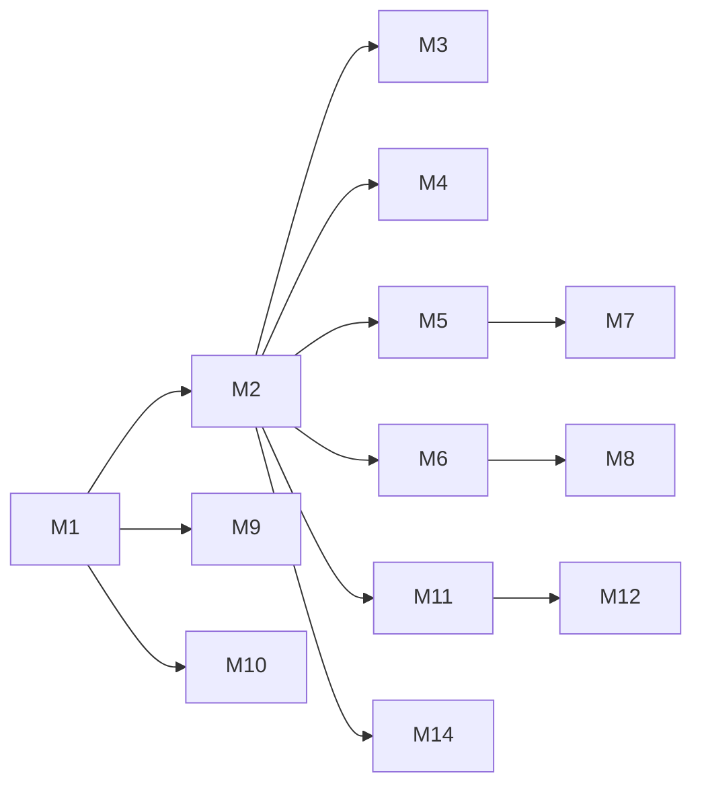

# AumMon — Database Evolution Plan

> Status: **PLAN ONLY.** No migration was written or executed. All future migrations stay append-only in `supabase/migrations/`, run first on local + Dev, and each needs pgTAP tests. Destructive operations need owner approval (CLAUDE.md).

## 1. Existing schema (current effective state after 30 migrations)

| Schema.table                                                                                                         | Purpose                                                                                                                           | Game-agnostic?                           |
| -------------------------------------------------------------------------------------------------------------------- | --------------------------------------------------------------------------------------------------------------------------------- | ---------------------------------------- |
| `public.profiles`                                                                                                    | display name, avatar                                                                                                              | Yes                                      |
| `public.game_rooms`                                                                                                  | owner, join_code_hash, mode (`solo`,`online`), status, max_players 2–8, ruleset_version (`'7'..'13'`, default `'13'`), expires_at | Mostly — lacks `game_id`, `config`       |
| `public.room_players`                                                                                                | seat 1–8, player_type (`human`,`bot`), display_name_snapshot, status                                                              | Yes                                      |
| `public.matches`                                                                                                     | room_id, status, phase (`play`,`reaction`,`finished`), round_number, version, engine_version, ruleset_version                     | Phase CHECK is EDO-specific              |
| `public.match_players`                                                                                               | seat 1–8, player_type, `hand_count`, status (`playing`,`won`,`left`)                                                              | `hand_count`/status values EDO-flavoured |
| `public.match_events`                                                                                                | event_seq, public_payload                                                                                                         | Yes (redaction must be per game)         |
| `public.game_settings`                                                                                               | key/value (sounds)                                                                                                                | Global, no game scope                    |
| `private.match_runtime`                                                                                              | internal_state jsonb, rng_state, deadlines, seat_timeouts, lease                                                                  | Yes (opaque state)                       |
| `private.command_receipts`, `private.rate_limits`, `private.function_metrics` (+views)                               | platform                                                                                                                          | Yes                                      |
| `private.round_stats`                                                                                                | EDO telemetry                                                                                                                     | EDO-specific                             |
| `private.admin_roles`, `private.admin_audit_log`                                                                     | admin                                                                                                                             | Yes                                      |
| Functions: `is_room_member`, `is_match_member`, `private.grant_admin/revoke_admin`, `private.anonymize_deleted_user` |                                                                                                                                   | Yes                                      |
| Realtime: publication on `matches`, `room_players`, `game_rooms`; policy for topic `match:{uuid}`                    |                                                                                                                                   | Yes                                      |

## 2. Reuse decisions

| Table                                                                                         | Decision                                                                                                                                              |
| --------------------------------------------------------------------------------------------- | ----------------------------------------------------------------------------------------------------------------------------------------------------- |
| profiles, room*players, match_events, match_runtime, receipts, rate_limits, metrics, admin*\* | **Reuse as-is**                                                                                                                                       |
| game_rooms, matches                                                                           | **Extend** (`game_id`, `config`, relaxed per-game checks)                                                                                             |
| match_players                                                                                 | **Extend** (`score`, `placement`); keep `hand_count` (nullable meaning "n/a" for non-card-count games is NOT needed: Dummy and Poker both have hands) |
| game_settings                                                                                 | **Extend** with nullable `game_id` (null = platform-wide) — or new table `game_settings_v2`; prefer adding column + new unique index                  |
| round_stats                                                                                   | **Keep as EDO-only** telemetry; add `game_id` column default `'edo_battle'` for admin filtering                                                       |

## 3. Required changes (ordered migrations)

| #   | Migration (proposed name)                             | Change                                                                                                                                                                                                                                                         | Backfill                                                                 | Risk                                                    |
| --- | ----------------------------------------------------- | -------------------------------------------------------------------------------------------------------------------------------------------------------------------------------------------------------------------------------------------------------------- | ------------------------------------------------------------------------ | ------------------------------------------------------- |
| M1  | `games_registry`                                      | `public.games (id text pk, display_name_th, display_name_en, is_enabled bool, min_players, max_players, current_ruleset text, sort_order, created_at)`; seed `edo_battle` (enabled), `dummy`, `poker` (disabled). RLS: authenticated read enabled rows         | seed rows                                                                | Low (additive)                                          |
| M2  | `rooms_matches_game_id`                               | `game_rooms.game_id text not null default 'edo_battle' references games(id)`; same for `matches`; indexes `(game_id, status)`                                                                                                                                  | default fills existing rows (metadata-only in PG ≥ 11)                   | Low                                                     |
| M3  | `per_game_ruleset_check`                              | Replace global `ruleset_version` CHECKs with `(game_id = 'edo_battle' and ruleset_version in ('7'…'13')) or (game_id <> 'edo_battle')` + trigger validating against `games.current_ruleset`/allowed list                                                       | none                                                                     | Medium — dropping+adding CHECK; test with existing rows |
| M4  | `per_game_phase`                                      | `matches.phase` CHECK → EDO values when `game_id='edo_battle'`; other games free text from allow-list per game                                                                                                                                                 | none                                                                     | Medium                                                  |
| M5  | `room_config_mode`                                    | `game_rooms.config jsonb not null default '{}'` (validated server-side by game schema); `mode` CHECK add `'quick_match'`; `room_players.bot_difficulty text`                                                                                                   | none                                                                     | Low                                                     |
| M6  | `match_results`                                       | `public.match_results (match_id pk, game_id, finished_at, summary jsonb public)`, `public.match_player_results (match_id, match_player_id, user_id, placement, score, chip_delta)`; RLS: members read own matches; owner reads own rows                        | backfill from finished EDO matches (winner = status `won`) — optional    | Low                                                     |
| M7  | `matchmaking`                                         | `private.matchmaking_queue (user_id, game_id, config_key, enqueued_at, unique(user_id))`                                                                                                                                                                       | none                                                                     | Low                                                     |
| M8  | `player_game_stats`                                   | `public.player_game_stats (user_id, game_id, played, won, rating, updated_at)`; owner read RLS                                                                                                                                                                 | backfill from M6                                                         | Low                                                     |
| M9  | `game_settings_scope`                                 | `game_settings.game_id text null references games(id)`; unique `(coalesce(game_id,''), key)`                                                                                                                                                                   | existing rows → `null` (platform) or `edo_battle` (sounds stay platform) | Medium (PK change)                                      |
| M10 | `admin_roles_scope`                                   | role CHECK add `game_admin`, `viewer`; `game_id` nullable                                                                                                                                                                                                      | none                                                                     | Low                                                     |
| M11 | `poker_play_money`                                    | `private.chip_wallets (user_id pk, balance bigint check >= 0)`, `private.chip_ledger (id, user_id, match_id null, delta, reason, created_at)` append-only trigger; public read via `public.my_chip_balance()` security-definer RPC or view restricted to owner | none                                                                     | Medium (financial-like integrity)                       |
| M12 | `poker_hand_history`                                  | `private.poker_hands (match_id, hand_no, deck_seed_commit, board, pots jsonb, created_at)` + `public.poker_hand_summaries` (public showdown info only)                                                                                                         | none                                                                     | Low                                                     |
| M13 | `dummy_runtime` (only if JSON state proves too large) | Dummy melds/discard pile can live in `match_runtime.internal_state`; add tables only on measured need                                                                                                                                                          | none                                                                     | —                                                       |
| M14 | `realtime_room_topic`                                 | Add `realtime.messages` policy for topic `room:{uuid}` via `is_room_member`                                                                                                                                                                                    | none                                                                     | Low                                                     |

Seat range: `seat between 1 and 8` stays; widen to 10 only if owner wants 9/10-max poker tables (M-optional).

## 4. Game-specific vs shared storage

- **Shared relational:** rooms, seats, matches, results, stats, queue, settings, admin.
- **Opaque per-game runtime:** `private.match_runtime.internal_state` (engine-owned JSON, versioned by `engine_version`/`ruleset_version`). Never read by RLS or clients.
- **Game-specific relational tables only where queried/audited:** poker chip ledger and hand history (integrity, admin audit). No generic JSON for money-like data.

## 5. Migration dependencies

## 6. Data preservation & backward compatibility

- Every change is additive or a CHECK relaxation; no table/column drops; existing rows get `game_id='edo_battle'` through defaults.
- Existing Edge Functions keep working before code changes because defaults supply `game_id` (functions do not insert it today).
- Code hard-coding `'13'` keeps working while EDO remains the only enabled game; it is generalized in Phase 2 before Dummy rooms can exist.
- Before each migration on Dev: `pg_dump` of public+private (owner Dev project), run on local stack + pgTAP first.
- Rollback = forward-fix migration (append-only), never manual edits.

## 7. Security & RLS

- Every new public table: RLS enabled in the same migration, explicit grants to `authenticated` (select only), `service_role` full; pgTAP access-matrix test (extend `006_access_matrix.test.sql`).
- New private tables: revoke from public/anon/authenticated (same pattern as `20261119000000_core_schema.sql`).
- `games` read policy must hide disabled games from non-admins.
- Realtime: only `match:` and `room:` private topics; no table with hidden data in the publication.
- Chip ledger: append-only trigger (like `private.audit_log_immutable`), balance changes only via security-definer functions called by service role.
