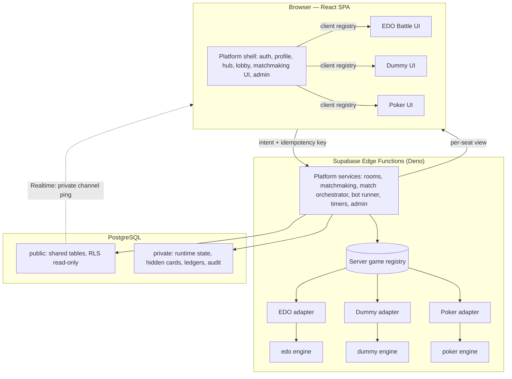
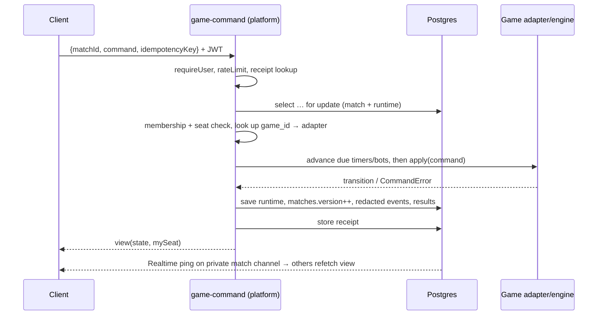
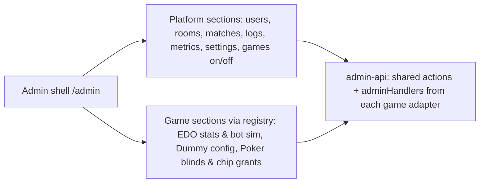

# AumMon — Game Center Master Architecture

> Status: **APPROVED 2026-11-23** — implementation in progress (`docs/roadmap/GAME_CENTER_ROADMAP.md`). Deviation from §11: game modules are folders in `packages/game-engine/src` (see GAME_MIGRATION_PLAN owner decisions). Changing the stack/architecture needs owner approval (CLAUDE.md); this design keeps the approved stack unchanged.
> Inputs: `FULL_TECHNICAL_AUDIT.md`, `REUSABLE_SYSTEM_INVENTORY.md`.

## 1. Vision

**AumMon — Game Center**: one account, one lobby, many independent games. Launch library:

| Game                              | Internal `game_id` | Players                               | Source                                                    |
| --------------------------------- | ------------------ | ------------------------------------- | --------------------------------------------------------- |
| EDO Battle                        | `edo_battle`       | 2–8                                   | Existing Casual Discard Edition (ruleset "13"), unchanged |
| Dummy (Thai Dummy / Rummy family) | `dummy`            | 2–4 (to confirm)                      | New                                                       |
| Texas Hold'em Poker               | `poker`            | 2–8 at launch (9 needs seat widening) | New, play-money only                                      |

Principle: **the platform orchestrates, each game owns its rules and authoritative state.** No universal engine.

## 2. Architectural style — Modular Monolith on the existing stack

- One repo, one SPA, one Supabase project, one set of Edge Functions — no new services, no stack change.
- Isolation is enforced by **package boundaries + lint/architecture tests**, not by deployment.
- Dependency rule (enforced): `games/*` → `game-sdk` only; `platform` → `game-sdk` + registry; **no game imports another game; platform never imports a game's internals** (only its registered module object).



## 3. Module boundaries

| Module                        | Owns                                                                                                                                | Must not                                              |
| ----------------------------- | ----------------------------------------------------------------------------------------------------------------------------------- | ----------------------------------------------------- |
| `game-sdk` (new, pure TS)     | Interfaces: `GameModule`, `SeatView`, `Command`, `Transition`, `RandomSource`, seeded RNG (moved/re-exported from current `rng/`)   | Contain rules                                         |
| `games/<id>/engine` (pure TS) | State, legal moves, scoring, events, redaction, bot policy                                                                          | Use I/O, clock, `Math.random`, React, Supabase        |
| `games/<id>/server` (adapter) | Mapping DB rows ↔ engine, game-specific tables, event redaction, telemetry                                                          | Touch other games' tables                             |
| `games/<id>/ui`               | Table UI, rules text, tutorial, sounds                                                                                              | Call Supabase directly except via platform API client |
| `platform/*` (server)         | Rooms, seats, matchmaking, match lifecycle, locking, idempotency, rate limit, timers, bot scheduling, realtime ping, admin, metrics | Know any game's rules                                 |
| `platform/*` (client)         | Auth, profile, hub, lobby, matchmaking, game shell, admin shell                                                                     | Render game tables                                    |

## 4. Game Module Interface

Two halves: a pure **engine module** (shared by server, bots, simulation tests) and **manifest metadata** (shared by client + server). Sketch (TypeScript, not code to commit yet):

```ts
// game-sdk
export interface GameManifest {
  id: GameId; // 'edo_battle' | 'dummy' | 'poker'
  displayName: { th: string; en: string };
  rulesetVersion: string; // current playable ruleset ('13' for EDO)
  players: { min: number; max: number };
  modes: ReadonlyArray<"solo" | "online_private" | "quick_match">;
  timing: {
    kind: "turn" | "turn_with_reactions" | "timed_betting";
    turnMs: number;
    reactionMs?: number;
  };
  botDifficulties: ReadonlyArray<"easy" | "normal" | "hard">;
  configSchema?: ConfigSchema; // e.g. poker blinds, dummy target score (validated server-side)
}

export interface GameEngine<S, C, V, E> {
  start(seats: SeatSpec[], config: unknown, rng: RandomSource): { state: S; events: E[] };
  actingSeats(state: S): Seat[]; // empty = waiting / finished
  legalCommands?(state: S, seat: Seat): C[]; // for bots/UI hints
  apply(state: S, seat: Seat, cmd: C, rng: RandomSource): Transition<S, E> | CommandError;
  onTimeout(state: S, seat: Seat): C; // default action (fold, auto-draw, …)
  view(state: S, seat: Seat | null): V; // per-seat redaction — sole source of client data
  publicEvent(event: E): PublicEvent | null; // redaction for public.match_events (null = private)
  result(state: S): MatchResult | null; // placements, scores, chip deltas
  bot(state: S, seat: Seat, difficulty: Difficulty, rng: RandomSource): C;
  parseCommand(raw: unknown): C; // strict validation of client intent
}
```

| Concern                          | Owner                                                                     | Mechanism                                                                                             |
| -------------------------------- | ------------------------------------------------------------------------- | ----------------------------------------------------------------------------------------------------- |
| Registration                     | Platform                                                                  | Static registry (`games/index.ts`) + `public.games` row (enabled flag); both must agree               |
| Metadata / player counts / modes | Game manifest                                                             | Platform validates room size and mode against manifest                                                |
| Room creation / joining          | Platform                                                                  | `rooms-create {gameId, maxPlayers, config}`                                                           |
| Match initialization             | Platform calls `engine.start` with crypto-seeded RNG                      |                                                                                                       |
| State management                 | Game                                                                      | `private.match_runtime.internal_state` (opaque JSON per game) + optional game-specific private tables |
| Actions                          | Platform validates auth/seat/idempotency/version; game validates legality | `game-command {matchId, command, idempotencyKey}`                                                     |
| Turn management                  | Game (`actingSeats`) ; Platform enforces deadlines                        |                                                                                                       |
| Bots                             | Platform schedules; game decides (`bot`)                                  |                                                                                                       |
| Completion / results             | Game (`result`); Platform persists to `match_results`                     |                                                                                                       |
| Reconnection                     | Platform (`game-view` + "my active matches")                              |                                                                                                       |
| Errors                           | Game returns typed `CommandError`; platform maps to HTTP 409 with code    |                                                                                                       |

**EDO Battle compatibility:** the existing `discard` functions map 1:1 — `startGame`→`start`, `applyCommand`→`apply`, `actingSeat`→`actingSeats`, `getView`→`view`, `chooseBotCommand`→`bot`, timeout logic in `game-flow.ts` `timeoutCommands`→`onTimeout`. The adapter **wraps** them; the engine files are not edited.

## 5. Data flow (command)



## 6. Backend architecture

- Keep generic functions `game-create`, `game-start`, `game-view`, `game-command`, `game-leave`, `game-rematch`, `rooms-*`; add `gameId` to create calls. **The adapter is always chosen from `matches.game_id` in the DB, never from client input** for existing matches.
- New functions: `matchmaking-join`, `matchmaking-cancel`, `games-list`, `match-tick` (service-only sweeper, see §8), later `wallet-*` (poker play-money read-only for clients).
- `_shared/` split: `_shared/platform/*` (current generic helpers stay where they are; new orchestrator extracted from `game.ts`) and `_shared/games/<id>/adapter.ts`.
- Engine sync: `scripts/sync-engine.mjs` extended to copy `packages/game-sdk` + every `packages/games/*/src`.

## 7. Bot architecture

| Layer                                                                                     | Shared / specific                                                                                                                                                         |
| ----------------------------------------------------------------------------------------- | ------------------------------------------------------------------------------------------------------------------------------------------------------------------------- |
| Bot seats (`player_type='bot'`), naming, replacement of leavers                           | Shared (exists)                                                                                                                                                           |
| Bot scheduling: step bots one action per `BOT_STEP_MS` while `actingSeats` are bots       | Shared (generalize `advanceGame`)                                                                                                                                         |
| Difficulty + config (`room_players.bot_difficulty`, per-game defaults in `game_settings`) | Shared storage, game-interpreted                                                                                                                                          |
| Decision policy `engine.bot(state, seat, difficulty, rng)`                                | Game-specific, pure, sees full state but **must only use the seat's legal information** (enforced by giving bots `view(state, seat)` where feasible — required for Poker) |
| Background progress (§8)                                                                  | Shared                                                                                                                                                                    |

Poker/Dummy bots receive the **seat view**, not full state, to make cheating structurally impossible.

## 8. Multiplayer architecture

| Need              | EDO today                             | Platform design                                                                                                                                      |
| ----------------- | ------------------------------------- | ---------------------------------------------------------------------------------------------------------------------------------------------------- |
| Player counts     | 2–8                                   | Manifest min/max; DB seat CHECK widened only if a game needs >8                                                                                      |
| Turn system       | single acting seat + reactions        | `actingSeats[]` supports simultaneous actors                                                                                                         |
| Timers            | lazy deadline on request              | Keep lazy evaluation **plus** a `match-tick` sweeper (pg_cron → Edge Function, free tier — verify) for matches with overdue deadlines and no viewers |
| Real-time actions | none                                  | Not needed for card games; all actions are discrete commands                                                                                         |
| Reconnection      | reload by URL; 2 timeouts → auto-play | Add `my-active-matches` endpoint + hub banner across games                                                                                           |
| Termination       | winner / all leave / admin abandon    | Game `result()` or platform abandon (inactivity TTL, admin)                                                                                          |
| Realtime          | private `match:{id}` ping + refetch   | Same, reused for all games; lobby moves to private `room:{id}`                                                                                       |

**Matchmaking (Quick Match = auto-pair):** `private.matchmaking_queue (user_id, game_id, config_key, enqueued_at)`; a matcher (inside `matchmaking-join` with `for update skip locked`) forms a room when `min` players are queued or fills with bots after a wait limit (owner decision). Naming note: EDO's existing "Quick Match" ruleset label must be renamed in UI copy to avoid confusion (UI text only, not identifiers).

**Private rooms:** current join-code rooms, plus `game_id` and `config`.

## 9. Security architecture

- Unchanged principles: JWT check in every handler (`verify_jwt=false` stays, add an architecture test asserting each function calls `requireUser` or is on an allow-list), clients read only via RLS, writes only via service role, private schema never exposed.
- Hidden info: per-game `view` + `publicEvent` redaction are mandatory interface members; contract tests run every game's random simulations and assert no other seat's hidden card ID appears in any view or public event.
- Poker: deck order/hole cards only in `private`; showdown reveal only through `view` after the hand ends; chip balance changes only via server ledger.
- Play-money only: no purchase, deposit, withdrawal, cash-out, or chip transfer between users (prevents real-value markets). Legal check before any monetisation (consistent with DC7).
- Admin: add roles `game_admin` (scoped by `game_id`) and `viewer`; MFA aal2 for all.

## 10. Admin architecture



Existing actions are kept verbatim; new ones are added with `game_id` filters. Game-specific admin actions are namespaced `edo_battle.*`, `poker.*`, etc.

## 11. Proposed directory structure (target, incremental — no moves in Phase 0)

```text
packages/
  game-engine/            # EXISTING — stays as EDO engine package (name kept for compatibility)
  game-sdk/               # NEW: interfaces + seeded RNG re-export
  games/dummy/            # NEW engine package
  games/poker/            # NEW engine package
src/
  app/                    # router, layout (exists)
  platform/               # NEW home for hub, game registry (client), matchmaking; existing features/auth, profile, admin, online migrate here gradually
  games/edo-battle/       # later: re-export of features/game + tutorial (move only when safe)
  games/dummy/ games/poker/
  components/ lib/ styles/  # shared (exists)
supabase/functions/
  _shared/                # existing helpers (generic) stay
  _shared/platform/       # NEW orchestrator, registry, bot runner
  _shared/games/{edo_battle,dummy,poker}/adapter.ts
docs/architecture/ docs/roadmap/ docs/games/<id>/
```

Rationale for keeping `packages/game-engine` as the EDO package: renaming touches imports, sync script, tsconfig, ESLint and architecture tests for zero user value; a rename can happen last, if ever.

## 12. Scalability

- Per-match row lock serializes commands per match only — scales horizontally across matches.
- Supabase free/Pro limits: Realtime concurrent connections and Edge Function invocations are the first ceilings; ping-then-refetch doubles invocations — consider sending the per-seat version number in the ping and skipping refetch when unchanged.
- Batch seat updates in `saveGame` (one statement) before adding games.
- Partition/prune `match_events` and `function_metrics` by time when volume grows.
- Poker hands are short; store per-hand history in compact rows, not one ever-growing JSON.
