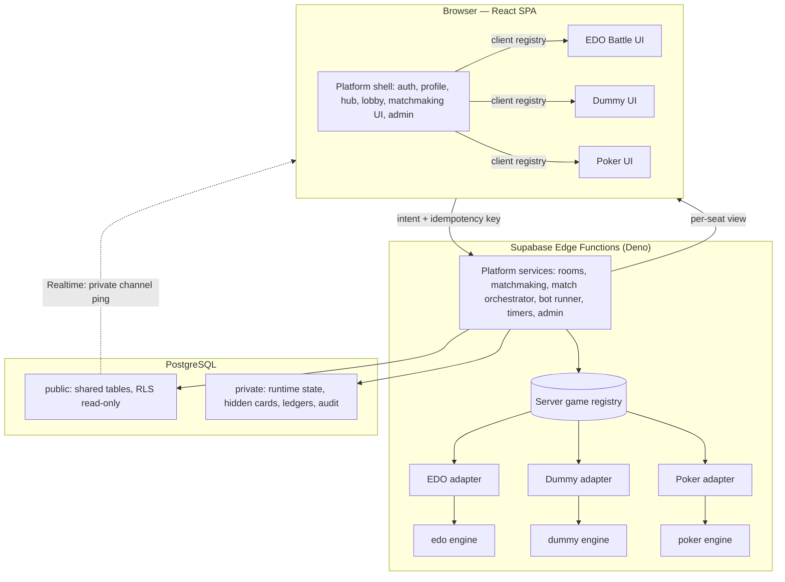
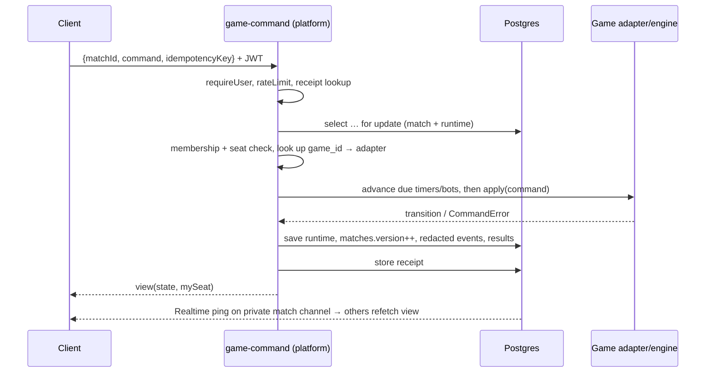
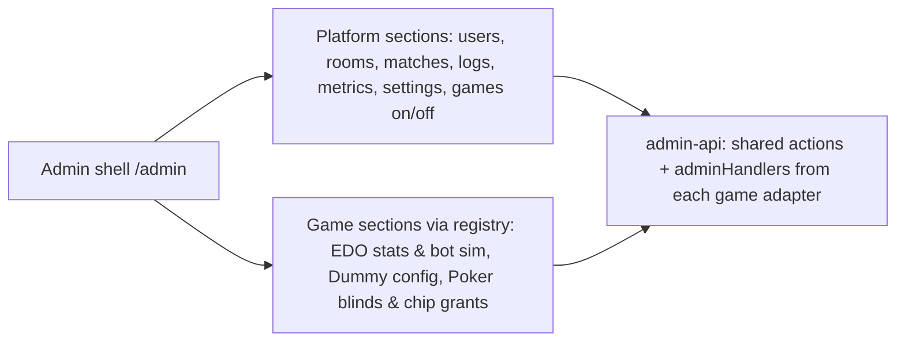

# AumMon — Platform Spec (shared functions)

> Single source for everything the games share: brand, product, identity, rooms, SDK, content, UI theme, architecture, security, admin, operations, tests, post-MVP progression. Game rules live in `docs/games/<game>/SPEC.md`. Read only the section you need (token-efficiency.md).

## 1. Brand architecture

> Source: owner message 2026-11-27. AumMon is the master brand and multi-game party platform, not a single game.

### 1. Brand structure

| Level           | Name                                                           |
| --------------- | -------------------------------------------------------------- |
| Master brand    | AumMon                                                         |
| Platform        | AumMon Party Game Platform                                     |
| Game collection | AumMon Games                                                   |
| Categories      | Social Party Games · Card Games · future categories            |
| Games           | AumMon BLUFF · AumMon Object Battle Card · future game modules |

### 2. Platform principle (maps to the current architecture)

- All games share platform services: guest / account identity, rooms + join codes, server-authoritative match orchestrator (SDK, timers, bots), content management, admin, telemetry.
- Each game keeps its own rules, engine module (`packages/game-engine/src/<game>`), ruleset version and content.
- A new game = new engine module + registry row (`public.games`) + client entry (`src/platform/games.ts`) + UI; no brand or platform redesign (Game Center registry, 14.x / 15.x).

### 3. Intellectual property (owner actions, outside the codebase)

- Trademark protection for **AumMon** first; evaluate the logo; evaluate each game name separately.
- Keep ownership / licensing records for source code, game content (e.g. BLUFF Thai pack v1 drafted by Claude, approved by the owner), artwork and other creative assets.

### 4. Open questions (owner)

| ID     | Question                                                                             | Proposed default                                                               |
| ------ | ------------------------------------------------------------------------------------ | ------------------------------------------------------------------------------ |
| BR1 ✅ | Is "AumMon Object Battle Card" the new public name of EDO Battle (deferred, hidden)? | yes — rename display text only when it returns; internal id `edo_battle` stays |
| BR2 ✅ | Show "AumMon BLUFF" (not just "BLUFF") in the app header and share text?             | yes                                                                            |

## 2. Product vision

> Approved by the owner 2026-11-25 (decisions V1–V10, audit `docs/platform/PLATFORM_SPEC.md`).

**AumMon** is a guest-first, browser-based social party gaming platform for 2–8 players, where friends can instantly join, bluff, guess, vote, troll each other, and compete in short, memorable matches. It offers Casual play for social fun and Ranked competition for long-term progression, without forcing registration before players are ready.

**Category:** Text-Driven Social Party Gaming Platform
**Tagline:** _Say Less. Bluff More. Troll Your Friends._

### Promise to players

| Pillar       | Meaning                                                                        |
| ------------ | ------------------------------------------------------------------------------ |
| Instant      | Open a link → nickname → playing in under 30 seconds; no sign-up.              |
| With friends | Private rooms with a code or link; 2–8 players; every player acts every round. |
| Short        | 5–10 minute matches (~5 rounds).                                               |
| Funny        | Teasing narration, taunts, reveals; shareable result cards.                    |
| Light        | Text first, small bundle, works on a phone browser and desktop.                |
| Fair         | Server decides every result; nothing paid changes who wins.                    |

### Non-goals

- No real-money betting or prizes; "wager" uses in-match points only.
- No pay-to-win, no rank advantage for sale.
- No heavy graphics, downloads or app-store dependency for the MVP.
- No content that targets real private individuals or exposes personal data.

## 3. Product strategy

> Status: approved direction (V1–V10); proposals P1–P6 approved with defaults (owner 2026-11-25).

### 1. Audience and use cases

- Friend groups (Thai first, 15–35) in a chat or a call who want a quick game "right now".
- Party / classroom / office ice-breakers on one shared link.
- Duo play (2 players) when the group is small.

### 2. Growth loop

Room link shared in chat → friends join as guests → funny reveal → **result card shared** → new players open the link. Accounts are offered at the moment of value (keep XP, start Ranked), never before the first match.

### 3. Product phases

| Stage       | Goal                                | Scope                                                                    |
| ----------- | ----------------------------------- | ------------------------------------------------------------------------ |
| MVP         | Prove BLUFF is fun with real groups | Guest, Casual private rooms, BLUFF 2–8, content set, share, admin review |
| Retention   | Make people come back               | XP / levels, missions, achievements, match history                       |
| Competition | Long-term skill play                | Ranked, seasons, leaderboard                                             |
| Revenue     | Sustainable costs                   | Cosmetics, VIP host, supporter membership (after legal check)            |

### 4. Success metrics (playtest → launch)

| Metric                              | MVP target |
| ----------------------------------- | ---------- |
| Time from link to first round       | ≤ 30 s     |
| Matches finished / started          | ≥ 85 %     |
| Rematch rate (same room)            | ≥ 40 %     |
| Result shares per finished match    | ≥ 10 %     |
| Owner + playtester fun score (1–10) | ≥ 8        |

### 5. Existing games

Dummy and Poker retired (V9). EDO Battle deferred: kept in code, reachable while BLUFF is built, hidden from the new home when it ships (Q1 default). Art production paused (Q8).

## 4. Product requirements (MVP R1–R8)

> Scope: MVP only (audit §6). Every requirement has acceptance criteria (AC). Post-MVP items are listed at the end and are not built yet.

### R1 Guest session (P1, Q2)

- Supabase Anonymous Sign-in creates a guest user; the client keeps the session; nickname 2–24 chars.
- AC: a new visitor reaches a room lobby without e-mail; refresh keeps the same identity; guest creation is rate limited per IP; expired guests (no activity 30 days) are cleaned up; guests cannot call admin or Ranked endpoints.

### R2 Private Casual room

- Create room (host), share code / link, join, ready, start; 2–8 seats per game's min / max; host settings and fun modifiers shown to everyone before start.
- AC: join by link works for guests and accounts; a full or started room refuses joins; host leaving passes host to the next player; no result affects any rating.

### R3 BLUFF match

- ~5 rounds; each round: situation → private choice → optional wager → simultaneous reveal → server score → narration → scoreboard. Variants for 2, 3–4 and 5–8 players (design in `docs/games/bluff/SPEC.md`, Phase 3).
- AC: choices stay hidden until every player chose or the round timer ends; timeout = defined default choice; the client never sends scores; disconnect keeps the seat for the reconnect window then auto-plays; ties resolved by a documented rule; a match never waits on one player without a timer.

### R4 Results and share

- Final scoreboard, round highlights, funny title per player; share as image / text with room-free link.
- AC: share content contains nicknames and scores only (no ids, no hidden data); works on iOS Safari and Android Chrome.

### R5 Content

- Content items in the database with id, category, locale, text, tags, player range, modes, humor level, status, review status, version (`docs/games/bluff/SPEC.md`, Phase 9).
- AC: only `approved` items reach matches; admin can add / edit / retire items without an engine release; ~150 Thai items reviewed by the owner before playtest (Q6).

### R6 Optional account and linking (Q4)

- Guest can add e-mail + password; the user id stays the same, so all guest data stays.
- AC: linking an e-mail already owned by another account does not merge — the player is offered to sign in to that account; no XP / history / inventory is lost or duplicated.

### R7 UI

- Minimal dark + playful type, mobile first, large touch targets; Home, Create, Join, Lobby, Gameplay, Results, Profile (guest / registered), Admin content.
- AC: WCAG 2.1 AA (axe), works at 360 px width, round number / timer / players' status / score always visible during play.

### R8 Platform rules kept

- Server-authoritative, RLS on every exposed table, private schema not exposed, idempotent commands, rate limits, append-only migrations, `pnpm check` + CI gate.

### Post-MVP (not built)

Ranked + seasons + matchmaking rating, XP / levels / missions / achievements, collection, shop, VIP host, payments, leaderboard, English locale, bots in BLUFF (Q7 = no bots in MVP).

## 5. Owner decisions log (v2 audit)

> Status: **for owner review**. Written 2026-11-25 from the repository at `main` `1fe947c`. Nothing has been implemented, migrated, deleted or moved.
> Product Direction v2: "Guest-First, Text-Driven Social Party Gaming Platform" — tagline _"Say Less. Bluff More. Troll Your Friends."_ — flagship game **BLUFF**, 2–8 players.

### 1. Decisions

#### 1.1 Approved by the owner (2026-11-25)

| ID  | Decision                                                                                                                 |
| --- | ------------------------------------------------------------------------------------------------------------------------ |
| V1  | Product identity, category and tagline as in the v2 brief §1.1.                                                          |
| V2  | 2–8 players per room; every game module declares its own min / max; 2, 3–4 and 5–8 players are designed separately.      |
| V3  | Guest-first: nickname → create / join → play → results → share, with no sign-up. Accounts are optional (permanent data). |
| V4  | Two modes: **Casual** (private rooms, custom rules, no rating) and **Ranked** (standard rules, matchmaking, seasons).    |
| V5  | Flagship game **BLUFF**, ~5 rounds, 5–10 min; server-authoritative scoring; no real-money wagering.                      |
| V6  | XP / Level separate from Rank; no gameplay power from XP, level or purchases.                                            |
| V7  | Free-to-play + cosmetics + convenience; no pay-to-win; guests may join VIP rooms free.                                   |
| V8  | Keep the current stack (Supabase, Vercel, GitHub workflow, server authority, module architecture).                       |
| V9  | **Dummy and Poker are removed** ("เอาเกมดัมมี่และโป๊กเกอร์เดิมออกไปเลย") — executed only after this audit is approved.         |
| V10 | The site's game spec becomes the v2 product (spec rewritten in Phase 2).                                                 |

#### 1.2 Proposed (need approval)

| ID  | Proposal                                                                                                                                                                                                     |
| --- | ------------------------------------------------------------------------------------------------------------------------------------------------------------------------------------------------------------ |
| P1  | Guests = **Supabase Anonymous Sign-ins** (real `auth.users` row, JWT, `is_anonymous`). Linking = `linkIdentity` / `updateUser({email})` keeps the **same user id**, so XP, history and inventory never move. |
| P2  | EDO Battle: **defer** (hidden from the home page, code and data kept) until BLUFF MVP ships; then decide keep / retire.                                                                                      |
| P3  | Ranked is **account-only**; guests play Casual and "Ranked practice" (no stored rating). The link prompt appears when a guest opens Ranked or ends a match with XP.                                          |
| P4  | MVP = BLUFF + guest + Casual private rooms + results share + content table + admin content review. Ranked, XP, shop, payments = post-MVP.                                                                    |
| P5  | UI v2 = Minimal Dark + playful type as a new token theme in the existing `am-*` system (`docs/platform/PLATFORM_SPEC.md`), not a new CSS stack.                                                              |
| P6  | Tagline stays English; UI and content Thai-first with `locale` on every content item (English later).                                                                                                        |

### 2. Repository audit (what exists today)

| Area            | Current state                                                                                                                                        | Evidence                                                           |
| --------------- | ---------------------------------------------------------------------------------------------------------------------------------------------------- | ------------------------------------------------------------------ |
| Stack           | pnpm, React 19 + Vite + TS strict, Tailwind v4 `am-*` tokens, Supabase (Auth, Postgres, Edge Functions, Realtime), Vercel, Vitest, Playwright, pgTAP | `docs/platform/PLATFORM_SPEC.md` §1                                |
| Games           | EDO Battle (ruleset 13), Dummy (ruleset 5), Poker (ruleset 1) behind one Game Module Interface                                                       | `packages/game-engine/src/{edo-battle,dummy,poker}`, `registry.ts` |
| Module SDK      | `GameModule`: start / apply / view / bot / timeouts / publicEvent / privateEvents / result; **one acting seat at a time**                            | `packages/game-engine/src/sdk/module.ts`                           |
| Server          | 14 Edge Functions; generic orchestrator (bots, timers, AFK auto-play, idempotency, row locks, rematch); rooms, join codes, quick match               | `supabase/functions/_shared/game.ts`, `lobby.ts`, `matchmaking.ts` |
| Identity        | Email + password accounts only; `enable_anonymous_sign_ins = false`; RLS keyed on `auth.uid()`                                                       | `supabase/config.toml`, migrations                                 |
| Data            | 36 append-only migrations; `public.games` registry, `player_game_stats`, private runtime / receipts / rate limits / audit log                        | `supabase/migrations/`                                             |
| Admin           | RBAC + MFA aal2 + audit log; game enable / disable; playtest stats                                                                                   | `docs/platform/PLATFORM_SPEC.md`                                   |
| Quality gates   | `pnpm check`, CI (unit, pgTAP, backend, E2E, a11y), secret guard, engine isolation test                                                              | `.github/workflows/ci.yml`                                         |
| Content         | Card text hard-coded in engine / UI; **no content tables**                                                                                           | `packages/game-engine/src/discard/cards.ts`                        |
| Progression     | Per-game win / loss stats only; **no XP, rank, season, inventory**                                                                                   | `player_game_stats`                                                |
| Payments        | None (VIP / gacha designed only, blocked on legal check, 12.7)                                                                                       | `docs/games/object-battle/SPEC.md`                                 |
| Known test debt | `tests/backend/game.test.ts` "solo with 3 bots" fails when a bot moves first and makes seat 0 draw                                                   | changelog 2026-11-23                                               |

### 3. Impact analysis

#### 3.1 Reuse as-is

- Stack, CI, secret guard, migration discipline, Dev project, Vercel previews, playtest branch.
- Server-authoritative orchestrator: idempotency keys, row-locked commands, timers, AFK auto-play, rematch, reconnection through `game-view` polling + Realtime channel.
- Rooms, join codes, ready flow, rate limits, quick-match queue (basis for Ranked matchmaking).
- Admin RBAC, MFA, audit log, game registry (`public.games`), enable / disable per game.
- Settings popup, back button, sound / music, accessibility checks.

#### 3.2 Must change

| Item                | Change                                                                                                                                                                        | Size |
| ------------------- | ----------------------------------------------------------------------------------------------------------------------------------------------------------------------------- | ---- |
| Module SDK          | Add **simultaneous decisions**: `pendingSeats(state)` (many seats act in one phase), one phase deadline, per-seat hidden choice, reveal step. EDO keeps the single-seat path. | M    |
| Identity            | Enable anonymous sign-ins; nickname on `profiles` for guests; CAPTCHA / rate limit on guest creation; guest expiry + cleanup job; RLS reviewed for anonymous users.           | M    |
| Account linking     | Link email to the anonymous user (same id). Conflict: email already owned → sign in to that account; guest data is **not merged** in MVP (shown as a choice, see Open Q4).    | M    |
| Content             | New `content_items` (id, category, locale, text, tags, min/max players, modes, humor level, status, review status, version) + admin review UI; engine receives content by id. | M    |
| Home / UX           | New home (nickname → create / join), dark theme, mobile-first party flow; remove Dummy / Poker cards.                                                                         | M    |
| Results share       | Share card (image or text + link) generated client-side from server results; no private data.                                                                                 | S    |
| Spec + docs         | Rewrite `docs/platform/PLATFORM_SPEC.md`, blueprint, handoff, roadmap for v2.                                                                                                 | S    |
| Ranked, XP, economy | New services and tables (post-MVP).                                                                                                                                           | L    |

#### 3.3 Retire (V9) — plan only, after approval

Remove from code: `packages/game-engine/src/{dummy,poker}`, `src/games/{dummy,poker}`, rules popup entries, tests, registry entries, smoke checks. Database: a forward migration sets `games.is_enabled = false` and ends active Dummy / Poker rooms and matches; **rows stay as history** (no destructive delete). Docs move to (git history).

### 4. Existing game modules — compatibility

| Game       | Verdict                                      | Reason                                                                                                       |
| ---------- | -------------------------------------------- | ------------------------------------------------------------------------------------------------------------ |
| Dummy      | **Retire** (owner V9)                        | Classic card game, not text-driven party play; 2–4 players only.                                             |
| Poker      | **Retire** (owner V9)                        | Play-money poker still carries legal / store risk; overlaps with "wager" mechanics BLUFF covers more safely. |
| EDO Battle | **Defer** (P2) — needs UX redesign to fit v2 | Works with the platform today; art not produced; not text-driven. Keep code, hide from home until decided.   |

### 5. Documents (proposed)

New folder (git history). "Update" = existing file rewritten, no duplicate.

| #   | Document                                | Action                                                          | Phase |
| --- | --------------------------------------- | --------------------------------------------------------------- | ----- |
| 1   | AumMon_Product_Vision.md                | new                                                             | 2     |
| 2   | AumMon_Product_Strategy.md              | new                                                             | 2     |
| 3   | docs/platform/PLATFORM_SPEC.md          | new (+ `docs/platform/PLATFORM_SPEC.md` rewritten as index)     | 2     |
| 4   | AumMon_Game_Design_Principles.md        | new                                                             | 3     |
| 5   | docs/games/bluff/SPEC.md                | new                                                             | 3     |
| 6   | docs/games/bluff/SPEC.md                | new                                                             | 4     |
| 7   | docs/platform/PLATFORM_SPEC.md          | new                                                             | 6     |
| 8   | docs/platform/PLATFORM_SPEC.md          | new                                                             | 6     |
| 9   | docs/platform/PLATFORM_SPEC.md          | new                                                             | 7     |
| 10  | docs/platform/PLATFORM_SPEC.md          | new                                                             | 8     |
| 11  | docs/platform/PLATFORM_SPEC.md          | new                                                             | 8     |
| 12  | docs/platform/PLATFORM_SPEC.md          | update from `docs/games/object-battle/SPEC.md`                  | 8     |
| 13  | docs/platform/PLATFORM_SPEC.md          | new (cost model)                                                | 8     |
| 14  | docs/platform/PLATFORM_SPEC.md          | update from `docs/platform/PLATFORM_SPEC.md` (dark theme added) | 5     |
| 15  | docs/games/bluff/SPEC.md                | new                                                             | 9     |
| 16  | AumMon_Technical_Architecture_Impact.md | update `docs/platform/PLATFORM_SPEC.md` (v2 section)            | 10    |
| 17  | AumMon_Game_Module_Compatibility.md     | from §4 of this audit                                           | 2     |
| 18  | docs/platform/PLATFORM_SPEC.md          | update blueprint §6 + brief §12 cases                           | 10    |
| 19  | AumMon_Migration_Roadmap.md             | update `docs/platform/ROADMAP.md` (new Phase 15+)               | 2     |
| 20  | AumMon_Master_Project_Handoff.md        | update `docs/platform/PLATFORM_SPEC.md`                         | 2     |

### 6. MVP scope (proposal P4)

**MVP (Closed Playtest):** guest nickname + anonymous session + reconnect · Casual private room (2–8, join code / link) · BLUFF with 2, 3–4 and 5–8 variants, 5 rounds, server scoring, timers, AFK / disconnect rules · ~150 reviewed Thai content items · results screen + share · optional email link (same id) · admin content review · dark mobile UI · Dummy / Poker retired, EDO hidden.

**Post-MVP:** Ranked (rating, placement, tiers, seasons, anti-boost), XP / levels / missions / achievements, collection, shop, VIP host, payments, leaderboard, English locale, more games.

### 7. Roadmap and dependencies

| Phase | Name                         | Depends on | Output / gate                                                    |
| ----- | ---------------------------- | ---------- | ---------------------------------------------------------------- |
| 1     | Repository Audit             | —          | this document → **owner approval**                               |
| 2     | Product Direction & Reqs     | 1          | docs 1–3, 17, 19, 20; spec rewritten; Dummy / Poker retired      |
| 3     | BLUFF Game Design            | 2          | docs 4–5; scoring model + simulation → **owner approval**        |
| 4     | 2–8 Player Balance           | 3          | doc 6; engine simulation per player count                        |
| 5     | UI/UX Prototype              | 3          | doc 14; clickable prototype on Vercel preview → **owner review** |
| 6     | Guest-First Architecture     | 2          | docs 7–8; anonymous auth + RLS design → **owner approval**       |
| 7     | Casual & Ranked Architecture | 6          | doc 9; SDK simultaneous-decision design                          |
| 8     | XP & Rank Design             | 7          | docs 10–13 (design only, built post-MVP)                         |
| 9     | Content Management           | 3          | doc 15; content schema + review flow                             |
| 10    | Technical Migration Plan     | 4–9        | docs 16, 18; migration list → **owner approval**                 |
| 11    | MVP Implementation           | 10         | engine, functions, migrations, UI; CI green; Dev deploy          |
| 12    | Closed Playtest              | 11         | real phones, 2 / 4 / 8 players; telemetry                        |
| 13    | Balance & UX Iteration       | 12         | ruleset bumps as needed                                          |
| 14    | Launch Preparation           | 13         | production project (6.8), legal, payments decision (7.8)         |

Phases 3, 5, 6 and 9 can run in parallel after Phase 2.

### 8. Cost assumptions (to verify before Phase 8 — public prices change)

| Item     | Dev / playtest         | Small launch (assumption: ≤ 5k MAU, ≤ 200 concurrent)      |
| -------- | ---------------------- | ---------------------------------------------------------- |
| Supabase | Free (current)         | Pro ≈ US$25 / month + usage                                |
| Vercel   | Hobby (non-commercial) | Pro ≈ US$20 / member / month (required for commercial use) |
| Realtime | Free tier limits       | included in Supabase Pro quota                             |
| Payments | —                      | provider fee ≈ 3–4 % + fixed per transaction               |

### 9. Open questions (owner)

| #   | Question                                                                                        | Default if not answered                                      |
| --- | ----------------------------------------------------------------------------------------------- | ------------------------------------------------------------ |
| Q1  | EDO Battle: defer (hidden, kept) or retire too?                                                 | defer (P2)                                                   |
| Q2  | Guests via Supabase Anonymous Sign-ins (P1)?                                                    | yes                                                          |
| Q3  | Ranked account-only (P3)?                                                                       | yes                                                          |
| Q4  | Email already has an account when a guest links: keep guest data separate (MVP) or merge later? | separate, sign in to the account                             |
| Q5  | Content language at launch: Thai only?                                                          | Thai only                                                    |
| Q6  | Who writes the first ~150 BLUFF scenarios: Claude drafts, owner reviews?                        | yes                                                          |
| Q7  | Bots in BLUFF (to fill 2-player or small rooms)?                                                | ~~no bots~~ → owner 2026-11-25: medium bots fill empty seats |
| Q8  | Art pipeline (Phase 13 of the old roadmap) paused since v2 is text-driven?                      | pause                                                        |

### 10. Assumptions

- "Remove Dummy / Poker" means remove from product and code, keeping database rows as history.
- BLUFF content can be humorous but must never target real private individuals; group-directed prompts ("ใครในห้องนี้…") are moderated by humor level and tags.
- Existing registered accounts stay valid and become "Registered" players in v2.
- No production deploy or paid service is enabled without separate owner approval.

## 6. Game module compatibility

| Game       | Verdict               | Status (2026-11-25)                                                                                                              |
| ---------- | --------------------- | -------------------------------------------------------------------------------------------------------------------------------- |
| Dummy      | Retired (owner V9)    | Code removed (engine, UI, tests). `public.games` row disabled; rooms / matches kept as history. Rules archived in (git history). |
| Poker      | Retired (owner V9)    | Same as Dummy; rules in (git history).                                                                                           |
| EDO Battle | Deferred (Q1 default) | Playable on Dev; hidden from the new home when the v2 home ships; keep / retire decided after BLUFF MVP.                         |
| BLUFF      | New flagship          | Design Phase 3; needs the SDK simultaneous-decision extension (audit §3.2).                                                      |

Admin: retired games can be filtered in history and switched off, never switched back on (no module).

## 7. Guest-first identity

> **APPROVED by owner 2026-11-25** (G1–G3 / L1–L2 = proposed defaults). Covers R1 (guest session) and the guest side of R2–R4. Account linking: `docs/platform/PLATFORM_SPEC.md`. Decisions P1 / Q2 (Supabase Anonymous Sign-ins), Q3 (Ranked account-only), Q7 (no bots in Casual rooms). Built in Phase 11; migrations listed in 15.10.

### 1. Identity model

| Kind    | How created                                                                | `auth.users.is_anonymous` | JWT claim `is_anonymous` |
| ------- | -------------------------------------------------------------------------- | ------------------------- | ------------------------ |
| Guest   | `supabase.auth.signInAnonymously({ options: { data: { display_name } } })` | `true`                    | `true`                   |
| Account | e-mail + password sign-up, or a guest that linked an e-mail                | `false`                   | `false`                  |

- Both use the Postgres role `authenticated` and a real `auth.uid()`, so every existing RLS policy keyed on `auth.uid()` keeps working for guests — no parallel "guest tables".
- `private.handle_new_user()` already creates `public.profiles` from `display_name` metadata (2–24 chars, fallback `Player-xxxxxx`) — reused unchanged.
- Session: supabase-js keeps the refresh token in `localStorage`; reload / reconnect keeps the same id. Clearing browser data = a new guest (UI warns: "ลิงก์อีเมลเพื่อเก็บโปรไฟล์ไว้").

### 2. Config changes (`supabase/config.toml` + Dev / prod dashboards)

- `enable_anonymous_sign_ins = true`.
- `[auth.rate_limit] anonymous_users = 30` per hour per IP (already set; keep).
- CAPTCHA (Cloudflare Turnstile, free) on anonymous sign-in **before public launch** (G1); closed playtest relies on the rate limit.

### 3. Authorization

- SQL helper `public.is_guest()` = `coalesce((auth.jwt() ->> 'is_anonymous')::boolean, false)` (stable; in `public` because RLS policies run as `authenticated`, which has no usage on `private`; it reads only the caller's own claim).
- **Account-only** tables (future Ranked ratings, purchases, inventory, leaderboard entries) add a **restrictive** policy `using (not public.is_guest())` on top of the owner policy, so a missing check fails closed.
- Edge Functions: `requireUser()` returns `{ id, isGuest }` (from the verified JWT via `auth.getUser`, never from the request body). New `requireAccount()` rejects guests with `403 account_required` — used by Ranked, purchases and admin.
- Admin already needs an admin role + MFA `aal2`; guests can hold neither. `requireAdmin()` also rejects `isGuest` explicitly (defence in depth).
- Realtime room / match channels: authorized by seat membership (unchanged), so guests and accounts are treated the same.

| Feature                                              | Guest |  Account   |
| ---------------------------------------------------- | :---: | :--------: |
| Nickname, create / join Casual room, play, rematch   |  ✅   |     ✅     |
| Results + share, per-game Casual stats               |  ✅   |     ✅     |
| Report content                                       |  ✅   |     ✅     |
| Ranked, leaderboard, XP / rank, purchases (post-MVP) |  ❌   |     ✅     |
| Admin / content review                               |  ❌   | role + MFA |

### 4. Nickname

- `profiles.display_name`, editable any time (server command `profile-update`, 2–24 chars, trimmed, no control / zero-width characters, small Thai + English blocklist; not unique).
- Rooms store a nickname **snapshot** per seat at join, so a later rename cannot change match history or a live room.

### 5. Abuse and limits

- Guest creation: rate limit per IP (§2) + Turnstile at launch.
- Existing per-user command rate limits (`_shared/ratelimit.ts`) apply to guests unchanged; room create stricter for guests: 10 / hour.
- Join codes stay unguessable (existing) — guests cannot list rooms.

### 6. Guest lifetime and cleanup

- "Active" = `auth.users.last_sign_in_at` or last token refresh / command within 30 days (R1).
- Daily job (pg_cron → `private.cleanup_guests()`, security definer): delete `auth.users` where `is_anonymous` and inactive > 30 days and not seated in an active room / match. `profiles` cascade.
- Finished matches keep their rows: seat user ids become `null`, the nickname snapshot stays (keeps results and stats of other players intact). Exact FK changes → 15.10.
- Volume watch: every guest counts as a Supabase monthly active user (free plan quota) — admin dashboard shows guests created per day.

### 7. Privacy

- Guests give no PII. IP addresses are used only by the rate limiter (not stored with the user).
- `account-delete` works for guests too (deletes the guest immediately).

### 8. Tests (Phase 11)

- pgTAP: guest can read / write own rows only; guest blocked by restrictive account-only policy; anon role (no session) blocked; `cleanup_guests` deletes only inactive guests not in active rooms.
- Backend: anonymous sign-in → create room → second guest joins by code → match plays to results; guest gets `403 account_required` on an account-only function; rate limit returns 429.
- E2E: first visit → nickname → lobby without e-mail; reload keeps identity.

### 9. Open questions (owner)

| ID    | Question                                                                          | Proposed default |
| ----- | --------------------------------------------------------------------------------- | ---------------- |
| G1 ✅ | CAPTCHA (Turnstile, free) only before public launch, not for the closed playtest? | yes              |
| G2 ✅ | Guest expiry 30 days of inactivity (R1), finished match rows kept with nickname?  | yes              |
| G3 ✅ | Guest room-create limit 10 / hour?                                                | yes              |

## 8. Account linking

> **APPROVED by owner 2026-11-25** (G1–G3 / L1–L2 = proposed defaults). Covers R6 and Q4. A guest becomes an account **without changing its user id**, so profile, stats and history stay.

### 1. Flow (Supabase "convert anonymous user")

1. Guest opens Profile → "บันทึกบัญชี" (save account). Allowed only outside an active match (avoids a token swap mid-round).
2. Client: `supabase.auth.updateUser({ email })`.
   - E-mail confirmation ON (production): Supabase sends a link; after the click the user is permanent (`is_anonymous = false`).
   - Dev keeps confirmation OFF for playtesting → permanent immediately.
3. Client: `supabase.auth.updateUser({ password })` (≥ 8 chars, existing password policy).
4. Client refreshes the session; the new JWT has `is_anonymous = false`; account-only features unlock.

- Same `auth.uid()` before and after → no data copy, nothing to merge, nothing duplicated.
- Display name is kept; the player can edit it afterwards.

### 2. E-mail already used (Q4: no merge in MVP)

- `updateUser({ email })` fails with `email_exists` → UI explains: "อีเมลนี้มีบัญชีอยู่แล้ว — เข้าสู่ระบบบัญชีนั้นได้ แต่ข้อมูลของ guest นี้จะไม่ถูกย้าย".
- Choosing "sign in" signs the guest out and into the existing account. The old guest keeps its data until the normal 30-day cleanup (it can be reused on the same browser only while its session lives — in practice it is abandoned).
- Server never merges two users; a merge tool is post-MVP if playtests show demand.

### 3. Other cases

| Case                                                  | Behaviour                                                                |
| ----------------------------------------------------- | ------------------------------------------------------------------------ |
| Guest taps "ออกจากระบบ"                               | Confirm dialog: the guest identity is lost on this device unless linked. |
| Link started, e-mail never confirmed                  | Still a guest; can retry or change the e-mail; cleanup rules unchanged.  |
| Account signs in on a device that has a guest session | Guest session replaced; guest left for cleanup.                          |
| Social login (Google / LINE)                          | Post-MVP via `linkIdentity` (needs manual linking enabled) — L1.         |
| Delete account                                        | `account-delete` works for both kinds.                                   |

### 4. Security

- Linking is done by Supabase Auth with the guest's own session; no custom Edge Function touches e-mail or password.
- Rate limits: Supabase `[auth.rate_limit]` e-mail / sign-in limits apply.
- Production e-mail confirmation ON (prevents linking someone else's address); SMTP for production is a launch task (Phase 14).

### 5. Tests (Phase 11)

- Backend: guest plays a match → links e-mail + password → same user id, stats unchanged, `is_anonymous = false`, account-only function now allowed.
- Backend: linking an existing e-mail returns `email_exists`; no rows change for either user.
- E2E: guest → Profile → save account → reload → still signed in as an account with the same nickname.

### 6. Open questions (owner)

| ID    | Question                                | Proposed default |
| ----- | --------------------------------------- | ---------------- |
| L1 ✅ | Social login (Google / LINE) post-MVP?  | yes, post-MVP    |
| L2 ✅ | Linking blocked during an active match? | yes              |

## 9. Game modes + SDK simultaneous decisions

> **APPROVED by owner 2026-11-25** (M1–M3 = proposed defaults). Casual = MVP (R2, R3). Ranked = post-MVP, architecture only here; rating / tiers / seasons are 15.8. Guest rules: `docs/platform/PLATFORM_SPEC.md`.

### 1. Modes

| Item          | Casual (MVP)                                                                                                     | Ranked (post-MVP)                                                   |
| ------------- | ---------------------------------------------------------------------------------------------------------------- | ------------------------------------------------------------------- |
| Who           | guests + accounts                                                                                                | accounts only (`requireAccount()`, Q3)                              |
| Entry         | private room: create → code / link → join → ready → host starts                                                  | queue (reuses `matchmaking.ts`), per game + size bucket             |
| Players       | host picks 2–8 seats; empty seats become medium bots at start (owner 2026-11-25, replaces Q7); 1 human may start | fixed sizes (BLUFF 4 or 6) so ratings compare                       |
| Settings      | host: timer speed normal / slow ×1.5, humor 1–2, `group` prompts on / off                                        | fixed: normal timers, humor 1, no `group`, items with `ranked` mode |
| Result effect | Casual stats only, never rating                                                                                  | rating change (15.8); dodge / AFK penalties                         |
| After match   | rematch in the same room (existing)                                                                              | back to queue                                                       |
| Leave / AFK   | seat kept for the reconnect window, then timeout defaults; match continues                                       | same + counted as AFK for penalties                                 |

- Room settings are stored on the room, shown to everyone in the lobby before start (R2), copied into the match at start (immutable during the match).
- `match.mode` gets `casual` / `ranked` (existing `solo` / `online` / `quick_match` stay for EDO). Exact columns → 15.10.

### 2. SDK: simultaneous decisions

Today `GameModule.actingSeat(state)` returns **one** seat; `flow.advance` loops bots / timeouts for that seat. BLUFF needs every seat to act in the same phase. Additive, backwards compatible (EDO unchanged):

| Addition (optional)             | Meaning                                                                                                                                   |
| ------------------------------- | ----------------------------------------------------------------------------------------------------------------------------------------- |
| `pendingSeats?(state): Seat[]`  | seats that may still act in this phase. Absent → `[actingSeat]` (or `[]` when null). `actingSeat` returns `null` in a simultaneous phase. |
| `tick?(state, rng): Transition` | called when the phase deadline passes and **no** seat is pending (Read / Reveal / Score phases): moves to the next phase.                 |
| `seatCount(state): number`      | replaces the `handCounts(state).length` trick (EDO implements it as before).                                                              |
| `bot?`                          | becomes optional; a module without bots cannot be created with bot seats (BLUFF MVP).                                                     |

Orchestrator rules (`flow.ts` + `_shared/game.ts`):

1. A command is accepted from any seat in `pendingSeats(state)`; others get `409 not_your_turn`. Commands that mark `allowsStaleVersion` (BLUFF `claim`, `lock`) skip the `expectedVersion` check, so two players locking at the same moment never conflict; the per-match row lock still serializes them; idempotency keys unchanged.
2. **One deadline per phase** (`timerKey` = phase id + round). `deadlineAfterAct` keeps the deadline while `timerKey` is unchanged, even if the pending set shrinks.
3. Early end: when the last pending seat acts, the module itself moves to the next phase inside `apply` (e.g. Lock → Reveal); a new deadline starts.
4. Deadline passed:
   - pending seats left → apply `timeoutCommands(state, seat)` for **each** pending seat in seat order, emit `timeoutEvent(seat)`, increment that seat's timeout counter (AFK);
   - no pending seats → `tick`.
5. Timers are lazy as today: applied on the next `game-view` / command after the deadline (+ `GRACE_MS`); clients poll / receive Realtime and call `game-view` at the deadline, so no server cron is needed.
6. Hidden choices: the module stores answers / predictions / wagers in state; `view(state, seat)` shows a seat only its own choice and, for others, only `locked: true` until Reveal. `publicEvent` for `lock` carries the seat only; claims are public text. Broadcasts never include hidden fields (existing rule).
7. AFK: a seat with ≥ `afkTimeouts` consecutive missed phases is shown "AFK" and keeps receiving timeout defaults (no bot takeover, M2); acting again resets the counter. Only real bot seats (filled seats, players who left) are played by the server; bots use public data only (`bluffBot`).

### 3. BLUFF module sketch (`packages/game-engine/src/bluff/`)

- `GameId` adds `"bluff"`; registry row in `public.games` (min 2, max 8, ruleset `"2"`).
- Phases: `read → claim → lock → reveal → score` × 5 rounds → finished (Bluff §3). `pendingSeats`: `claim` = seats that have not claimed (claim optional, phase still ends on its timer); `lock` = seats not locked; others `[]`.
- Content: the server passes the 5 selected `content_id` + version into `start` (selection is a server query, §2 of Content Management); the engine never reads the database.
- `result(state)`: placements with the approved tie-break; Casual stats from it.

### 4. Tests (Phase 11)

- SDK contract tests run for every registered module (EDO + BLUFF): single-seat path unchanged (existing golden / flow tests must stay green), simultaneous path: any pending seat may act, early advance, per-seat timeout defaults, tick phases, deadline kept while the phase is the same.
- BLUFF engine: scoring table per variant (2 / 3–4 / 5–8), tie-break, hidden view, stale-version lock accepted.
- Backend: 3 guests play a full Casual match with two locks sent concurrently; a non-pending seat gets 409; a silent seat gets defaults after the deadline.

### 5. Open questions (owner)

| ID    | Question                                                                                | Proposed default                        |
| ----- | --------------------------------------------------------------------------------------- | --------------------------------------- |
| M1 ✅ | Casual host settings = timer speed, humor 1–2, `group` on / off (nothing else for MVP)? | yes                                     |
| M2 ✅ | AFK in Casual: keep the seat with timeout defaults, never kick?                         | yes                                     |
| M3 ✅ | Ranked later with fixed BLUFF sizes 4 and 6?                                            | yes (decide in 15.8 with rating design) |

## 10. UI / UX + theme

> **APPROVED by owner 2026-11-25** (U1–U3 after prototype review; claim buttons show option text). Extends `docs/platform/PLATFORM_SPEC.md` (Theme A, light, EDO) with a **dark party theme** for v2 / BLUFF. Clickable prototype: `/prototype/bluff` on the Vercel preview (mock data, no backend).

### 1. Principles

- Mobile first (360 × 640 baseline), one hand, thumb zone: primary action fixed at the bottom.
- One decision per screen; text short and playful (tagline _"Say Less. Bluff More. Troll Your Friends."_ stays English, everything else Thai).
- Always show the timer and who is still deciding; never show hidden choices before Reveal.
- Touch targets ≥ 48 px; focus ring visible; `prefers-reduced-motion` turns animations off.

### 2. Dark party theme (tokens, class `.theme-party`)

| Token                    | HEX       | Use                             |
| ------------------------ | --------- | ------------------------------- |
| `--party-bg`             | `#140B26` | page background                 |
| `--party-surface`        | `#22143F` | cards, panels                   |
| `--party-surface-raised` | `#2E1C55` | selected / hover panels         |
| `--party-border`         | `#4A3480` | panel borders                   |
| `--party-text`           | `#F6F0FF` | body text (contrast 16:1 on bg) |
| `--party-muted`          | `#B9A9DD` | hints (≥ 7:1 on bg)             |
| `--party-accent`         | `#FFC83D` | primary button, timer, scores   |
| `--party-pink`           | `#FF4F9A` | bluff / claim highlights        |
| `--party-blue`           | `#55C9F4` | prediction                      |
| `--party-green`          | `#65D69A` | correct / locked                |
| `--party-red`            | `#FF6B85` | wrong / negative points         |

- Brand colours stay the same as Theme A (accent, pink, blue, green) so EDO and v2 feel related.
- Text on the accent button uses `--party-bg` (contrast ≥ 10:1).

### 3. Screens (MVP)

| Screen  | Key elements                                                                                |
| ------- | ------------------------------------------------------------------------------------------- |
| Home    | logo + tagline, nickname field (guest), "สร้างห้อง", "เข้าห้องด้วยโค้ด"                           |
| Lobby   | big room code + share link, player chips with ready state, host settings (M1), start button |
| Read    | situation + options A–D, phase timer                                                        |
| Claim   | preset claims "ฉันเลือก A–D" + taunts; live claim feed                                        |
| Lock    | three rows: คำตอบของฉัน · ห้องจะเลือกอะไร · เดิมพัน 0/1/2; "ล็อก" button; who-locked chips        |
| Reveal  | votes per option, each player's claim vs real answer ("โกหก!" stamp), narration line        |
| Score   | round points with reasons, scoreboard, final round ×2 banner                                |
| Results | podium, "อ่านใจถูก X ครั้ง" per player (P2), rematch, share                                     |

### 4. Copy & tone

- Teasing, never insulting; no rude slang. Narration examples: "ห้องนี้โกหกเก่งกว่าที่คิด", "มีคนพูดจริง… แต่ไม่มีใครเชื่อ".
- Numbers use tabular figures; points shown with sign (+3 / −1).

### 5. Owner review (prototype)

| ID    | Question                                                                      |
| ----- | ----------------------------------------------------------------------------- |
| U1 ✅ | Dark party theme colours and feel OK?                                         |
| U2 ✅ | Screen flow Home → Lobby → Read → Claim → Lock → Reveal → Score → Results OK? |
| U3 ✅ | Lock screen (answer + prediction + wager on one screen) easy enough on phone? |

## 11. Architecture blueprint

> Architecture, database, security and test plan. Game rules: `docs/platform/PLATFORM_SPEC.md` → `docs/games/object-battle/SPEC.md`. Roadmap and status: `docs/platform/ROADMAP.md`, `docs/DEVELOPMENT_PROGRESS.md`.
> Rewritten 2026-11-22 (task 12.4) when the 1v1 TCG was removed; history lives in git and `docs/DEVELOPMENT_CHANGELOG.md`.

### 1. Stack

pnpm workspaces · React 19 + Vite + TypeScript strict · Tailwind v4 (`am-*` tokens, `docs/platform/PLATFORM_SPEC.md`) · Supabase (Auth, PostgreSQL, Edge Functions on Deno, Realtime) · Vercel · Vitest · Playwright · pgTAP.

### 2. Architecture

```text
Browser (React)  ──intent──▶  Edge Functions (Deno)  ──▶  PostgreSQL (public + private schemas)
     ▲                              │ uses
     └──── per-seat view ◀──────────┘ packages/game-engine (pure TS, synced copy)
```

- **Engine** (`packages/game-engine/src/discard`): `startGame(players, rng)`, `applyCommand(state, seat, command)`, `getView(state, seat)`, `chooseBotCommand`. Deterministic: seeded RNG stored server-side; no I/O, clock or `Math.random`.
- **Server-authoritative:** clients send `play {card, useAbility, choice}`, `draw` or `react {useUmbrella}` plus an idempotency key. The server validates seat, turn and phase, runs the engine, stores the state and events.
- **Flow** (`supabase/functions/_shared/game-flow.ts`): after each command the server runs bots one step at a time (`BOT_STEP_MS` 700) and applies timeouts — turn 60 s → auto-draw (a playable drawn card is kept), reaction 5 s → decline; commands received ≤ 0.5 s after the deadline still count; Online seats with 2 timeouts in a row are auto-played until the player returns; `serverNow` lets clients correct their countdown; `game-rematch` starts a new match in the same room.
- **Privacy:** `game-view` returns only the caller's hand, counts for others, and peek cards only to the peeking seat. Stored and broadcast events never contain private cards.
- **Modes:** Solo (1 human + 1–7 bots), Online (room code, 2–8 seats, ready → `game-start`; leaving online seats become bots).

### 3. Edge Functions

| Function                                                      | Purpose                                         |
| ------------------------------------------------------------- | ----------------------------------------------- |
| `game-create`                                                 | Solo match (1–7 bots)                           |
| `game-start`                                                  | Start an online room's match (owner, all ready) |
| `game-view`                                                   | Per-seat view (+ advance due bots/timeouts)     |
| `game-command`                                                | Play / draw / react intent                      |
| `game-leave`                                                  | Leave or forfeit                                |
| `rooms-create` / `rooms-join` / `rooms-ready` / `rooms-leave` | Online lobby                                    |
| `account-delete`                                              | Delete own account (history anonymized)         |
| `admin-api`                                                   | Developer admin (MFA, roles, audit log)         |
| `engine-health`                                               | Engine and ruleset version check                |

### 4. Database

| Schema                               | Tables                                                                                                                                                                                                                                                 |
| ------------------------------------ | ------------------------------------------------------------------------------------------------------------------------------------------------------------------------------------------------------------------------------------------------------ |
| `public` (RLS on every table)        | `profiles`, `game_rooms` (max_players 2–8), `room_players` (seats 1–8), `matches` (phase `play`/`reaction`/`finished`, ruleset `7`), `match_players` (seat, player_type, `hand_count`, status `playing`/`won`/`left`), `match_events`, `game_settings` |
| `private` (never exposed by the API) | `match_runtime` (engine state, RNG, deadlines, resolve lease), `command_receipts` (idempotency), `round_stats` (playtest telemetry, aggregates only), `rate_limits`, `function_metrics`, `admin_roles`, `admin_audit_log`                              |

- Migrations are append-only (`supabase/migrations/`); `20261122000100_discard_cutover.sql` removed the TCG tables and data.
- Members read their own room and match rows only; all writes go through Edge Functions with the service role.
- Account deletion: profile removed, rooms and matches kept with the user link nulled and seats anonymized.

### 5. Security

- No secrets in the client or git (`pnpm check:secrets`); only public `VITE_*` values.
- Every command is authenticated, authorized for its seat, rate limited and idempotent.
- Hands, deck order, RNG and peeks stay in `private` or in the requesting seat's view.
- Admin: MFA (aal2), role table, audit log; Dev and production are separate projects.

### 6. Test plan

| Layer                 | Where                                | Covers                                                                                     |
| --------------------- | ------------------------------------ | ------------------------------------------------------------------------------------------ |
| Engine                | `packages/game-engine/tests`         | every card ability, pile reset, reactions, direction, winning, bots, 2–8 player simulation |
| Architecture          | `tests/architecture`                 | engine isolation                                                                           |
| Integration / backend | `tests/integration`, `tests/backend` | game flow, timeouts, bots, privacy of views, online rooms, admin, account deletion         |
| Database              | `supabase/tests/database` (pgTAP)    | schema, constraints, RLS, access matrix, account deletion                                  |
| UI / E2E              | `tests/e2e` (Playwright)             | Solo, Online flows; accessibility                                                          |

Gate: `pnpm check` locally + CI on the pull request (CI also runs pgTAP and E2E).

## 12. Master architecture

> Status: **APPROVED 2026-11-23** — implementation in progress ((git history)). Deviation from §11: game modules are folders in `packages/game-engine/src` (see GAME_MIGRATION_PLAN owner decisions). Changing the stack/architecture needs owner approval (CLAUDE.md); this design keeps the approved stack unchanged.
> Inputs: `FULL_TECHNICAL_AUDIT.md`, `REUSABLE_SYSTEM_INVENTORY.md`.

### 1. Vision

**AumMon — Game Center**: one account, one lobby, many independent games. Launch library:

| Game                              | Internal `game_id` | Players                               | Source                                                    |
| --------------------------------- | ------------------ | ------------------------------------- | --------------------------------------------------------- |
| EDO Battle                        | `edo_battle`       | 2–8                                   | Existing Casual Discard Edition (ruleset "13"), unchanged |
| Dummy (Thai Dummy / Rummy family) | `dummy`            | 2–4 (to confirm)                      | New                                                       |
| Texas Hold'em Poker               | `poker`            | 2–8 at launch (9 needs seat widening) | New, play-money only                                      |

Principle: **the platform orchestrates, each game owns its rules and authoritative state.** No universal engine.

### 2. Architectural style — Modular Monolith on the existing stack

- One repo, one SPA, one Supabase project, one set of Edge Functions — no new services, no stack change.
- Isolation is enforced by **package boundaries + lint/architecture tests**, not by deployment.
- Dependency rule (enforced): `games/*` → `game-sdk` only; `platform` → `game-sdk` + registry; **no game imports another game; platform never imports a game's internals** (only its registered module object).



### 3. Module boundaries

| Module                        | Owns                                                                                                                                | Must not                                              |
| ----------------------------- | ----------------------------------------------------------------------------------------------------------------------------------- | ----------------------------------------------------- |
| `game-sdk` (new, pure TS)     | Interfaces: `GameModule`, `SeatView`, `Command`, `Transition`, `RandomSource`, seeded RNG (moved/re-exported from current `rng/`)   | Contain rules                                         |
| `games/<id>/engine` (pure TS) | State, legal moves, scoring, events, redaction, bot policy                                                                          | Use I/O, clock, `Math.random`, React, Supabase        |
| `games/<id>/server` (adapter) | Mapping DB rows ↔ engine, game-specific tables, event redaction, telemetry                                                          | Touch other games' tables                             |
| `games/<id>/ui`               | Table UI, rules text, tutorial, sounds                                                                                              | Call Supabase directly except via platform API client |
| `platform/*` (server)         | Rooms, seats, matchmaking, match lifecycle, locking, idempotency, rate limit, timers, bot scheduling, realtime ping, admin, metrics | Know any game's rules                                 |
| `platform/*` (client)         | Auth, profile, hub, lobby, matchmaking, game shell, admin shell                                                                     | Render game tables                                    |

### 4. Game Module Interface

Two halves: a pure **engine module** (shared by server, bots, simulation tests) and **manifest metadata** (shared by client + server). Sketch (TypeScript, not code to commit yet):

```ts
// game-sdk
export interface GameManifest {
  id: GameId; // 'edo_battle' | 'dummy' | 'poker'
  displayName: { th: string; en: string };
  rulesetVersion: string; // current playable ruleset ('13' for EDO)
  players: { min: number; max: number };
  modes: ReadonlyArray<"solo" | "online_private" | "quick_match">;
  timing: {
    kind: "turn" | "turn_with_reactions" | "timed_betting";
    turnMs: number;
    reactionMs?: number;
  };
  botDifficulties: ReadonlyArray<"easy" | "normal" | "hard">;
  configSchema?: ConfigSchema; // e.g. poker blinds, dummy target score (validated server-side)
}

export interface GameEngine<S, C, V, E> {
  start(seats: SeatSpec[], config: unknown, rng: RandomSource): { state: S; events: E[] };
  actingSeats(state: S): Seat[]; // empty = waiting / finished
  legalCommands?(state: S, seat: Seat): C[]; // for bots/UI hints
  apply(state: S, seat: Seat, cmd: C, rng: RandomSource): Transition<S, E> | CommandError;
  onTimeout(state: S, seat: Seat): C; // default action (fold, auto-draw, …)
  view(state: S, seat: Seat | null): V; // per-seat redaction — sole source of client data
  publicEvent(event: E): PublicEvent | null; // redaction for public.match_events (null = private)
  result(state: S): MatchResult | null; // placements, scores, chip deltas
  bot(state: S, seat: Seat, difficulty: Difficulty, rng: RandomSource): C;
  parseCommand(raw: unknown): C; // strict validation of client intent
}
```

| Concern                          | Owner                                                                     | Mechanism                                                                                             |
| -------------------------------- | ------------------------------------------------------------------------- | ----------------------------------------------------------------------------------------------------- |
| Registration                     | Platform                                                                  | Static registry (`games/index.ts`) + `public.games` row (enabled flag); both must agree               |
| Metadata / player counts / modes | Game manifest                                                             | Platform validates room size and mode against manifest                                                |
| Room creation / joining          | Platform                                                                  | `rooms-create {gameId, maxPlayers, config}`                                                           |
| Match initialization             | Platform calls `engine.start` with crypto-seeded RNG                      |                                                                                                       |
| State management                 | Game                                                                      | `private.match_runtime.internal_state` (opaque JSON per game) + optional game-specific private tables |
| Actions                          | Platform validates auth/seat/idempotency/version; game validates legality | `game-command {matchId, command, idempotencyKey}`                                                     |
| Turn management                  | Game (`actingSeats`) ; Platform enforces deadlines                        |                                                                                                       |
| Bots                             | Platform schedules; game decides (`bot`)                                  |                                                                                                       |
| Completion / results             | Game (`result`); Platform persists to `match_results`                     |                                                                                                       |
| Reconnection                     | Platform (`game-view` + "my active matches")                              |                                                                                                       |
| Errors                           | Game returns typed `CommandError`; platform maps to HTTP 409 with code    |                                                                                                       |

**EDO Battle compatibility:** the existing `discard` functions map 1:1 — `startGame`→`start`, `applyCommand`→`apply`, `actingSeat`→`actingSeats`, `getView`→`view`, `chooseBotCommand`→`bot`, timeout logic in `game-flow.ts` `timeoutCommands`→`onTimeout`. The adapter **wraps** them; the engine files are not edited.

### 5. Data flow (command)



### 6. Backend architecture

- Keep generic functions `game-create`, `game-start`, `game-view`, `game-command`, `game-leave`, `game-rematch`, `rooms-*`; add `gameId` to create calls. **The adapter is always chosen from `matches.game_id` in the DB, never from client input** for existing matches.
- New functions: `matchmaking-join`, `matchmaking-cancel`, `games-list`, `match-tick` (service-only sweeper, see §8), later `wallet-*` (poker play-money read-only for clients).
- `_shared/` split: `_shared/platform/*` (current generic helpers stay where they are; new orchestrator extracted from `game.ts`) and `_shared/games/<id>/adapter.ts`.
- Engine sync: `scripts/sync-engine.mjs` extended to copy `packages/game-sdk` + every `packages/games/*/src`.

### 7. Bot architecture

| Layer                                                                                     | Shared / specific                                                                                                                                                         |
| ----------------------------------------------------------------------------------------- | ------------------------------------------------------------------------------------------------------------------------------------------------------------------------- |
| Bot seats (`player_type='bot'`), naming, replacement of leavers                           | Shared (exists)                                                                                                                                                           |
| Bot scheduling: step bots one action per `BOT_STEP_MS` while `actingSeats` are bots       | Shared (generalize `advanceGame`)                                                                                                                                         |
| Difficulty + config (`room_players.bot_difficulty`, per-game defaults in `game_settings`) | Shared storage, game-interpreted                                                                                                                                          |
| Decision policy `engine.bot(state, seat, difficulty, rng)`                                | Game-specific, pure, sees full state but **must only use the seat's legal information** (enforced by giving bots `view(state, seat)` where feasible — required for Poker) |
| Background progress (§8)                                                                  | Shared                                                                                                                                                                    |

Poker/Dummy bots receive the **seat view**, not full state, to make cheating structurally impossible.

### 8. Multiplayer architecture

| Need              | EDO today                             | Platform design                                                                                                                                      |
| ----------------- | ------------------------------------- | ---------------------------------------------------------------------------------------------------------------------------------------------------- |
| Player counts     | 2–8                                   | Manifest min/max; DB seat CHECK widened only if a game needs >8                                                                                      |
| Turn system       | single acting seat + reactions        | `actingSeats[]` supports simultaneous actors                                                                                                         |
| Timers            | lazy deadline on request              | Keep lazy evaluation **plus** a `match-tick` sweeper (pg_cron → Edge Function, free tier — verify) for matches with overdue deadlines and no viewers |
| Real-time actions | none                                  | Not needed for card games; all actions are discrete commands                                                                                         |
| Reconnection      | reload by URL; 2 timeouts → auto-play | Add `my-active-matches` endpoint + hub banner across games                                                                                           |
| Termination       | winner / all leave / admin abandon    | Game `result()` or platform abandon (inactivity TTL, admin)                                                                                          |
| Realtime          | private `match:{id}` ping + refetch   | Same, reused for all games; lobby moves to private `room:{id}`                                                                                       |

**Matchmaking (Quick Match = auto-pair):** `private.matchmaking_queue (user_id, game_id, config_key, enqueued_at)`; a matcher (inside `matchmaking-join` with `for update skip locked`) forms a room when `min` players are queued or fills with bots after a wait limit (owner decision). Naming note: EDO's existing "Quick Match" ruleset label must be renamed in UI copy to avoid confusion (UI text only, not identifiers).

**Private rooms:** current join-code rooms, plus `game_id` and `config`.

### 9. Security architecture

- Unchanged principles: JWT check in every handler (`verify_jwt=false` stays, add an architecture test asserting each function calls `requireUser` or is on an allow-list), clients read only via RLS, writes only via service role, private schema never exposed.
- Hidden info: per-game `view` + `publicEvent` redaction are mandatory interface members; contract tests run every game's random simulations and assert no other seat's hidden card ID appears in any view or public event.
- Poker: deck order/hole cards only in `private`; showdown reveal only through `view` after the hand ends; chip balance changes only via server ledger.
- Play-money only: no purchase, deposit, withdrawal, cash-out, or chip transfer between users (prevents real-value markets). Legal check before any monetisation (consistent with DC7).
- Admin: add roles `game_admin` (scoped by `game_id`) and `viewer`; MFA aal2 for all.

### 10. Admin architecture



Existing actions are kept verbatim; new ones are added with `game_id` filters. Game-specific admin actions are namespaced `edo_battle.*`, `poker.*`, etc.

### 11. Proposed directory structure (target, incremental — no moves in Phase 0)

```text
packages/
  game-engine/            # EXISTING — stays as EDO engine package (name kept for compatibility)
  game-sdk/               # NEW: interfaces + seeded RNG re-export
  games/dummy/            # NEW engine package
  games/poker/            # NEW engine package
src/
  app/                    # router, layout (exists)
  platform/               # NEW home for hub, game registry (client), matchmaking; existing features/auth, profile, admin, online migrate here gradually
  games/edo-battle/       # later: re-export of features/game + tutorial (move only when safe)
  games/dummy/ games/poker/
  components/ lib/ styles/  # shared (exists)
supabase/functions/
  _shared/                # existing helpers (generic) stay
  _shared/platform/       # NEW orchestrator, registry, bot runner
  _shared/games/{edo_battle,dummy,poker}/adapter.ts
(git history) (git history) docs/games/<id>/
```

Rationale for keeping `packages/game-engine` as the EDO package: renaming touches imports, sync script, tsconfig, ESLint and architecture tests for zero user value; a rename can happen last, if ever.

### 12. Scalability

- Per-match row lock serializes commands per match only — scales horizontally across matches.
- Supabase free/Pro limits: Realtime concurrent connections and Edge Function invocations are the first ceilings; ping-then-refetch doubles invocations — consider sending the per-seat version number in the ping and skipping refetch when unchanged.
- Batch seat updates in `saveGame` (one statement) before adding games.
- Partition/prune `match_events` and `function_metrics` by time when volume grows.
- Poker hands are short; store per-hand history in compact rows, not one ever-growing JSON.

### 13. v2 (Product Direction 2026-11-25)

Guest-first party platform with flagship BLUFF. Changes to this architecture are planned in `docs/platform/PLATFORM_SPEC.md` (migrations M1–M8, build slices S1–S8) and tested per `docs/platform/PLATFORM_SPEC.md`.

## 13. Security review

Date: 2026-11-20 · Scope: Dev (`AumMon-Dev`) + Vercel Preview · Reviewer: Claude (automated + manual)

| Area           | Check                                                                                                               | Result | Evidence                                                                    |
| -------------- | ------------------------------------------------------------------------------------------------------------------- | ------ | --------------------------------------------------------------------------- |
| Secrets        | No secret/service-role key in Git or client bundle                                                                  | ✅     | `pnpm check:secrets` in CI; deployed bundle contains only `sb_publishable_` |
| Secrets        | Server credentials only in Supabase function env / environment secrets                                              | ✅     | `SUPABASE_DB_URL` etc. injected by Edge Runtime                             |
| Database       | RLS on every `public` table; least-privilege grants; `private` not exposed                                          | ✅     | pgTAP 001–007 (121 tests); cloud check: `db_schema = public,graphql_public` |
| Database       | SECURITY DEFINER functions: empty `search_path`, schema-qualified, EXECUTE restricted                               | ✅     | pgTAP 002, 004                                                              |
| Game integrity | Server-authoritative engine; client sends intent only; forbidden fields rejected                                    | ✅     | backend tests (forged `hp` → 400)                                           |
| Game integrity | Idempotency, version checks, single resolver (row lock)                                                             | ✅     | backend concurrency tests                                                   |
| Privacy        | Hands/deck/RNG/skill state never in API, events or Realtime                                                         | ✅     | engine view tests, backend leak checks, publication test                    |
| Realtime       | Postgres Changes filtered by RLS; private `match:<id>` channel members-only                                         | ✅     | backend online tests                                                        |
| Abuse          | Rate limits: room create 10/min, join 10/min, submit 60/min, match reads 240/min; join codes hashed + 30 min expiry | ✅     | `_shared/ratelimit.ts`, backend 429 test                                    |
| Abuse          | Sign-up/login rate limits                                                                                           | ✅     | Supabase Auth built-in limits                                               |
| Web            | CORS allow-list (`*-aum-mon.vercel.app`, localhost)                                                                 | ✅     | `origins.ts` tests; cloud preflight check                                   |
| Web            | CSP, HSTS, X-Frame-Options/frame-ancestors, nosniff, Referrer-Policy, Permissions-Policy, noindex                   | ✅     | `vercel.json`; verified on deployed preview                                 |
| Web            | XSS: React escaping, no `dangerouslySetInnerHTML`, validated names                                                  | ✅     | code search; name regex server-side                                         |
| Logging        | Errors logged without stack/state/secrets; clients get generic `internal_error`                                     | ✅     | `_shared/http.ts`                                                           |
| Dependencies   | `pnpm audit`                                                                                                        | ✅     | no known vulnerabilities (2026-11-20)                                       |

### Open items (must be closed before production — task 7.8)

1. **Email confirmation** is OFF on `AumMon-Dev` for playtesting (owner-approved); production must keep it ON with a real SMTP provider.
2. **Vercel Authentication** is OFF for previews (owner choice); production URL decision pending.
3. ~~Pass & Play privacy on a shared device~~ — mode removed 2026-11-22 (task 12.10).
4. **Timeouts are lazy** (applied on the next request); a fully idle online match pauses until someone reconnects — acceptable, not a security issue.
5. Production project, secrets rotation and backups are covered by 6.8 / 7.3.

### Game Center update (GC8.3, 2026-11-23)

Scope: Phase 14 changes (game registry, Dummy, Poker, Quick Match, per-game stats, admin game switches). Reviewer: Claude (code review + tests).

| Area               | Check                                                                                                                                                                                                                          | Result | Evidence                                                                                   |
| ------------------ | ------------------------------------------------------------------------------------------------------------------------------------------------------------------------------------------------------------------------------ | ------ | ------------------------------------------------------------------------------------------ |
| Game selection     | Game module chosen from `matches.game_id` in the DB, never from client input; unknown / disabled games → 404                                                                                                                   | ✅     | `_shared/game.ts` `lockGame`, `enabledGame`; backend `game-center.test.ts`                 |
| Hidden information | Dummy hands / stock and Poker hole cards / deck stay in `private.match_runtime`; views expose only the caller's cards; public events carry no hidden card (Dummy `drew` has no card; Poker hole cards only in public showdown) | ✅     | engine view tests, backend tests (`"hand"` / `"hole"` never in responses)                  |
| Bots               | Dummy and Poker bots decide from the seat view only (cannot read other hands or the deck)                                                                                                                                      | ✅     | `dummy/bot.ts`, `poker/bot.ts` use `get*View(state, seat)`                                 |
| Input              | Each game parses intent strictly (card codes, integer amounts, bounded arrays); rule errors → 409, malformed → 400                                                                                                             | ✅     | `parseDummyCommand`, `parsePokerCommand`, unit tests                                       |
| Matchmaking        | Authenticated, rate-limited (join 20/min, status 120/min), serialised per (game, size) with an advisory lock; queue in `private`                                                                                               | ✅     | `_shared/matchmaking.ts`, pgTAP 014, backend pairing test                                  |
| Realtime           | Lobby moved to private `room:{uuid}` topic authorised by `is_room_member` (was a public topic, audit S3)                                                                                                                       | ✅     | migration `20261123000100`, E2E online                                                     |
| Stats              | `player_game_stats` RLS: owner reads own rows; writes only by service role                                                                                                                                                     | ✅     | pgTAP 014                                                                                  |
| Registry           | `public.games` readable only for enabled rows; only admins (MFA) change it, audited                                                                                                                                            | ✅     | pgTAP 013, backend admin test                                                              |
| Auth coverage      | Every Edge Function calls `requireUser` / `requireAdmin` (verify_jwt is off by design)                                                                                                                                         | ✅     | `tests/architecture/game-modules.test.ts`                                                  |
| Play money         | Poker chips exist only inside a match (no balance, purchase, transfer or cash-out)                                                                                                                                             | ✅     | `docs/games/poker/POKER_RULES.md`; legal check still required before public launch (GC9.2) |

No new high or medium findings. Open: audit S1 (banned users' existing tokens) still needs verification against Supabase behaviour.

## 14. Risk register

> Date: 2026-11-23 · Likelihood/Impact: L / M / H.

| ID  | Category    | Risk                                                                                                    | L   | I   | Mitigation                                                                      | Recovery                                     |
| --- | ----------- | ------------------------------------------------------------------------------------------------------- | --- | --- | ------------------------------------------------------------------------------- | -------------------------------------------- |
| R1  | Regression  | Extracting orchestrator from `_shared/game.ts` changes EDO behaviour (timers, bots, rematch, leave→bot) | M   | H   | Golden replay + unchanged backend/E2E suites before refactor (GC1.1); small PRs | Revert PR; EDO path is isolated by `game_id` |
| R2  | Regression  | "EDO Battle" mapping wrong (owner meant retired TCG)                                                    | L   | H   | Owner question G1 before Phase 2                                                | Re-plan; TCG only in git history             |
| R3  | Regression  | UI rename accidentally renames identifiers/URLs                                                         | M   | M   | Copy-only PR; route tests                                                       | Revert                                       |
| R4  | Database    | CHECK replacement (M3/M4) rejects existing rows or blocks inserts                                       | M   | H   | Test on local with copy of Dev data; `not valid` + `validate` pattern           | Forward-fix migration                        |
| R5  | Database    | `game_settings` key change breaks sound settings                                                        | L   | M   | Backfill + pgTAP `012` extended                                                 | Forward-fix                                  |
| R6  | Database    | Migrations applied to Dev while playtesters online                                                      | M   | M   | Apply in quiet window; additive only                                            | Abandon affected matches (admin)             |
| R7  | Security    | New game leaks hidden cards via `public.match_events` or view                                           | M   | H   | Mandatory `publicEvent`/`view` + contract test per game                         | Hot-fix; purge events                        |
| R8  | Security    | New function forgets `requireUser` (`verify_jwt=false`)                                                 | M   | H   | GC1.6 architecture test                                                         | Hot-fix                                      |
| R9  | Security    | Poker play-money seen as gambling / chip trading market                                                 | L   | H   | No purchase/transfer/cash-out; legal check (GC9.2)                              | Disable poker via `games.is_enabled`         |
| R10 | Security    | Bot logic reads full state (cheating bots in poker)                                                     | M   | M   | Bots receive seat view only                                                     | Patch bot                                    |
| R11 | Concurrency | Simultaneous commands → double apply                                                                    | L   | H   | Existing row lock + version + idempotency reused                                | —                                            |
| R12 | Concurrency | Timers stall without polling (Poker hangs)                                                              | H   | H   | `match-tick` sweeper (GC2.8) before online poker                                | Admin abandon + chip refund via ledger       |
| R13 | Concurrency | Matchmaking races create duplicate rooms                                                                | M   | M   | `for update skip locked` + unique `user_id` in queue                            | Close stale rooms (existing admin action)    |
| R14 | Isolation   | Game code imports another game / platform internals                                                     | M   | M   | ESLint boundaries + architecture tests                                          | Refactor                                     |
| R15 | Isolation   | Shared `match_players` columns bent for one game                                                        | M   | M   | Game-specific data in runtime JSON / own tables                                 | —                                            |
| R16 | Performance | Realtime ping→refetch multiplies Edge invocations with 3 games                                          | M   | M   | Version in ping, skip stale refetch; batch seat updates                         | Throttle refetch                             |
| R17 | Performance | Free-tier limits (Realtime connections, function invocations, Actions minutes)                          | M   | M   | Monitor `metrics_functions_24h`; docs-only CI skip remains                      | Owner upgrades plan (approval)               |
| R18 | Deployment  | Engine sync script misses new game packages → Deno import errors                                        | M   | H   | Extend `sync-engine.mjs` + `engine-health` per game                             | Redeploy                                     |
| R19 | Deployment  | No production project yet (6.8)                                                                         | H   | M   | Keep Dev-only until Phase 9                                                     | —                                            |
| R20 | Scope       | Dummy rules variants undefined → rework                                                                 | H   | M   | Owner-approved rules doc before code (GC3.1)                                    | —                                            |
| R21 | Process     | Tests not run during this audit (no `node_modules`)                                                     | —   | L   | Run `pnpm check` at the start of GC1.1                                          | —                                            |

## 15. Admin

### How it works

- Login uses the normal **Supabase Auth** login page (`/login`), then open **`/admin`**. There is no admin registration page.
- Role `super_admin` lives in `private.admin_roles` (schema not exposed to the API). Players cannot read or write it.
- Every admin request goes to the `admin-api` Edge Function, which checks on the server: valid session → `super_admin` role → **MFA (aal2)**. Hiding the UI is not the security boundary.
- Card, recipe and deck data are **read-only** in the dashboard (rule changes go through `docs/platform/PLATFORM_SPEC.md` + PR). Admins see **public match data only** (no hands, deck order or RNG) — no impersonation.
- Every admin change (disable/enable player, close room, abandon match, bot simulation, grant/revoke admin) is written to the append-only `private.admin_audit_log`.
- Tier comes from the function secret `AUMMON_ENV` (`development` / `staging` / anything else = `production`). Dev tools (bot simulation) run only in `development`.

### Create the first admin (per environment)

Each Supabase project (Dev, Staging, Production) has its **own** admins. Never reuse Dev credentials elsewhere.

1. **Owner** opens the project in the Supabase Dashboard → **Authentication → Users → Add user → Create new user**.
   Enter the admin email and a strong password of your own (tick _Auto Confirm User_). Never send the password in chat.
2. **Operator** grants the role once (SQL editor or management API, server side):
   ```sql
   select private.grant_admin('admin@example.com', 'bootstrap: <who>/<date>');
   ```
   Re-running is safe (idempotent, audited only once). Nothing runs on deploy.
3. Owner logs in at `/login`, opens `/admin`, scans the QR with an authenticator app and enters the 6-digit code (MFA).

Staging/Production: same steps, separate account, **only after owner approval** (task 7.8 / production rules).
Set `AUMMON_ENV` per project: `supabase secrets set AUMMON_ENV=development --project-ref <dev-ref>` (Staging: `staging`; Production: leave unset).

### Recovery

| Problem             | Fix                                                                                                           |
| ------------------- | ------------------------------------------------------------------------------------------------------------- |
| Forgot password     | Dashboard → Authentication → Users → the user → **Send password recovery** (or set a new password there).     |
| Lost authenticator  | Dashboard → Authentication → Users → the user → remove the MFA factor; next `/admin` visit enrolls a new one. |
| Remove an admin     | `select private.revoke_admin('admin@example.com', 'by <who>');` (audited).                                    |
| Disabled by mistake | Admins cannot disable admins; for players use Players → เปิดใช้, or Dashboard → user → unban.                   |

## 16. Operations (deploy, rollback, incidents)

### Monitoring (task 7.2)

Run in Supabase → SQL Editor (project `AumMon-Dev`):

```sql
select * from private.metrics_functions_24h;   -- requests, p50/p95/p99 ms, 5xx, 429, 409 per function
select * from private.metrics_matches_daily;   -- matches created / finished / abandoned / active, avg duration
```

- Raw rows: `private.function_metrics` (no user ids, no game data).
- Function logs and errors: Supabase → Edge Functions → _function_ → Logs (`Unhandled error …`).
- Scaling triggers (blueprint §11.4): `game-command` p95 > 800 ms, 5xx > 1 %, frequent 429 for normal play → investigate before adding a dedicated server.
- Retention: delete old metric rows periodically, e.g. `delete from private.function_metrics where created_at < now() - interval '30 days';`

### Load test (task 7.6)

```bash
NODE_USE_ENV_PROXY=1 FUNCTION_REGION=ap-northeast-1 \
SUPABASE_URL=https://<dev-ref>.supabase.co SUPABASE_PUBLISHABLE_KEY=<publishable> \
node tests/load/solo-load.mjs 20
```

Dev / Staging only. Each virtual player signs up, plays a full 1v1 Solo match against the server bot and deletes its account.

Baseline ruleset 2 (2026-11-20, task 8.14, AumMon-Dev Free plan, 20 concurrent players, 20/20 matches finished, 0 errors):

| Function (server-side, `metrics_functions_24h`) | p50 ms | p95 ms |
| ----------------------------------------------- | -----: | -----: |
| `game-command`                                  |    138 |    360 |
| `game-view`                                     |     59 |    450 |
| `game-create`                                   |    727 |    854 |
| `account-delete`                                |    120 |    590 |

Earlier baseline, retired ruleset 1 (2026-11-20, task 7.6):

| Function (server-side, `metrics_functions_24h`) | p50 ms | p95 ms |
| ----------------------------------------------- | -----: | -----: |
| `matches-submit-action`                         |    261 |    673 |
| `rooms-create`                                  |    408 |    926 |
| `matches-start`                                 |   1740 |   2936 |
| `account-delete`                                |    102 |    599 |

Finding: without the `x-region` header, Edge Functions ran near the caller (US) while the DB is in Tokyo, making `matches-submit-action` p50 ≈ 12 s. The client now sends `x-region` = the DB region (`VITE_SUPABASE_FUNCTIONS_REGION`, default `ap-northeast-1`).

### Deploy (Dev) — task 7.7

1. Merge to `main` (CI green). `playtest` branch follows automatically → Vercel Preview rebuilds.
2. New migrations: apply in order to the Dev project only; never edit an applied migration.
3. Edge Functions: `pnpm sync:engine && supabase functions deploy --remote=<ref> --use-api`.
4. Smoke test (read-only): `pnpm smoke https://aum-mon-card-game-git-playtest-aum-mon.vercel.app https://<ref>.supabase.co` → all PASS.

Production deploys require owner approval (task 7.8).

### Rollback

| Layer          | How                                                                                                                            |
| -------------- | ------------------------------------------------------------------------------------------------------------------------------ |
| Web (Vercel)   | Vercel → Deployments → previous good deployment → **Promote** / redeploy; or revert the PR on GitHub and let `playtest` follow |
| Edge Functions | `git checkout <last-good-commit>` → `pnpm sync:engine` → redeploy functions                                                    |
| Database       | Forward-only: write a new migration that reverts the change. Never drop data without owner approval.                           |

### Incident checklist

1. **Detect:** smoke test fails, `metrics_functions_24h` shows 5xx > 1 % or p95 spike, players report errors.
2. **Contain:** if a release caused it, roll back web + functions (table above). If data exposure is suspected, rotate keys in Supabase → Project Settings → API Keys and Vercel env, then redeploy.
3. **Diagnose:** Supabase → Edge Functions → Logs (`Unhandled error …`), Postgres logs, `private.function_metrics`.
4. **Fix forward:** branch → fix + test → PR → CI → merge → deploy → smoke test.
5. **Record:** add an entry to `docs/DEVELOPMENT_CHANGELOG.md` (what happened, impact, fix, prevention).

## 17. Test strategy

> Extends blueprint §6. Every slice in `docs/platform/PLATFORM_SPEC.md` §3 ships with its tests; CI (`.github/workflows/ci.yml`) must be green before merge.

| Layer            | Tool                         | v2 additions                                                                                                                                                                                                                     |
| ---------------- | ---------------------------- | -------------------------------------------------------------------------------------------------------------------------------------------------------------------------------------------------------------------------------- |
| Engine unit      | Vitest                       | SDK contract suite for every module (single + simultaneous seats); BLUFF scoring table per variant, tie-break, timeouts, hidden view; property test: total points = sum of rule outcomes                                         |
| Engine sim       | `scripts/bluff-sim.mjs`      | kept as balance reference; re-run on any ruleset change and record numbers in the changelog                                                                                                                                      |
| Database         | pgTAP                        | guest vs account RLS, restrictive account-only policy, anon role blocked, content tables not readable by clients, seat 1–8 checks, `cleanup_guests`                                                                              |
| Backend          | Vitest + local Supabase      | guest → room → join by code → full BLUFF match (3 players, concurrent locks); 409 for non-pending seat; timeout defaults; 403 `account_required`; linking keeps user id; content selection respects humor / group / player count |
| E2E              | Playwright (phone 360 px)    | first visit → nickname → create room; second browser context joins by code; play 1 round; results + share; reload keeps identity; no horizontal scroll                                                                           |
| Accessibility    | axe in Playwright            | Home, Lobby, Lock, Reveal, Results on the dark theme (contrast ≥ 4.5 : 1)                                                                                                                                                        |
| Security         | `pnpm check:secrets`, review | no hidden choice in broadcasts / views before Reveal (test asserts on serialized payloads)                                                                                                                                       |
| Playtest (15.12) | telemetry                    | lock time p90 per size, claim usage, silent-player win rate, items with a dominant option                                                                                                                                        |

- Existing EDO tests stay green; the known flaky EDO solo backend test is fixed in S1 (root cause: a bot may move first and make seat 0 draw before the first view).
- Deterministic tests: seeded RNG only; no wall-clock in the engine (existing rules).

## 18. Post-MVP: level & XP

> Status: **APPROVED by owner 2026-11-25 (E1–E4), design only — built post-MVP** (15.8, audit P4). Server-authoritative; nothing affects game results (no pay-to-win).

### 1. XP per match (server computes from the match result)

| Source                                    | XP          |
| ----------------------------------------- | ----------- |
| Finish a match (not AFK > 50 % of phases) | 20          |
| Each correct prediction (BLUFF)           | 3           |
| Bluff or Honest point earned              | 2           |
| Placement 1st / 2nd / 3rd                 | 15 / 10 / 5 |
| First match of the day                    | +30         |

- Casual and Ranked give the same XP (Ranked has its own rating). Guests earn XP too; it stays on linking (same id).
- Anti-farm: after 20 matches per day XP × 0.5; matches where every other seat timed out all phases give 0 XP.

### 2. Levels

- XP to next level = 100 + 25 × (level − 1); no level cap. Level 10 ≈ 2,100 XP ≈ 25 matches.
- Levels unlock cosmetics only (frames, titles, claim / taunt styles) and soft coins (Economy §2). Never gameplay power.

### 3. Missions & achievements

- Daily: 3 missions from a pool (e.g. "ทายถูก 5 ครั้ง", "ชนะด้วยการ bluff 1 ครั้ง", "เล่นกับเพื่อน 2 แมตช์"); weekly: 1 bigger mission. Reward: coins + XP.
- Achievements: one-time badges (first win, 10 correct reads in a match, …). Progress stored per user in `private.user_progress`.

### 4. Data (sketch, private schema, Edge Functions only)

`user_progress` (user, xp, level, updated_at) · `xp_ledger` (append-only: match_id, source, amount) · `mission_state` · `achievements`. XP is granted in the same transaction that finishes the match (idempotent per match + user).

## 19. Post-MVP: rank system

> Status: **APPROVED by owner 2026-11-25 (E1–E4), design only — built post-MVP** (15.8, audit P4). Server-authoritative; nothing affects game results (no pay-to-win). Ranked is account-only (Q3); fixed BLUFF sizes 4 and 6 (M3).

### 1. Rating

- Multiplayer skill rating **OpenSkill (Weng-Lin / Plackett-Luce)** — open-source, works for free-for-all placements, no licence cost. Per account × game × size bucket: `mu`, `sigma`.
- Shown rating = round((mu − 3 σ) × 40 + 1000) — rises as the system becomes confident.
- Placement: first 5 Ranked matches show "กำลังจัดอันดับ"; tier appears after.
- Ties use the approved tie-break; a shared place counts as a tie in the rating update.

### 2. Tiers (funny bluff-themed names, owner request 2026-11-25)

Order goes from "easy to read" to "unreadable", so the joke also tells the skill level. Each tier has I–III steps (display only) and a fixed icon + colour so the order is clear without reading.

| #   | Tier (TH)  | EN label        | Shown rating                 | Icon | Joke / meaning               |
| --- | ---------- | --------------- | ---------------------------- | ---- | ---------------------------- |
| 1   | หน้าใส      | Open Book       | < 1100                       | 😇   | ทุกคนอ่านออกหมด โกหกแล้วหูแดง    |
| 2   | เนียนนิดหน่อย | Kinda Smooth    | 1100–1249                    | 😏   | เริ่มตบตาได้ แต่ยังหลุดขำ          |
| 3   | ตีหน้าตาย    | Poker Face      | 1250–1399                    | 😐   | หน้านิ่งจนเพื่อนเริ่มไม่ไว้ใจ         |
| 4   | นักแสดงนำ   | Drama Star      | 1400–1549                    | 🎭   | เล่นใหญ่ เล่นจริง ห้องเชื่อทั้งห้อง    |
| 5   | เซียนอ่านใจ  | Mind Reader     | ≥ 1550                       | 🔮   | อ่านทุกคนออก แต่ไม่มีใครอ่านเราออก |
| ★   | ราชันย์ตบตา  | Grand Trickster | top 100 of tier 5 per season | 👑   | ตำนานของซีซัน                  |

- Names never insult the player (no "โง่", no rude slang); final wording reviewed with the 15.5 UI copy.

### 3. Seasons

- 8 weeks. Soft reset: sigma raised toward the start value, mu moved 50 % toward the default. End-of-season cosmetic reward (frame with the tier icon) by highest tier reached.

### 4. Integrity

- Solo queue only at first (no premade parties); two accounts from the same device / IP hash are never placed in one match.
- Account must have a confirmed e-mail and ≥ 3 finished Casual matches.
- AFK (≥ 50 % phases timed out) or leaving = counted as last place + 5 min queue cooldown (doubling, reset daily).
- Rating changes are written by the server in the match-finish transaction; history kept (`rating_history`, append-only) for admin review and rollbacks after cheating reports.

## 20. Post-MVP: economy

> Status: **APPROVED by owner 2026-11-25 (E1–E4), design only — built post-MVP** (15.8, audit P4). Server-authoritative; nothing affects game results (no pay-to-win). Updates `docs/games/object-battle/SPEC.md` (12.7) for v2; its principles, legal checklist (§6) and owner questions (Q1–Q5) still apply.

### 1. Items (cosmetic only)

Profile frames, titles, avatar sets, name colours, claim / taunt styles, reveal animations, room themes (host). Rarity: common / rare / epic — cosmetic only.

### 2. Currencies

| Currency          | Earned by                        | Spent on                        |
| ----------------- | -------------------------------- | ------------------------------- |
| เหรียญ (coins)     | levels, missions, season rewards | common / rare items in the shop |
| เพชร (gems, paid) | purchase only (post legal check) | epic items, VIP pass            |

- Every item has a direct price (no item only from random draws). Gacha stays **off** until the 12.7 legal check + owner decision (Q2).
- Guests may earn and spend coins; buying gems requires an account (confirmed e-mail) and the age threshold (Q4).
- Coin faucet target: ~150 coins / day for a regular player; common item 300, rare 1,200 → a rare item about once a week.

### 3. VIP (host pass, v2)

- 30-day pass, no auto-renew (12.7 Q1 default): monthly cosmetic, room themes for rooms you host, +1 custom room nickname colour; no gameplay or scoring effect, no extra content advantage.

### 4. Data

Unchanged from 12.7 §7: private `catalog_items`, `user_items`, `wallets`, `wallet_ledger` (append-only), `orders`, `vip_subscriptions`; Edge Functions only, idempotency keys, server-side receipt validation.

## 21. Post-MVP: monetization & cost model

> Status: **APPROVED by owner 2026-11-25 (E1–E4), design only — built post-MVP** (15.8, audit P4). Server-authoritative; nothing affects game results (no pay-to-win). Prices below are **assumptions from audit §8** and must be re-checked on the providers' pricing pages before any paid plan is enabled (owner approval required — CLAUDE.md).

### 1. Costs

| Stage                   | Supabase                       | Vercel               | Other               | Monthly (≈)          |
| ----------------------- | ------------------------------ | -------------------- | ------------------- | -------------------- |
| Closed playtest (MVP)   | Free                           | Hobby                | —                   | 0                    |
| Small launch (≤ 5k MAU) | Pro ≈ US$25 + usage            | Pro ≈ US$20 / member | domain, SMTP ≈ US$5 | ≈ US$50 ≈ 1,800 THB  |
| Growth (≤ 50k MAU)      | Pro + compute / egress ≈ US$75 | Pro + usage ≈ US$40  | SMTP ≈ US$20        | ≈ US$135 ≈ 4,900 THB |

- Main variable cost drivers: Realtime messages (one broadcast per phase change × players), Edge Function invocations (polling at deadlines), guest MAU. BLUFF sends ~25 phase events per match — cheap.
- Watch list (admin dashboard, Phase 11): guests / day, matches / day, Realtime messages, function invocations vs plan quotas.

### 2. Revenue options (in order)

1. **Cosmetic shop** (gems) — after the legal check and payment provider (12.7 Q5).
2. **VIP host pass** — 30 days, no auto-renew.
3. Optional later: non-intrusive ads only between matches on the results screen, never in gameplay (owner decision).

### 3. Break-even (assumptions)

- Payment fee ≈ 3–4 % + fixed per transaction → net ≈ 90 THB from a 99 THB purchase.
- Small launch costs ≈ 1,800 THB / month → **≈ 20 paying players / month**; at 2 % payer conversion ≈ **1,000 MAU**.
- Growth stage ≈ 4,900 THB → ≈ 55 payers ≈ 2,750 MAU at 2 %.

### 4. Guardrails

- No pay-to-win, no paid random boxes before the legal check, odds always shown, spending caps for minors per legal advice, refunds through the provider, all purchases audited.

### 5. Open questions (owner, for all four 15.8 docs)

| ID    | Question                                                                                                | Proposed default       |
| ----- | ------------------------------------------------------------------------------------------------------- | ---------------------- |
| E1 ✅ | XP / levels / missions as in `docs/platform/PLATFORM_SPEC.md`; guests earn XP?                          | yes                    |
| E2 ✅ | Ranked: OpenSkill rating, 8-week seasons, tiers หน้าใส → ราชันย์ตบตา (renamed by owner), solo queue first? | yes                    |
| E3 ✅ | Economy: coins (earned) + gems (paid), cosmetics only, gacha still off until legal check?               | yes                    |
| E4 ✅ | Revenue order: cosmetic shop → VIP host pass; ads only later and only on results screen?                | yes; ads decided later |
